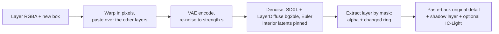
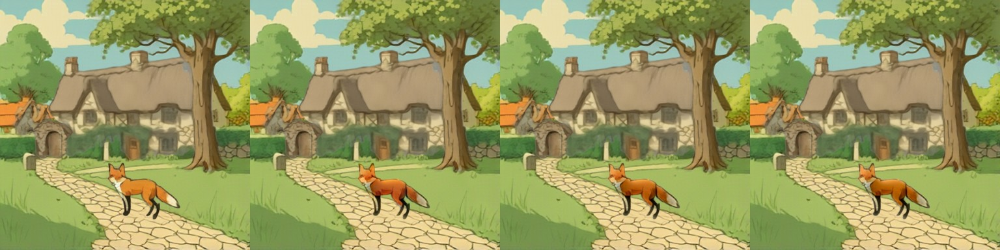
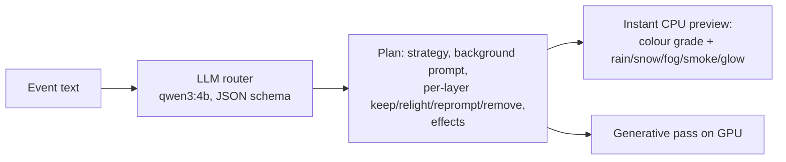
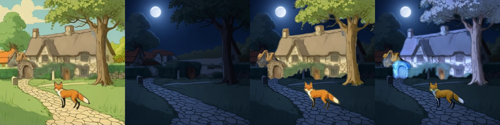
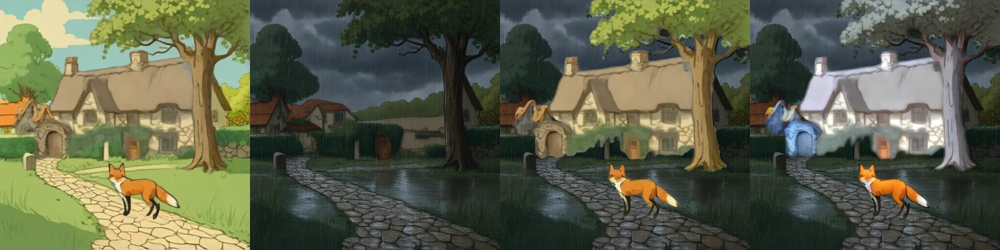
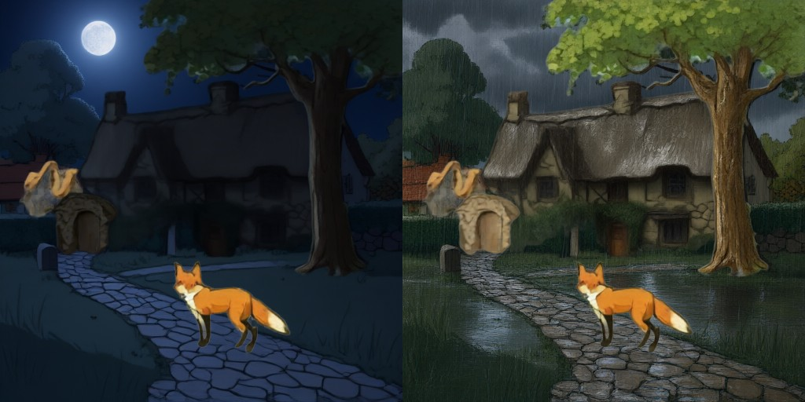
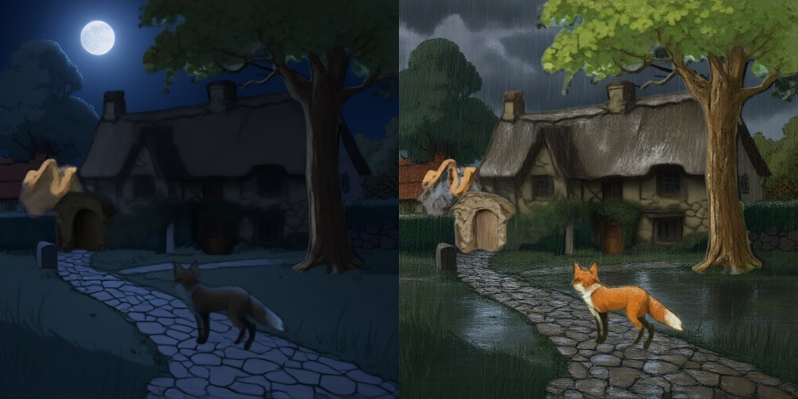

# Editing mechanics: move/resize, relighting, shadows, story events

> **Role: concept (reference).** How the editing steps work. The history of each version (v1–v5, bugs found) is in [../log.md](../log.md), Phase 5; measured numbers in [../models/README.md](../models/README.md).

## 1. Move / resize with re-harmonisation: `relocate()`

Code: `LayerDiffuseChain.relocate()` in [layerdiffuse_chain.py](../../prototype/layerproto/backends/layerdiffuse_chain.py). About 4 s per edit at 512 px on a T4.

| Parameter | Effect | Tested values |
|---|---|---|
| `strength` | how much of the schedule is redone | 0.3 keeps identity + takes on the new light; 0.5 redraws details; higher broke with a stochastic sampler |
| `pin_frac`, `band` | how long / how tightly the object's interior latents are held (alpha > 40, eroded by `band` px) | every step except the last 2; band 4–9 |
| `paste_back` | blend the original pixels back inside the alpha after decoding | 0.8 kept the moved skeleton's look |
| sampler | Euler (deterministic); DPM++ SDE fought the pinning | Euler |
| extraction | mask (alpha + pixels that changed in a ring) beats LayerDiffuse `bgble2fg` | mask |

**Limits:** thin parts at the edge (chair legs) can still change; the old position needs inpainting if the background still contains the object (RevealLayer's filled background avoids this). Based on DreamLayer's harmonisation step ([../research/papers-survey.md](../research/papers-survey.md#3-move-and-resize-in-the-papers)).

**In the app (2026-11-10):** the layer-order panel has two buttons next to Apply / Reset. **Fit to planned box** is a canvas transform into the planner's box (CPU, instant). **Fit + re-harmonise (GPU)** calls `Engine.relocate_layer`, which sends the layer, the scene below it and the target box to the chain's `relocate()` (locally or through the new `/chain/relocate` route of the remote server) and stores the result as a new variant with the position baked in. Both are tested without a model (`tools/test_fit_to_box.py`, `tools/test_relocate_route.py`); the real call is the 3.5 s `relocate()` measured above.

## 2. Relighting and shadows

| Component | What it does | Speed | Code |
|---|---|---|---|
| **IC-Light v1 fbc** (SD1.5, Apache-2.0) | relights a layer to match a given background: Realistic Vision 5.1 UNet widened 4 → 12 input channels; fg (transparent pixels filled grey) and bg latents concatenated each step; we re-apply the layer's alpha and transfer the original's fine detail | 44 s CPU (8 steps, 384 px); seconds on a T4 [est] | [relight.py](../../prototype/layerproto/relight.py) |
| **Procedural shadow layer** | black RGBA layer under the object: alpha squashed and sheared along the light, blurred with distance, plus a contact blob; one contact line per object; length capped (EasyOmnimatte recipe) | 0.6 s per layer CPU | [shadow.py](../../prototype/layerproto/shadow.py) |

**Hue drift and its fix (CPU test, fox layer relit in place against the day scene, 384 px, 8 steps, 56 s per relight):** IC-Light lowers the fox's lightness (mean Lab L 54.8 → 46.1) and raises its redness (a* 15.2 → 20.3). `restore_chroma(relit, original, keep)` in [relight.py](../../prototype/layerproto/relight.py) keeps the relit lightness and pulls the colour back: keep 0.5 gives a* 17.8, keep 0.8 gives a* 16.4 (close to the original 15.2). Tiles: original | relit | keep 0.5 | keep 0.8:

The difference is subtle on this fox at this size; the setting matters when the relit colour is far from the object (night, rain), where keeping too much chroma would also remove the intended colour cast, so `keep` should stay a per-event parameter.

IC-Light v2 (FLUX) never released weights. IC-Light has no notion of light sources (a campfire gets dimmed under "night"). Literature (harmonisation, insertion, shadow methods): [object_harmonisation.md](../../research_notes/Layered%20loop%20open%20paths/object_harmonisation.md).

## 3. Story events across layers

| Strategy | When | Generative step |
|---|---|---|
| `bg_relight` (most events) | weather, light, time of day | edit background, relight the other layers (IC-Light) |
| `per_layer` | several objects change appearance | Qwen-Image-2.1 RGBA edit per layer (keeps alpha) |
| `recompose` | geometry changes across objects (snow piles up) | edit the composite (Qwen-Image-2.1: night and heavy-rain edits keep the composition, about 22 s), re-split with Stable-Layers (Heun, 70 s; measured on the night and rain edits: cottage / tree / fox / moon come out as separate layers, [qwen-image-2.1.md](../models/qwen-image-2.1.md#story-event-composites-re-split-with-stable-layers-run-v10-5-layers-384-px-heun-6770-s)) |
| `effects` | only an overlay | procedural rain/snow; LayerDiffuse fog/fire/glow |

Rules in the router prompt: lighting changes apply to every visible layer; a layer holding several objects is re-prompted as a whole, never removed for one part. Code: [events.py](../../prototype/layerproto/events.py); 5 test events routed sensibly (about 30 s each on CPU). No layered method in the literature does this (gap G2): [story_events_global_edits.md](../../research_notes/Layered%20loop%20open%20paths/story_events_global_edits.md).

## 4. Full move loop on fox & cottage

Input: RevealLayer's fox & cottage split (filled background + 5 layers). The fox (layer 5) is moved 28 % left, 4 % up and scaled 1.15×. Code: [fox_move_demo.py](../../prototype/tools/fox_move_demo.py), notebook generator [make_fox_move_trial.py](../../prototype/tools/make_fox_move_trial.py); results in `prototype/kaggle/results_fox_move_v2`.

| Step | T4 time | Observation |
|---|---|---|
| naive paste | 0 | no hole at the old place (RevealLayer filled the background) |
| `relocate()` strength 0.3 / 0.45 | 3.4 s per edit (first call 133 s incl. SDXL download) | fox kept, edges blended into the path; 0.3 and 0.45 look nearly the same with paste-back 0.8 |
| + shadow layer | 0.04 s | soft cast shadow on the path, light from the left |
| + IC-Light fbc | 5–6 s (load 43 s) | warmer, redder fox matching the scene; hue shift stronger than wanted |

## 5. Story event, measured: `bg_relight` vs `recompose` (fox & cottage, night and heavy rain)

`bg_relight`: Qwen-Image-2.1 edits only RevealLayer's filled **background**; the five object layers are then relit one by one, back to front, against the scene below with IC-Light fbc (T4: Qwen-2.1 edit about 20 s per event, IC-Light 24–28 s for five layers). Tiles: day composite | edited background | objects pasted unchanged | objects relit.

Night:

Heavy rain:

| Measure (mean grey level) | Night | Rain |
|---|---|---|
| day composite | 148.7 | 148.7 |
| edited background alone | 33.1 | 52.2 |
| objects pasted unchanged | 73.9 | 83.0 |
| objects relit with IC-Light | 65.5 | 85.1 |

Findings:
- The **background edit is very good** (moon, wet cobblestones, rain streaks, same composition) because the input has no objects to disturb.
- **Pasted objects look like daylight cut-outs** on the new background (the expected failure).
- **IC-Light v1 does not fix it**: it brightens the cottage and tree to a pale blue-grey (night) or white-grey (rain), turns the fox yellowish, and darkens only slightly (luminance 74 → 65 at night, no change in rain). It has no sense of a night scene's low key; this is the known IC-Light limitation (no light sources, relights towards the background colour).
- **Compared with `recompose`** (Qwen-2.1 edits the whole composite, then a splitter, §3 and [qwen-image-2.1.md](../models/qwen-image-2.1.md)): the whole-scene edit gives dark cottages with lit windows and a consistent result in about 22 s plus the split (30–70 s), so for weather and time of day `recompose` currently produces the better picture; `bg_relight` keeps the layers exactly as they were, which matters only if the object pixels must not change.

Files: `prototype/tools/make_qwen21_bgevent_trial.py`, `fox_event_relight.py`, results in `prototype/kaggle/results_qwen21_bgevent/` and `results_fox_event/`.

### Per-layer Qwen-Image-2.1 relighting (strategy `per_layer`, same event, T4)

Each RevealLayer object layer is sent to Qwen-Image-2.1 as an RGBA image ("relight this object for a dark night / a heavy rainstorm, keep its exact shape"), 23 s per layer, then composited over the edited background. Night (left) and rain (right); layers whose alpha did not survive were replaced by the unlit original:

| Layer | Night | Rain |
|---|---|---|
| village houses | returned almost opaque (10 % transparent) → original used | emptied (98 % transparent) → original used |
| cottage | edited, alpha kept (76 % transparent): dark roof and walls, wet look in rain | edited, alpha kept |
| gate arch | edited, alpha kept | emptied → original used |
| tree | edited, alpha kept: dark silhouette at night | edited, alpha kept |
| fox | returned a **fully opaque night scene** (0 % transparent) → original used, so the fox stays daylight-bright | same, opaque |

- Where the alpha survives, this is **much better than IC-Light** for the large objects: the cottage and tree get genuinely dark or wet, no colour cast.
- The edit does **not reliably keep the layer's alpha**: 6 of 10 edits kept it (cottage, tree, arch once); the fox and houses came back opaque or empty. Qwen-Image-2.1's RGBA edit needs a check-and-retry (alpha coverage within ±15 % of the input) in the loop.
- Cost: 5 layers × 23 s ≈ 2 min vs 25 s for IC-Light, versus about 22 s + a 30–70 s split for `recompose`.

Results: `prototype/kaggle/results_perlayer/`, generator `make_qwen21_perlayer_trial.py`.

**With an alpha check-and-retry (v2):** accept an edit only if the layer's transparent share stays within 15 points of the input, else retry with the next seed (42, 7, 123, 2024). Result: **all 10 edits accepted, 4 of them on the second try** (night: houses, gate arch, fox; rain: fox, all with seed 7), 20–26 s per try. Night (left) and rain (right), every layer edited:

**Applying a plan end to end (CPU glue, 2026-11-10):** [event_apply.py](../../prototype/layerproto/event_apply.py) takes a routed plan and the layers and, per layer, keeps, edits (with the retry above), falls back (colour grade for relight, unedited for reprompt) or removes it, adds a cast-shadow layer under every object and draws the plan's effects as overlays; the editor is any callable, so the Qwen-2.1 RGBA edit on a GPU server plugs in later. Tested with a stub editor on the fox & cottage layers (`prototype/tools/test_event_apply.py`: removed layer dropped, emptied fox retried, shadows and rain overlay added).

The test also exposed a gap in the share check: a layer that is 97 % transparent (the fox) is still "within 15 points" when the editor wipes it completely. `edit_layer_keep_alpha` now also requires the visible area to stay between 0.4x and 2.5x of the input (`visible_ratio` in the report). **Re-run with the stricter check (T4 x2, 547 s in total, results in `prototype/kaggle/results_perlayer_v3/`):** the same 10 edits, 10 of 10 accepted, and the same 4 needed a second try (night: houses, gate arch, fox; rain: fox, all retried with seed 7). Every rejected first try was a flooded scene (visible area x22 to x52 the input, transparent share 0 to 57 %), which the share check already caught; accepted edits kept the visible area between x1.00 and x1.63 of the input. So the new check changes nothing on these 10 edits and only adds safety for the wiped-layer case that the stub test showed.

The fox now gets a dark, cool look at night and a wet look in the rain; cottage and tree as before. Remaining flaws: the gate-arch layer comes out as a pale, blobby shape at night (it was already the weakest RevealLayer layer), and objects are only relit, not given cast shadows or reflections (the shadow layer of §2 could be added). Cost: about 2–2.5 min for five layers per event, so the three strategies cost about 25 s (IC-Light, colour casts), 2–2.5 min (per-layer Qwen-2.1, best object look and layers unchanged in shape) and 22 s + 30–70 s split (`recompose`, best overall picture).
