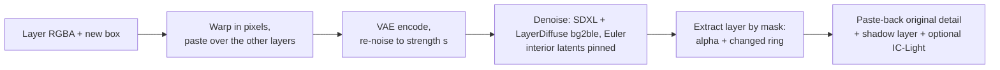
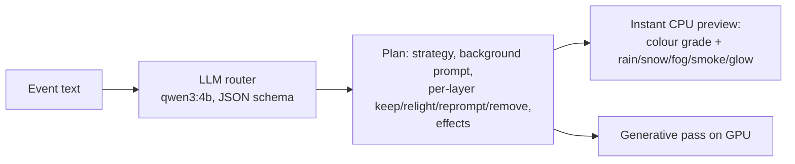

# Editing mechanics: move/resize, relighting, shadows, story events

> **Role: concept (reference).** How the editing steps work. The history of each version (v1–v5, bugs found) is in [../log.md](../log.md), Phase 5; measured numbers in [../models/README.md](../models/README.md).

## 1. Move / resize with re-harmonisation: `relocate()`

Code: `LayerDiffuseChain.relocate()` in [layerdiffuse_chain.py](../../prototype/layerproto/backends/layerdiffuse_chain.py). About 4 s per edit at 512 px on a T4.

| Parameter | Effect | Tested values |
|---|---|---|
| `strength` | how much of the schedule is redone | 0.3 keeps identity + takes on the new light; 0.5 redraws details; higher broke with a stochastic sampler |
| `pin_frac`, `band` | how long / how tightly the object's interior latents are held (alpha > 40, eroded by `band` px) | every step except the last 2; band 4–9 |
| `paste_back` | blend the original pixels back inside the alpha after decoding | 0.8 kept the moved skeleton's look |
| sampler | Euler (deterministic); DPM++ SDE fought the pinning | Euler |
| extraction | mask (alpha + pixels that changed in a ring) beats LayerDiffuse `bgble2fg` | mask |

**Limits:** thin parts at the edge (chair legs) can still change; the old position needs inpainting if the background still contains the object (RevealLayer's filled background avoids this). Based on DreamLayer's harmonisation step ([../research/papers-survey.md](../research/papers-survey.md#3-move-and-resize-in-the-papers)).

## 2. Relighting and shadows

| Component | What it does | Speed | Code |
|---|---|---|---|
| **IC-Light v1 fbc** (SD1.5, Apache-2.0) | relights a layer to match a given background: Realistic Vision 5.1 UNet widened 4 → 12 input channels; fg (transparent pixels filled grey) and bg latents concatenated each step; we re-apply the layer's alpha and transfer the original's fine detail | 44 s CPU (8 steps, 384 px); seconds on a T4 [est] | [relight.py](../../prototype/layerproto/relight.py) |
| **Procedural shadow layer** | black RGBA layer under the object: alpha squashed and sheared along the light, blurred with distance, plus a contact blob; one contact line per object; length capped (EasyOmnimatte recipe) | 0.6 s per layer CPU | [shadow.py](../../prototype/layerproto/shadow.py) |

IC-Light v2 (FLUX) never released weights. IC-Light has no notion of light sources (a campfire gets dimmed under "night"). Literature (harmonisation, insertion, shadow methods): [object_harmonisation.md](../../research_notes/Layered%20loop%20open%20paths/object_harmonisation.md).

## 3. Story events across layers

| Strategy | When | Generative step |
|---|---|---|
| `bg_relight` (most events) | weather, light, time of day | edit background, relight the other layers (IC-Light) |
| `per_layer` | several objects change appearance | Qwen-Image-2.1 RGBA edit per layer (keeps alpha) |
| `recompose` | geometry changes across objects (snow piles up) | edit the composite (Qwen-Image-2.1: night and heavy-rain edits keep the composition, about 22 s), re-split |
| `effects` | only an overlay | procedural rain/snow; LayerDiffuse fog/fire/glow |

Rules in the router prompt: lighting changes apply to every visible layer; a layer holding several objects is re-prompted as a whole, never removed for one part. Code: [events.py](../../prototype/layerproto/events.py); 5 test events routed sensibly (about 30 s each on CPU). No layered method in the literature does this (gap G2): [story_events_global_edits.md](../../research_notes/Layered%20loop%20open%20paths/story_events_global_edits.md).

## 4. Full move loop on fox & cottage

Input: RevealLayer's fox & cottage split (filled background + 5 layers). The fox (layer 5) is moved 28 % left, 4 % up and scaled 1.15×. Code: [fox_move_demo.py](../../prototype/tools/fox_move_demo.py), notebook generator [make_fox_move_trial.py](../../prototype/tools/make_fox_move_trial.py); results in `prototype/kaggle/results_fox_move_v2`.

| Step | T4 time | Observation |
|---|---|---|
| naive paste | 0 | no hole at the old place (RevealLayer filled the background) |
| `relocate()` strength 0.3 / 0.45 | 3.4 s per edit (first call 133 s incl. SDXL download) | fox kept, edges blended into the path; 0.3 and 0.45 look nearly the same with paste-back 0.8 |
| + shadow layer | 0.04 s | soft cast shadow on the path, light from the left |
| + IC-Light fbc | 5–6 s (load 43 s) | warmer, redder fox matching the scene; hue shift stronger than wanted |
