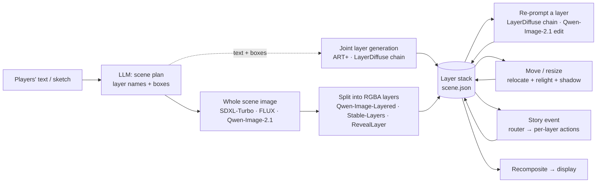

# The pipeline: loop, routes, roles, data model

> **Role: concept (high).** How the prototype's loop is built and why. Current numbers: [../status.md](../status.md); models: [../research/papers-survey.md](../research/papers-survey.md). Mechanics of move/resize, relighting and story events: [editing.md](editing.md).

## 1. The loop

**Why "generate one image, then split it" (or generate jointly):** generating every object on its own and pasting them gives a **sticker collage**: objects don't share lighting, perspective or style. The first prototype did exactly that (LLM splits the prompt into nouns → one LayerDiffuse layer per noun → boxes), so the LLM split is now only a helper (layer names, boxes, captions).

## 2. Candidate routes (from the 11-07 analysis, updated with measurements)

| | Route | Coherence | Re-prompt one layer | Move / resize | On free hardware (measured) |
|---|---|---|---|---|---|
| **A** | text-to-image → **Qwen-Image-Layered** (or Stable-Layers) | highest: all layers from one image | inpaint the composite in the layer mask, or edit the RGBA layer (Qwen-Image-2.1) | 2D + `relocate()` | ✅ 27–35 s per split on 2× T4 |
| **B** | background → per object LayerDiffuse `bg2ble → bgble2fg` on the composite so far | high: each object drawn into the real scene | re-run both steps with the other layers as background | `relocate()`; lighting baked in | ✅ 18 s per element (T4) |
| **C** | text-to-image → segmenter (SAM2, optionally grounded by the LLM's nouns) → LaMa / SDXL fill | as good as the source; occluded parts missing | inpaint the composite, re-segment | 2D; a moved object shows a "bite" unless completed | ✅ 3–7 s (T4); grouping poor so far |
| **D** | native joint models (ART+, PSDiffusion, DreamLayer, LASAGNA) | high in the papers | not described | DreamLayer only | ART+ runs (output still wrong); others unreleased |
| **E** | layout first (LLM / user boxes) → whole-canvas img2img ≈ 0.6 → split with A or C | high and respects placement | as A or C | placement fixed up front | untested |
| **F** | image + boxes → **RevealLayer** (or CLD) | high; hidden parts and background filled | as A | moving reveals no hole | ✅ 134 s (2× T4) |

**Re-prompting a layer while staying coherent:** never regenerate the layer alone. Background = composite of all other layers → mask = the layer's region → draw the new content into that scene (LayerDiffuse `bg2ble`, SDXL inpaint) → extract it as a layer (`bgble2fg`, a segmenter, or re-split). Qwen-Image-2.1 can edit the RGBA layer directly but doesn't see the scene.

## 3. Roles (one model per role, each behind its own interface)

| # | Role | Default now | Alternatives | Runs on |
|---|---|---|---|---|
| 1 | prompt refine + scene plan (nouns, boxes) | Ollama `qwen3:4b` | API LLM | laptop |
| 2 | text → whole scene | SDXL-Turbo | Qwen-Image-2.1, FLUX.1-dev GGUF | laptop / Kaggle |
| 3 | sketch + prompt → scene | SDXL-Turbo img2img | — | laptop |
| 4 | split into layers | Qwen-Image-Layered | Stable-Layers, RevealLayer, CLD, SAM2 + LaMa, LayerD | Kaggle 2× T4 |
| 5 | add / re-prompt a layer in context | LayerDiffuse chain | Qwen-Image-2.1 RGBA edit | Kaggle T4 |
| 6 | move / resize + re-harmonise | `relocate()` + IC-Light + shadow layer | plain 2D move (preview) | Kaggle T4 |
| 7 | story event | event router + previews | edit composite, re-split | laptop + Kaggle |
| 8 | recompose | alpha compositing | — | laptop |
| 9 | captions / word links (add-on) | `qwen2.5vl:3b` | API vision model | laptop |

## 4. Data model (`scene.json`)

| Object | Fields |
|---|---|
| Scene | prompt, chosen base image, canvas size, ordered layers, edit history |
| Layer | full-canvas RGBA PNG; transform `{x, y, scale, rotation}`; visibility; provenance (decomposed / re-prompted / edited / added by event); prompt, seed; optional caption |

## 5. Build status of the original plan

| Phase (from the 11-07 plan) | Status |
|---|---|
| 1. Remote decompose (Qwen-Image-Layered on Kaggle) | ✅ done (batch notebook; no live endpoint yet) |
| 2. Stronger text-to-image | ⚠️ tested (FLUX, Qwen-Image-2.1), not wired into the app |
| 3. "Generate → choose → decompose" in the UI + canvas | ❌ open |
| 4. Re-prompt / story-event layers via the chain | ✅ on Kaggle; app integration open |
| 5. Content edit of one layer (Qwen-Image-2.1 / Qwen-Image-Edit) | ✅ Qwen-Image-2.1 tested |
| 6. Captions and word links | ✅ in the local app |

Snapshots with the original reasoning: [2026-11-07 Coherent layered generation pipeline](../archive/2026-11-07%20Coherent%20layered%20generation%20pipeline.md), [2026-11-07 Qwen layered multi model pipeline plan](../archive/2026-11-07%20Qwen%20layered%20multi%20model%20pipeline%20plan.md).
