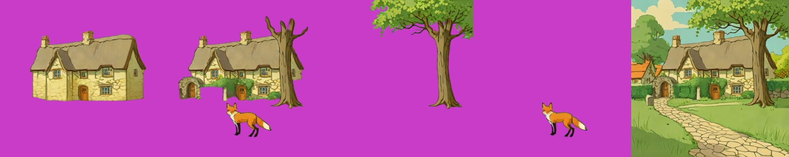
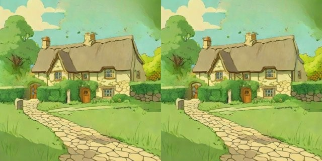
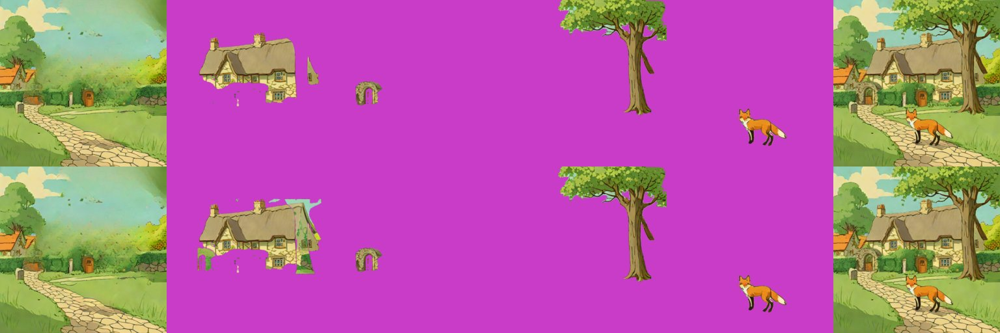
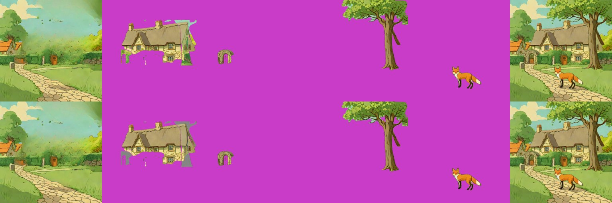

# Amodal completion (filling the hidden parts of an object)

> **Role: current factsheet** (approaches compared, not one model). Template: [TEMPLATE.md](TEMPLATE.md). Verdicts are the user's.

> **User assessment (first look, 2026-11-11):** Qwen-2.1 extraction strip (cottage a, cottage b, tree, fox, fox removed): good. SDXL-inpaint fills: good for the first three panels, terrible for the other two, it cannot add elements convincingly. Everything else: bad.

**Type:** an object layer cut from a scene (with parts hidden behind other objects) → the whole object.

## What it does

When one object stands in front of another, the back object's layer has a hole. Three routes are measured on the fox & cottage scene, where the cottage is hidden by the tree, the arch and the fox: **SDXL-inpaint** fill, **Qwen-Image-2.1 extraction** ("extract only the cottage without X") and the layered models that fill hidden parts themselves (RevealLayer, [reveallayer](revealayer.md)).

## Licence & weights

SDXL-inpaint: `diffusers/stable-diffusion-xl-1.0-inpainting-0.1` (CreativeML OpenRAIL++-M) with `madebyollin/sdxl-vae-fp16-fix`. Qwen-Image-2.1: Qwen Research licence (non-commercial). RevealLayer: [revealayer.md](revealayer.md).

## How we run it

1. **SDXL-inpaint:** hidden area = the object's box minus its own mask, restricted to the objects in front; 30 steps at 1024 px; code in `Sam2Decomposer._complete` (`DecomposeParams.amodal`, checkbox **Complete hidden parts**); stub-tested geometry `tools/test_amodal_fill.py`.
2. **Qwen-2.1:** `Qwen21Decomposer` (`method="qwen21-extract"`): one extract call per object with the objects in front named as exclusions.
3. Both are `/decompose` options behind the Kaggle server; the SAM2 + LaMa route ([sam2-lama.md](sam2-lama.md)) provides the masks.

## Fox & cottage benchmark

| Route | Compute | Result for the cottage |
|---|---|---|
| **A. Best case: Qwen-2.1 extract** (512 px, 8 steps) | 23–27 s per object, 114 s for all five layers through the route | a whole, clean cottage; best result so far |
| SDXL-inpaint fill, two prompts (T4, 1024 px, 30 steps) | 31 s per image after a 73 s load | cottage whole, style kept; the arch side gets a second door |
| SDXL-inpaint fill inside the real route (amodal on) | 80 s with load (8.5 s without amodal) | patchy: green and sky patches where the arch and tree were |
| **B. Live-demo budget (about 30 s)** | Qwen-2.1 about 23–27 s for one object; SDXL-inpaint about 31 s per object | both fit one object per request; not all five |

Qwen-2.1 extraction strip (cottage a, cottage b, tree, fox, scene with the fox removed); the input is the SDXL-Turbo scene and every tile is Qwen-2.1's work ([provenance](provenance.md)):

SDXL-inpaint fills of the cottage, the two prompts. **What is whose in these two panels:** the background (tree, arch and fox taken out) is SAM2 + LaMa, the visible cottage is the SDXL-Turbo scene cut out by SAM2, and **SDXL-inpaint made only the filled hidden part of the cottage**. (An earlier version of this page showed a five-panel strip here whose panels 3-5, fog, glow and snow, were LayerDiffuse SDXL effect layers, not SDXL-inpaint fills; they are now on [layerdiffuse-sdxl.md](layerdiffuse-sdxl.md).)

In the real route (top plain, bottom amodal on) and the neutral-base variant:

## Further investigations

- **Prompt wording matters for Qwen-2.1:** "without the tree, fox, arch or hedge in front of it" gave a whole cottage, "complete the parts hidden behind the tree" brought the tree and arch along.
- **SDXL-inpaint on a neutral grey base** removed the green patches but the fill came out grey (`Sam2Decomposer.amodal_neutral`, default off).
- **Convex-hull mask** was rejected on paper: the hidden part of an occluded object lies outside the hull of what is visible.
- The Qwen-2.1 arch came back larger than in the scene (no position in the prompt): [qwen-image-2.1.md](qwen-image-2.1.md).

## Special features

| Feature | Status | Evidence |
|---|---|---|
| Amodal completion | **supported** (Qwen-2.1, SDXL-inpaint) | strips above |
| Add / remove / modify a layer | **supported** (Qwen-2.1 also removed the fox and filled the path) | `qwen21_extract_strip.jpg` panel 5 |
| Move / resize a layer | enables it: a whole object can move without leaving a hole | [relocate-harmonise.md](relocate-harmonise.md) |
| Others | n/a | |

## Best features / Weak spots

- Best: Qwen-2.1 extraction gives clean whole objects and the background with objects removed in one session; SDXL-inpaint is light (one T4).
- Weak: SDXL-inpaint copies leftover background colour into the fill; Qwen-2.1 ignores object position and scale; both are one call per object.

## Status / Next attempts / Sources

Both routes work through the `/decompose` route in a session; the SDXL-inpaint flag is in the app. Next: pass the box to Qwen-2.1 (crop or paste back to the box), a Qwen-2.1 profile for the server notebook. Sources: [qwen-image-2.1.md](qwen-image-2.1.md), [sam2-lama.md](sam2-lama.md), pix2gestalt (not tried).
