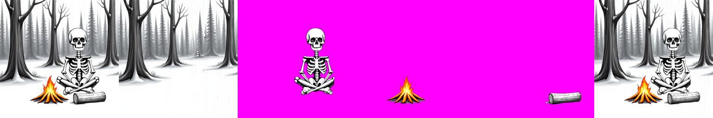
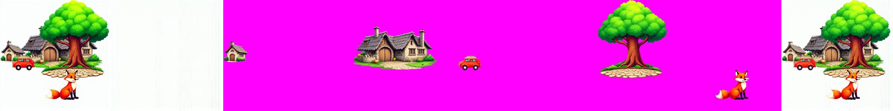
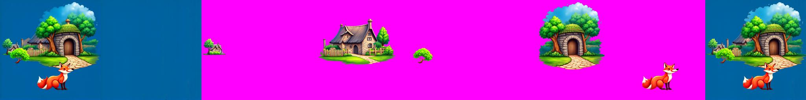
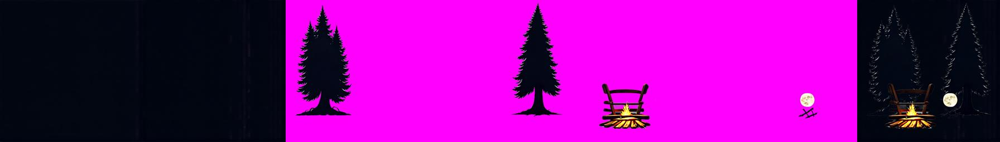
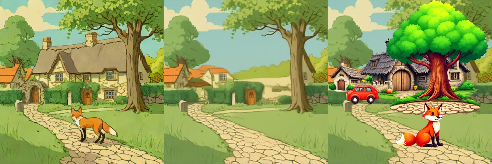
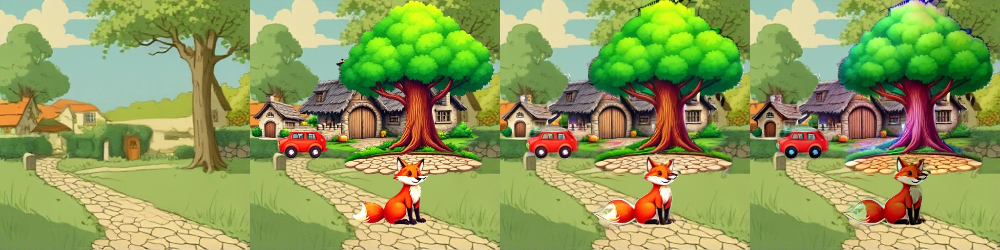
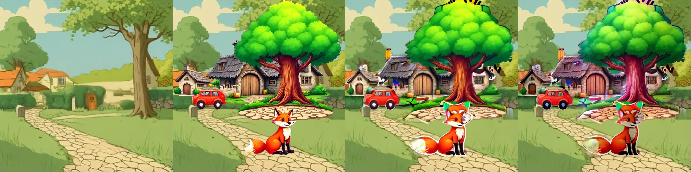
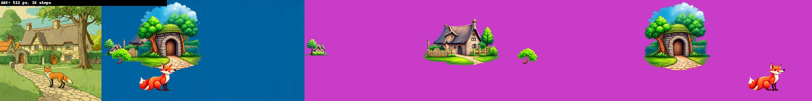
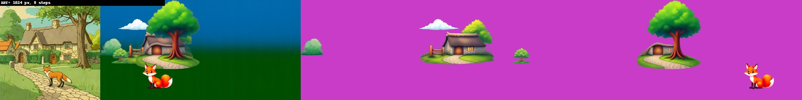

# ART+ / PrismLayers
> **Role: current factsheet.** Template: What it does · Licence & weights · How we run it (happy path) · Benchmarks · Best features · Weak spots · Status · Next attempts · Sources. Verdicts are the user's.

## What it does

Global caption + layout boxes → a variable number of RGBA layers generated jointly (Anonymous Region Transformer). **Text + boxes → layers without an input image.**

## Licence & weights

Code MIT ([redredsheep/PrismLayers](https://github.com/redredsheep/PrismLayers)); weights on Google Drive. The ART base LoRA is byte-identical (SHA-256) to `pre_trained_LoRA` in the official `thuteam/CLD` repo (Apache-2.0); the transparent decoder is CLD's `trans_vae`. An unofficial HF mirror `24yearsold/PrismLayers_ckpt` exists (fallback). FLUX.1-dev non-commercial.

## How we run it (happy path)

GGUF Q4_K_S FLUX.1-dev re-classed into `CustomFluxTransformer2DModel` (max 52 layers); three LoRAs attached unmerged (pre_fuse, ART base, ART+); `fp16_mixed`; 512 px, 16 steps, CFG 4; diffusers 0.32.2. Generator: [`../../prototype/tools/make_artplus_trial.py`](../../prototype/tools/make_artplus_trial.py).

## Benchmarks

| Run | Result |
|---|---|
| 2 | all LoRAs matched (190 / 304 / 304), weights from the official Drive folders; decoder checkpoint load failed (`weights_only`) |
| 3 | loaded 295 s (7.0 / 11.0 GB); fp16 inputs to fp32 VAEs |
| 4 | denoising finished; OOM in the fp32 VAE decode |
| 5 | end to end: 345 s / 285 s at 16 steps, 10 GB; image small in one corner, opaque rectangles |
| **6** | **`vae_scale_factor` 16 restored → full-size coherent scenes** (330 s / 282 s, 8.2 GB); layers still opaque crops of the whole image |
| 7 | ART+'s own transparent decoder (Drive, mirror fallback): same opaque crops |
| 8 | diagnostics: `layer_pe` distinct per layer, final latents differ per frame → conditioning reaches the model |
| **9** | **bug found in our `fp16_mixed.add_lora`: each LoRA replaced the previous one on the same module, so only the ART+ LoRA was active (pre_fuse and ART base dropped). Stacked → real transparent layers** (356 s / 294 s at 16 steps, 8.5 GB) |

Run 9, case 1 (whole | background | skeleton | fire | log | merged):

**Run 10, fox & cottage** (caption + the 5 JSON boxes, "cartoon" style prefix; 353 s, 8.6 GB). Whole | background | village houses | cottage | gate arch | tree | fox | merged:

Every box gets its own clean, consistently styled transparent object at the right place; but the background is plain white (sticker look), objects are small "island" vignettes, and the gate-arch box became a red car.

**Run 11, fox & cottage, "painting" prefix + "sky and lawn fill the whole background"** (343 s): background now flat blue instead of white; objects still island vignettes (the tree box now holds a tree + arch-door vignette). The vignette look seems to come from the training data (PrismLayersPro: poster/sticker-style designs), not the prompt.

Case 0 of run 9 (night forest): trees, campfire + bench and moon come out as separate layers, but the whole/background frames are almost black.

## ART+ objects on a separately generated background (composite check, no model call)

Run-10 object layers (tree, cottage, houses, car, fox) pasted over RevealLayer's filled background of the same scene (original | background | composite):

This is the "sticker collage" problem in one picture: the objects are in ART+'s own glossy cartoon style, at its own scale and with its own light, so they do not belong to the background. **Harmonisation attempt** (`tools/harmonise_artplus_demo.py`, T4): each object re-blended in place with `relocate()` against the composite so far (paste-back 0.5), then IC-Light. Tiles: background | pasted | relocate | relocate + IC-Light. Strength 0.4:

Strength 0.6:

It does **not** close the style gap: the glossy objects stay glossy and oversized, edges gain halos and stray fragments at 0.6, and IC-Light adds colour casts (a pink tree trunk). Matching style would need a stronger restyle than the pin-and-paste-back `relocate()` allows, or generating the background in ART+'s own style (its whole-image frame). Results: `prototype/kaggle/results_harmonise_artplus/`.

## Facts from the paper and repo

| Topic | Fact |
|---|---|
| Lineage | ART trained from FLUX.1-dev; ART+ fine-tuned from it (20K iterations at 512², then 10K at 1024²) on PrismLayersPro (Apache-2.0 dataset) |
| Input | JSON: caption with a style prefix ("This is a [STYLE] style image. …", 21 styles) + layout boxes; the first two boxes are the full image; no input image needed |
| Weights | Drive folders: `pre_fuse_lora`, `base_ckpt` (ART), `artplus_PrismLayersPro(100k)_ckpt` (`layer_pe` + LoRA), `transp_vae`; unofficial HF mirror `24yearsold/PrismLayers_ckpt` (5.56 GB, 100k variant only) |
| Original pipeline | the two LoRAs are fused into FLUX, the ART+ LoRA loaded as adapter "layer"; diffusers 0.31, torch 2.4, bf16 |
| diffusers ≥ 0.32 | FLUX `vae_scale_factor` changed from 16 to 8 → set `pipe.vae_scale_factor = 16`, else latents for twice the size and boxes in one corner |
| LoRA files | diffusers format, no alpha keys (scale 1.0); ART / ART+ rank 64, pre-fuse rank 16 |

## 1024 px scaling probe (T4 x2, 5 boxes of the fox & cottage scene, 2 steps, 2026-11-10)

To avoid a 50-minute run, one session measured only 2 denoising steps at 1024 px (boxes doubled): load 290 s, **2 steps 395 s, peak 11.0 GiB on GPU 0**. So 1024 px **fits in memory** (the 512 px run peaked at 8.6 GiB). Per step that is about 190 s against about 21 s at 512 px (343 s for 16 steps), roughly 9x, so a 16-step run at 1024 px would take about 50 min and 8 steps about 25 min; both exceed the 25-min cap used in the trials (the cap can be raised to 55 min). Two steps give noise, so no quality is claimed. Files: `prototype/kaggle/results_artplus_1024/`.

**Real run at 1024 px, 8 steps (`artplus-1024-8st`):** 1251 s (21 min) after a 340 s load, peak 11.0 GiB on GPU 0, so the estimate above held (about 150 s per step). Bottom row of the strip in [cld](cld.md) (whole image, background, merged, layers): a coherent sticker-style scene at 1024 px with the fox, cottage, tree, bush and cloud as separate transparent layers over a blue-to-green gradient background. As in the 512 px runs, ART+ draws its own scene from the caption and boxes in its own style, not the fox & cottage painting; 8 steps is below the 16 used at 512 px. Files: `prototype/kaggle/results_artplus_1024_8st/`.

## Fox & cottage benchmark (standard strips)

**ART+ does not split the fox & cottage image.** It generates a new layered scene from a caption and the five boxes (text + boxes → layers), so the recomposite is a new picture in ART+'s own style. Strips: caption-scene | recomposite | background | layers.

| | Settings | Compute (2× T4) | Peak | What the layers show |
|---|---|---|---|---|
| **A. Best case measured** | 512 px, 16 steps, 5 boxes | 343 s | 8.6 GB | a coherent glossy cartoon scene; fox, cottage, tree, houses as transparent layers |
| 1024 px, 8 steps (over 8 min) | | 1251 s | 11.0 GB | sticker-style scene at 1024 px with fox, cottage, tree, bush and cloud as layers |
| **B. Live-demo budget (about 30 s)** | **not reached**: 16 steps took 343 s; 2 steps at 1024 px took 395 s | | | 2 steps give noise |

A (512 px):

1024 px:

## Special features

| Feature | Status | Evidence |
|---|---|---|
| Split an image into layers | **n/a** (generates from text + boxes) | |
| Move / resize a layer | **partial**: objects are separate transparent layers, a canvas move works | strips above |
| Harmonise after a move | **tested, does not close the style gap** | harmonise strips below |
| Story composite | not tried | |
| Spatial edit | **supported**: a caption per box | strips above |
| Add / remove / modify a layer | **supported**: layers are generated per box | |
| Relight | IC-Light added colour casts | below |
| Amodal completion | n/a | |

Objects on a separately generated background, then harmonised with `relocate()` (strength 0.4 above, 0.6 below): the glossy objects stay glossy and gain halos: [relocate-harmonise.md](relocate-harmonise.md).

## Best features

The only released FLUX model that makes a layered scene straight from text + boxes (boxes can come from our LLM breakdown).

## Weak spots

Trained at 1024 px (we run 512); heavy; Drive downloads can hit quotas.

## Status

**Works since run 9:** text + boxes → background + clean transparent object layers on 1× T4 in about 5 min (16 steps, 512 px, 8.5 GB). Night scene very dark. Results: `prototype/kaggle/results_artplus_v9/`.

## Next attempts

Use ART+ only for the object layers and take the background from a scene model (e.g. RevealLayer's filled background or a text-to-image pass), then `relocate()`-harmonise each object; 1024 px; per-box captions.

## Sources

[`../../research_notes/Layered methods deep dive/joint_text_to_layers.md`](../../research_notes/Layered%20methods%20deep%20dive/joint_text_to_layers.md); [`../../research_notes/Layered loop open paths/flux_layered_t4_and_weights.md`](../../research_notes/Layered%20loop%20open%20paths/flux_layered_t4_and_weights.md).
