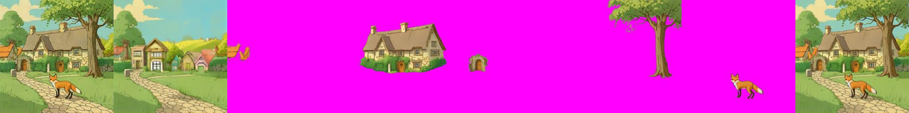
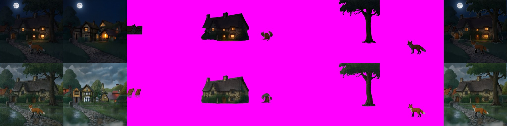
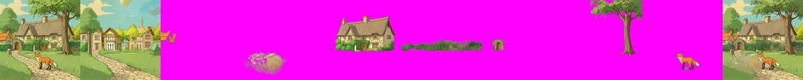

# CLD (Controllable Layer Decomposition)
> **Role: current factsheet.** Template: What it does · Licence & weights · How we run it (happy path) · Benchmarks · Best features · Weak spots · Status · Next attempts · Sources. Verdicts are the user's.

## What it does

Image + caption + one box per layer → RGBA whole image, background and one layer per box. Fine-tuned FLUX.1-dev (ART base + PrismLayers fine-tune + decouple LoRA) with an inpainting ControlNet adapter.

## Licence & weights

Code MIT ([monkek123King/CLD](https://github.com/monkek123King/CLD)); weights `thuteam/CLD` (Apache-2.0; LoRAs 598 MB each, transparent VAE 1.02 GB) + `alimama-creative/FLUX.1-dev-Controlnet-Inpainting-Alpha` (4.28 GB); FLUX.1-dev non-commercial.

## How we run it (happy path)

GGUF Q4_K_S FLUX.1-dev re-classed into CLD's custom transformer; three LoRAs (pre_trained, prism_ft, decouple) and the MultiLayerAdapter + its LoRA attached unmerged with `fp16_mixed` (the wrapper had to learn list outputs); input image + caption + boxes; 512 px, 16 steps, CFG 4, adapter scale 0.9; diffusers 0.32.2 (needs a one-line import patch for `BaseOutput`). Generator: [`../../prototype/tools/make_cld_trial.py`](../../prototype/tools/make_cld_trial.py), kernel `cld-trial`.

## Benchmarks

Fox & cottage with the 5 hand boxes, 2× T4: **376 s, peak 13.2 GB on GPU 0** (load 310 s). Whole | background | houses | cottage | gate arch | tree | fox | merged:

| Layer | Alpha coverage | Observation |
|---|---|---|
| village houses (box 0) | 1.8 % | two small orange roofs only |
| cottage | 26 % | clean cut-out incl. hedge |
| gate arch | 2.1 % | small arch with door |
| big tree | 17 % | trunk + crown, clean edges |
| fox | 2.5 % | clean, correct pose |

Results: `prototype/kaggle/results_cld_v3/`. The first runs failed on a diffusers import (v1) and on the fp16 wrapper not handling the adapter's list outputs (v2).

## Facts from the paper and repo

| Topic | Fact |
|---|---|
| Training | rank-64 LoRA on FLUX.1-dev, 25K iterations at 1024², on the PrismLayersPro training split; reuses ART's transparent decoder |
| Weights lineage | `pre_trained_LoRA` = ART base (SHA-256 identical); `prism_ft_LoRA` = ART+ PrismLayersPro or CLD's own fine-tune (unclear) |
| Inputs | image (to the ControlNet adapter) + caption + boxes (snapped to 16 px); adapter conditioning scale 0.9, CFG 4 |
| Outputs | RGBA whole image, RGBA background, one RGBA layer per box |

## Story-event composites split with CLD (v4: Qwen-Image-2.1 night and heavy-rain edits, same 5 boxes)

The edits keep the composition, so the hand boxes still fit. 2× T4, 512 px, 16 steps, about 6 min per case. Top row night, bottom row rain: whole | background | houses | cottage | gate arch | tree | fox | merged.

- Layers keep the edit's look (lit windows, dark roof, wet greenery) and are clean cut-outs: cottage 27 % of the canvas, tree 17 %, fox 2 %.
- The gate-arch layer comes out as a small stump-like object and the houses layer as a couple of roofs, as in the daylight run.
- The inpainted background is a **different village** (houses, lit windows at night, mist in the rain) rather than the real area behind the cottage, so a moved cottage reveals invented ground. For story events that is acceptable; for exact preservation it is not.

Results: `prototype/kaggle/results_cld_v4/`.

## Seven boxes (v5: the five objects + cobblestone path + hedge, original scene)

434 s, **peak 13.3 GB** (the same as with five boxes, so the two T4s are not the limit yet). Whole | background | houses | path | cottage | hedge | gate arch | tree | fox | merged:

The hedge/garden wall comes out as a clean horizontal strip and the cottage, tree and fox are as good as before; the **path layer is a faint blotch**: a ground plane under the other objects is not something CLD extracts as an object (it ends up in the background, which is correct for the picture but not a movable layer). Results: `prototype/kaggle/results_cld_v5/`.

## Best features

Controllable decomposition by boxes with a re-rendered, consistent whole image and a filled background; layers keep the input's style (unlike ART+).

## Weak spots

Needs an input image (not text → layers); three LoRAs + ControlNet → memory-tight.

## Status

**Works** (v3): faithful re-render of the input scene plus clean RGBA layers per box and an **inpainted background** (hallucinated village houses behind the cottage, i.e. the hidden parts are filled).

## Next attempts

1024 px; more boxes (rocks, hedge); compare moving a layer over CLD's background vs. RevealLayer's; timing with fewer steps.

## Sources

`../../research_notes/Layered methods deep dive/heavy_models_recheck_2026-11-09` (removed 2026-11-10; in git history before commit 35dc02a) §2.
