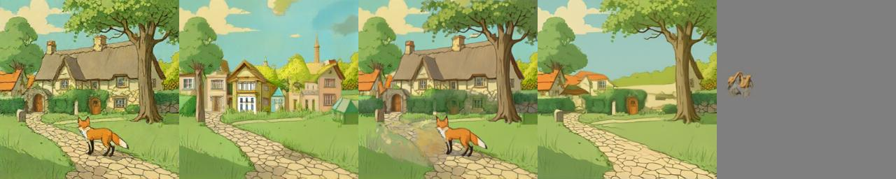
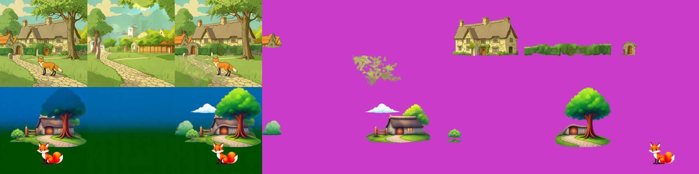
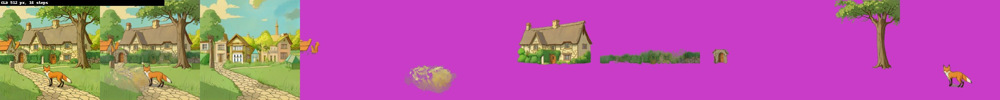
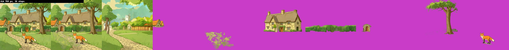
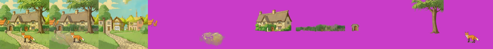
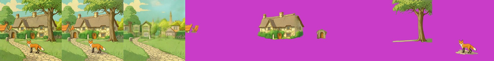

# CLD (Controllable Layer Decomposition)
> **Role: current factsheet.** Template: What it does · Licence & weights · How we run it (happy path) · Benchmarks · Best features · Weak spots · Status · Next attempts · Sources. Verdicts are the user's.

> **User assessment (final intermediate, 2026-11-11):** Layer extraction is pretty decent, but slow. Adding replacement backgrounds is interesting. The v4 Qwen-Image-2.1 night and heavy-rain edits show good style variation.

## What it does

Image + caption + one box per layer → RGBA whole image, background and one layer per box. Fine-tuned FLUX.1-dev (ART base + PrismLayers fine-tune + decouple LoRA) with an inpainting ControlNet adapter.

## Licence & weights

Code MIT ([monkek123King/CLD](https://github.com/monkek123King/CLD)); weights `thuteam/CLD` (Apache-2.0; LoRAs 598 MB each, transparent VAE 1.02 GB) + `alimama-creative/FLUX.1-dev-Controlnet-Inpainting-Alpha` (4.28 GB); FLUX.1-dev non-commercial.

## How we run it (happy path)

GGUF Q4_K_S FLUX.1-dev re-classed into CLD's custom transformer; three LoRAs (pre_trained, prism_ft, decouple) and the MultiLayerAdapter + its LoRA attached unmerged with `fp16_mixed` (the wrapper had to learn list outputs); input image + caption + boxes; 512 px, 16 steps, CFG 4, adapter scale 0.9; diffusers 0.32.2 (needs a one-line import patch for `BaseOutput`). Generator: [`../../prototype/tools/make_cld_trial.py`](../../prototype/tools/make_cld_trial.py), kernel `cld-trial`.

## Benchmarks

Fox & cottage with the 5 hand boxes, 2× T4: **376 s, peak 13.2 GB on GPU 0** (load 310 s). Whole | background | houses | cottage | gate arch | tree | fox | merged:

| Layer | Alpha coverage | Observation |
|---|---|---|
| village houses (box 0) | 1.8 % | two small orange roofs only |
| cottage | 26 % | clean cut-out incl. hedge |
| gate arch | 2.1 % | small arch with door |
| big tree | 17 % | trunk + crown, clean edges |
| fox | 2.5 % | clean, correct pose |

Results: `prototype/kaggle/results_cld_v3/`. The first runs failed on a diffusers import (v1) and on the fp16 wrapper not handling the adapter's list outputs (v2).

## Facts from the paper and repo

| Topic | Fact |
|---|---|
| Training | rank-64 LoRA on FLUX.1-dev, 25K iterations at 1024², on the PrismLayersPro training split; reuses ART's transparent decoder |
| Weights lineage | `pre_trained_LoRA` = ART base (SHA-256 identical); `prism_ft_LoRA` = ART+ PrismLayersPro or CLD's own fine-tune (unclear) |
| Inputs | image (to the ControlNet adapter) + caption + boxes (snapped to 16 px); adapter conditioning scale 0.9, CFG 4 |
| Outputs | RGBA whole image, RGBA background, one RGBA layer per box |

## Story-event composites split with CLD (v4: Qwen-Image-2.1 night and heavy-rain edits, same 5 boxes)

**Credit:** the night and rain pictures, and therefore the style variation, are **Qwen-Image-2.1 edits** of the SDXL-Turbo scene; CLD only splits them (and invents its own background). The edits keep the composition, so the hand boxes still fit. 2× T4, 512 px, 16 steps, about 6 min per case. Top row night, bottom row rain: whole | background | houses | cottage | gate arch | tree | fox | merged.

- Layers keep the edit's look (lit windows, dark roof, wet greenery) and are clean cut-outs: cottage 27 % of the canvas, tree 17 %, fox 2 %.
- The gate-arch layer comes out as a small stump-like object and the houses layer as a couple of roofs, as in the daylight run.
- The inpainted background is a **different village** (houses, lit windows at night, mist in the rain) rather than the real area behind the cottage, so a moved cottage reveals invented ground. For story events that is acceptable; for exact preservation it is not.

Results: `prototype/kaggle/results_cld_v4/`.

## Seven boxes (v5: the five objects + cobblestone path + hedge, original scene)

434 s, **peak 13.3 GB** (the same as with five boxes, so the two T4s are not the limit yet). Whole | background | houses | path | cottage | hedge | gate arch | tree | fox | merged:

The hedge/garden wall comes out as a clean horizontal strip and the cottage, tree and fox are as good as before; the **path layer is a faint blotch**: a ground plane under the other objects is not something CLD extracts as an object (it ends up in the background, which is correct for the picture but not a movable layer). Results: `prototype/kaggle/results_cld_v5/`.

## Backgrounds: CLD vs RevealLayer on fox & cottage (existing runs, 2026-11-10)

Panels: CLD whole image | CLD background layer | CLD merged | RevealLayer background | RevealLayer layer 0 (the village houses).

- **CLD's background layer is its own generation**: a village street with houses, trees and a path, not the scene without its objects. Moving objects over it would put them into a different scene, so with CLD the background has to come from elsewhere (RevealLayer's, SAM2 + LaMa, or a fill) if the objects are to be moved.
- **CLD's merged output** (layers put back together) matches the original, with a smeared patch on the path where the fox was.
- **RevealLayer's background** is the same scene with the objects taken out and filled; the cottage is partly cut away, which shows when objects move.
- Moving a layer over each background (a CPU composite) is therefore a comparison of two different things: CLD needs a background substitute, RevealLayer's background is usable but shows cut-outs.

## 1024 px scaling probe (T4 x2, 7 boxes, 2 steps, 2026-11-10)

Same set-up as the 512 px run with the image, boxes and canvas doubled, 2 denoising steps only (a probe, to avoid a long failing run). Load 303 s (11.0 GiB on each GPU). **Out of memory on GPU 0 during the first step**: it tried to allocate another 648 MiB with 12.6 GiB already allocated by PyTorch on a 14.6 GiB card (the 512 px run peaked at 13.3 GiB). So CLD at 1024 px does not fit on a T4 as it is set up (transformer plus adapter on GPU 0). **768 px also ran out of memory** (368 MiB short), and **retries with `PYTORCH_CUDA_ALLOC_CONF=expandable_segments:True` still failed** at both 768 px (246 MiB short) and 1024 px (648 MiB short), so it is not just fragmentation: about 11 GiB of static weights sit on GPU 0 and leave about 3.5 GiB for activations. **It fits with a different memory layout (2026-11-10, 2 steps each):**

| Size | Load | 2 steps wall-clock | Peak GPU 0 |
|---|---|---|---|
| 512 px (earlier layout) | 281 s | 434 s for 16 steps | 13.3 GiB |
| 768 px | 306 s | 412 s | 10.8 GiB |
| 1024 px | 289 s | 728 s | 13.0 GiB |

The recipe that made 768 and 1024 px fit (probes `cld-768c` / `cld-1024c`, files in `prototype/kaggle/results_cld_{768,1024}c/`): (1) the **adapter on GPU 1** with forward hooks that move its inputs to GPU 1 and its outputs back to GPU 0; (2) the **text encoders on the CPU in bf16** (they filled GPU 1; the prompt embeddings are cast to fp16 on GPU 0); (3) the adapter gets **its own copy of `layer_pe`**, because `adapter.to(D1)` otherwise also moves the transformer's shared parameter (the first adapter-on-GPU-1 attempt failed with "tensors on cuda:0 and cuda:1", the one before that ran out of memory on GPU 1 while the text encoders were still there). Loaded weights then are 7.0 GiB on GPU 0 and 4.0 GiB on GPU 1. The wall-clock includes the CPU text encoding and the VAE decode, so the per-step time is not separated; two steps give noise and no quality is claimed. 

**Full run at 768 px (`cld-768-full`, 16 steps, same layout, seven boxes, T4 x2):** 1380 s wall-clock (23 min) after a 288 s load, peak 10.8 GiB on GPU 0. Top row of the strip below: CLD whole image, background layer, merged, then the layers (village houses, a foliage fragment, cottage, hedge, gate arch ...). The layers are as clean as at 512 px (the background layer is again a separate village scene, see the comparison above), at 3x the pixels. Files: `prototype/kaggle/results_cld_768_full/`.

 Files: `prototype/kaggle/results_cld_1024/`.

## Fox & cottage benchmark (standard strips)

Input: the shared scene with seven boxes (the five objects plus the cobblestone path and hedge). Strips: input | recomposite | background layer | layers.

| | Settings | Compute (2× T4) | Peak | What the layers show |
|---|---|---|---|---|
| **A. Best case measured** | 512 px, 16 steps, 7 boxes | 434 s | 13.3 GB | clean cut-outs; the "background" layer is a separate village scene |
| 768 px, 16 steps (over 8 min) | adapter on GPU 1, text encoders on CPU | 1380 s | 10.8 GB | as clean as at 512 px |
| **B. Live-demo budget (about 30 s)** | **not reached**: 2 steps at 768 px took 412 s wall-clock including CPU text encoding and VAE decode | | 10.8 GB | 2 steps give noise |

A (512 px):

768 px:

Gap: per-step time is not separated from the CPU text encoding; a warm profile with the prompt embeddings cached would show the real per-request time.

### Profile benchmark (warm model in one Kaggle session, 2026-11-11)

Run through the new `cld` server profile ([`layerproto/serve/cld.py`](../../prototype/layerproto/serve/cld.py)): adapter on GPU 1, text encoders on the CPU in bf16, loaded once (296 s), 512 px. Each case was run twice; **the second run reuses the cached prompt embeddings**, the first run also pays the CPU text encoding (674.9 s for case A). Results: `prototype/kaggle/results_profile_cld/`.

| | Settings | Compute (second run) | Layers | Recomposite diff |
|---|---|---|---|---|
| **A. Best case** | seven boxes (five objects + path + hedge), 16 steps | 459.3 s | 8 | 13.39 |
| **B. Cheapest setting tried** (not under 30 s) | five boxes, 4 steps | 115.8 s | 6 | 11.96 |

A:

B (4 steps): the cottage, tree and fox are extracted cleanly with their own ground shadows; the "background" is again a different village:

4 steps already give usable object layers, at a quarter of the 16-step time. The prompt-embedding cache matters for live use: it removes about 215 s per new caption from the CPU text encoder only when the caption repeats, so a new caption still costs that.

## Special features

| Feature | Status | Evidence |
|---|---|---|
| Split an image into layers (with boxes) | **supported** | strips above |
| Move / resize a layer | **partial**: the generated background is a different scene, so moved objects need another background | [Backgrounds comparison](#backgrounds-cld-vs-reveallayer-on-fox--cottage-existing-runs-2026-11-10) |
| Story composite | the edit is Qwen-2.1's; CLD **splits** the night and heavy-rain edits with the same boxes (tested) | `cld_night_rain.jpg` (section above), [provenance](provenance.md) |
| Spatial edit | **supported**: the boxes (and the seven-box variant) control the grouping | `cld_7box.jpg` |
| Image to image / relight / effects | n/a | |
| Add / remove / modify a layer | **partial** (one box per layer) | |
| Amodal completion | **partial**: objects come out whole, the background is invented | strips above |

## Best features

Controllable decomposition by boxes with a re-rendered, consistent whole image and a filled background; layers keep the input's style (unlike ART+).

## Weak spots

Needs an input image (not text → layers); three LoRAs + ControlNet → memory-tight.

## Status

**Works** (v3): faithful re-render of the input scene plus clean RGBA layers per box and an **inpainted background** (hallucinated village houses behind the cottage, i.e. the hidden parts are filled).

## Next attempts

1024 px; more boxes (rocks, hedge); compare moving a layer over CLD's background vs. RevealLayer's; timing with fewer steps.

## Sources

`../../research_notes/Layered methods deep dive/heavy_models_recheck_2026-11-09` (removed 2026-11-10; in git history before commit 35dc02a) §2.
