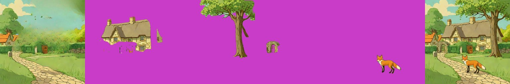

# Grounding DINO (find objects by name)

> **Role: current factsheet** (helper model). Template: [TEMPLATE.md](TEMPLATE.md). Verdicts are the user's.

> **User assessment (first look, 2026-11-11):** Layer extraction not the best, but very fast.

**Type:** image + a noun (or phrase) → a bounding box, which then prompts SAM2 for a mask ([sam2-lama.md](sam2-lama.md)).

## What it does

Open-vocabulary detection: "red fox", "stone gate arch" → box. In our pipeline it turns the layer names from the planner into boxes, so a scene can be split fully automatically without hand boxes.

## Licence & weights

`IDEA-Research/grounding-dino-tiny` (Apache-2.0), about 0.7 GB, loaded through `transformers` (`AutoModelForZeroShotObjectDetection`).

## How we run it

1. In `Sam2Decomposer._box_for`: text `"<name>."`, `threshold=0.3`, `text_threshold=0.25`, the highest-scoring box is kept.
2. Served by the `sam2-lama` profile of the Kaggle server (`/decompose`, `DecomposeParams.names`); about 45 s to load together with SAM2 and LaMa.

## Fox & cottage benchmark

Names only (no boxes) against hand boxes, same SAM2 + LaMa masks and fill:

| | Compute (T4) | Result |
|---|---|---|
| **A. Best case: names → Grounding DINO → SAM2** | 7 s per image | fully automatic; cottage, gate arch, tree, fox as clean cut-outs; "village houses" boxed the cottage instead |
| Hand boxes → SAM2 (for comparison) | 8 s | all five objects |
| **B. Live-demo budget (about 30 s)** | the same 7 s | far under budget |

Left to right: background, cottage, tree, gate arch, fox, recomposite (run from the app through the tunnel, names `cottage, big tree, red fox, stone gate arch`).

## Further investigations

- "Largest K automatic masks" (no detector) picked fragments (cloud, bush, lawn piece): [sam2-lama.md](sam2-lama.md).
- The app run with names against hand boxes: [sam2-lama.md](sam2-lama.md), strips `sam2_app_test1.jpg` / `sam2_app_test2.jpg`.

## Special features

| Feature | Status | Evidence |
|---|---|---|
| Split an image into layers | **supported** (with SAM2) | strip above |
| Others | n/a | detection only |

## Best features / Weak spots

- Best: names go straight to boxes with no training; the tiny model found the cottage, arch, tree and fox on this scene (the whole SAM2 route took 7 s).
- Weak: composite phrases ("village houses") can box the wrong thing; one box per name (the best-scoring one); it does not see hidden parts.

## Status / Next attempts / Sources

Works inside the SAM2 route. Next: try the base model or a score threshold per name; allow several boxes per name. Sources: Grounding DINO paper and `IDEA-Research` model card.
