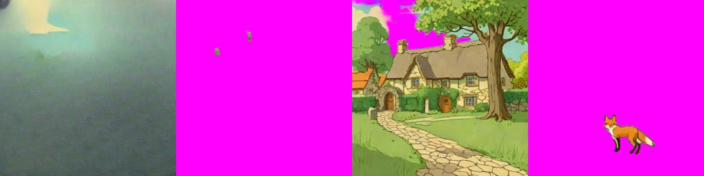

# LayerD (ICCV 2025)
> **Role: current factsheet.** Template: What it does · Licence & weights · How we run it (happy path) · Benchmarks · Best features · Weak spots · Status · Next attempts · Sources. Verdicts are the user's.

## What it does

Image → layers by repeated peeling: matte out the top layer (BiRefNet), inpaint beneath (LaMa), repeat.

## Licence & weights

Apache-2.0, `cyberagent/layerd-birefnet` (repo archived 2026-10-30).

## How we run it (happy path)

Kaggle CPU (no GPU quota), `transformers<5`, BiRefNet built with `low_cpu_mem_usage=False` (load info: 0 missing / unexpected keys). Generator: [`../../prototype/tools/make_layerd_v2.py`](../../prototype/tools/make_layerd_v2.py) (kernel `layerd-trial`).

## Benchmarks

| Image | Layers | CPU time | Recomposite diff | Matting output |
|---|---|---|---|---|
| fox & cottage (painted) | 1 | 55 s | 0 | max logit −11.9 → alpha 0 everywhere |
| forest (painted) | 1 | 58 s | 0 | alpha 0 everywhere |
| flat graphic design (circle, bar, text; control) | **3** | 206 s | 0.18 | step 1: 19 % covered, step 2: 13 %, then empty (stop) |

Generic BiRefNet (`ZhengPeng7/BiRefNet`) on the fox gives logits −27 … +19, so the pipeline and preprocessing are fine; LayerD's fine-tuned matting model simply sees no foreground in painted scenes. Results: `prototype/kaggle/results_layerd_v10/`.

**v11: LayerD loop with generic BiRefNet** as the matting model (`results_layerd_v11/`):

| Image | Layers | CPU time | Recomposite diff |
|---|---|---|---|
| fox & cottage | 4 (LaMa'd sky background, tiny fragment, whole scene minus sky, **fox**) | 220 s | 0.57 |
| forest | 1 (nothing found) | 47 s | 0 |
| flat design | 2 (palette refine on) / 5 (off) | 106 / 218 s | 0.15 / 0.38 |

The fox comes out as a clean layer and the hole is filled; after that the matting takes the whole scene below the sky as one layer (salient-object matting has no notion of cottage vs tree).

## Best features

Small, fast, CPU-only; trained for graphic-design images.

## Weak spots

Its matting model (fine-tuned on graphic designs) predicts no foreground at all on painted or illustrated scenes, at any threshold tested (5 variants in v6/v7).

## Status

Works as designed on flat graphic designs (3 clean layers); on our painted test scenes it finds no layer. The earlier "weights not loaded" diagnosis was wrong: weights load fully, the model's output is genuinely empty there.

## Next attempts

Generic-BiRefNet loop peels only the most salient object; combine with box-prompted masks (SAM2 by noun) for the remaining objects; or use LayerD only for UI/title overlays.

## Sources

[../log.md](../log.md) Phase 5.
