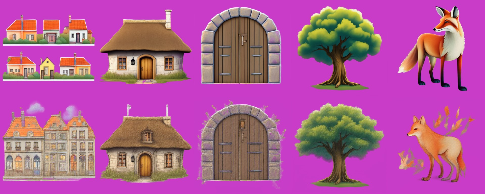

# LayerDiffuse-Flux
> **Role: current factsheet.** Template: What it does · Licence & weights · How we run it (happy path) · Benchmarks · Best features · Weak spots · Status · Next attempts · Sources. Verdicts are the user's.

> **User assessment (final intermediate, 2026-11-11):** All bad, not worth pursuing.

## What it does

LayerDiffuse's transparency for FLUX.1-dev: a LoRA plus a transparent VAE decoder; text → one transparent image.

## Licence & weights

`RedAIGC/Flux-version-LayerDiffuse` (`layerlora.safetensors`, `TransparentVAE.pth`), AFL-3.0 on the HF card; FLUX.1-dev non-commercial.

## How we run it (happy path)

GGUF Q4_K_S FLUX.1-dev + encoders/VAE from ungated `ostris/Flex.1-alpha`; LoRA keys converted from BFL/kohya format to diffusers, attached unmerged; 512 px, 16 steps. Generator: [`../../prototype/tools/make_layerdiffuse_flux_trial.py`](../../prototype/tools/make_layerdiffuse_flux_trial.py).

## Benchmarks

| Object (512 px, 16 steps) | Time | Transparent | Result |
|---|---|---|---|
| campfire | 63 s | 75% | clean cut-out, stylised fire |
| deer | 57 s | 82% | clean, fine legs and antlers |
| glass bottle | 58 s | 77% | **semi-transparent glass** |

Peak 8.9 GB (one T4). Run 2 (55 s, 0 LoRA keys matched) was plain FLUX. Results: [`../../prototype/kaggle/results_ldflux_v4/`](../../prototype/kaggle/results_ldflux_v4/).

## Fox & cottage benchmark

LayerDiffuse-Flux generates **one transparent object per call** (text → RGBA); it does not split a given image. The test therefore generates the five objects of the shared scene one by one from prompts (`make_ldflux_fox_bench.py`, 512 px, GGUF Q4_K_S, one T4, 2026-11-11; the objects are new images, not cut from the scene's picture). Model load is not counted; the prompt encoding takes 0.3-0.4 s. Results: `prototype/kaggle/results_ldflux_fox/`.

| | Settings | Compute per object | Peak | Per-layer check |
|---|---|---|---|---|
| **A. Best case (up to 8 min)** | 28 steps | 108-112 s (five objects: 556 s) | 8.9 GiB | clean cut-outs |
| **B. Live-demo budget (about 30 s)** | 6 steps | 24.1-24.8 s (five objects: 123 s) | 8.9 GiB | recognisable, noisier edges, artefacts |

Top row path A, bottom row path B; left to right: village houses, cottage, gate arch, big tree, red fox (transparent = magenta):

What each image shows:
- **Cottage A:** a thatched stone cottage with a brown thatched roof, chimney, two windows, an arched wooden door and a lantern, grass at its base; clean edges, close to the scene's cottage in kind but glossier and rounder.
- **Cottage B:** the same kind of cottage with a rougher, scratchy texture, two thin pole-like shapes on the roof and fuzzy edges.
- **Gate arch A:** a front view of a large arched stone frame with a wooden double door (the scene's arch is a small stone arch on the left of the path); clean, slight purple tint on the stones. **B:** the same with a fuzzy fringe of speckles and small plant fragments around the outline.
- **Tree A:** a round leafy tree with a trunk, roots and a small patch of grass; clean. **B:** nearly the same tree, slightly softer; the best result at 6 steps.
- **Fox A:** an orange and white fox with a long snout and very long thin legs (stretched proportions), glossy cartoon style; clean cut-out. **B:** a paler, shorter-legged orange fox with orange leaf-like fragments and wisps floating around it (artefacts), softer.
- **Village houses A:** two separate strips of three small orange-roofed houses each, with a white outline and a flat white ground strip (a sticker look), instead of one row. **B:** one row of three tall multi-storey grey townhouses with orange roofs and two purple smoke puffs: a different building type than the prompt asked for, with noisy edges.

Not like the scene: the style is a glossy digital cartoon, not the scene's flat storybook painting, and every object fills its own 512 px canvas (no control of size or place; the app's fit-to-box or `relocate()` would have to place them). Path B fits a 30 s request for one object (24.7 s), not for the five objects of a scene.

## Special features

| Feature | Status | Evidence |
|---|---|---|
| Add a layer (new transparent object from text) | **supported** | the five objects above; earlier campfire, deer and a semi-transparent glass bottle ([table](#benchmarks)) |
| Split an image into layers | n/a (generates) | |
| Move / resize / harmonise | not tried (objects come on their own canvas; place with fit-to-box or [relocate-harmonise.md](relocate-harmonise.md)) | |
| Story composite / spatial edit / image to image / relight / effects | n/a | |
| Real semi-transparency | **supported** (glass bottle, earlier run) | [table](#benchmarks) |
| Amodal completion | n/a (objects are generated whole) | |

## Best features

Clean FLUX-quality transparent objects, including real semi-transparency (glass); one T4 is enough.

## Weak spots

Single images only, no multi-layer scenes; heavy model; the style and scale of each object are not controlled (glossy cartoon objects that do not match a painted scene); at 6 steps the edges get noisy and fragments appear around the object (fox, arch).

## Status

Works since run 4 (LoRA keys converted from BFL/kohya format; all 494 modules matched).

## Next attempts

Confirm transparency; compare with LayerDiffuse SDXL and Qwen-Image-2.1 RGBA on the same objects.

## Sources

[`../../research_notes/Layered loop open paths/flux_layered_t4_and_weights.md`](../../research_notes/Layered%20loop%20open%20paths/flux_layered_t4_and_weights.md); [../log.md](../log.md) Phase 7.
