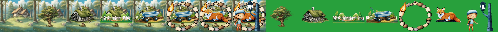
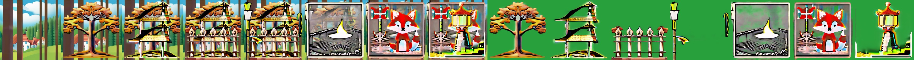

# LayerDiffuse SDXL (and our scene-to-layer chain)
> **Role: current factsheet.** Template: What it does · Licence & weights · How we run it (happy path) · Benchmarks · Best features · Weak spots · Status · Next attempts · Sources. Verdicts are the user's.

## What it does

Native transparency for Stable Diffusion: generates a transparent object, or (conditional modes) draws an object into a given background and extracts it as an aligned RGBA layer. Our chain uses `bg2ble → bgble2fg` per element on the current composite (modes below).

## Modes (how LayerDiffuse works)

LayerDiffuse teaches the model a **latent transparency** signal that a special decoder turns into alpha.

| Mode | Input | Output | Released for |
|---|---|---|---|
| `fg` | prompt | one transparent object | SD1.5, SDXL |
| joint fg + bg | prompt(s) | foreground + background together | SD1.5 only |
| `bg2ble` | background + prompt | the new object drawn into that background | SD1.5, SDXL |
| `bgble2fg` | background + blended image | that object as a transparent layer | SD1.5, SDXL |
| `fg2ble` / `fgble2bg` | foreground (+ blend) | a background around a given object | SD1.5, SDXL |

**Our chain:** composite the current scene → `bg2ble` draws the new element into it → `bgble2fg` extracts it as its own aligned layer → stack it.

## Licence & weights

Code Apache-2.0, weights OpenRAIL-M ([LayerDiffusion/layerdiffusion-v1](https://huggingface.co/LayerDiffusion/layerdiffusion-v1)); MIT diffusers port vendored in `prototype/vendor/diffuser_layerdiffuse`.

## How we run it (happy path)

SDXL **base** (not Turbo), 20 steps, CFG 7, Euler; 1024 px on a T4 or 512 px on CPU. Code: [`../../prototype/layerproto/backends/layerdiffuse_chain.py`](../../prototype/layerproto/backends/layerdiffuse_chain.py). Object prompts need "a single X, solo, centered"; "no background" / "isolated object" makes it paint an opaque backdrop. Lighting is baked into a layer, so moving it later needs `relocate()`. The vendored diffusers port needed keyword arguments for diffusers 0.37 (`shift_factor`).

## Benchmarks

| Setting | Time |
|---|---|
| one chain pass, 1024 px, T4 | about 18 s |
| full chain notebook incl. downloads | 291 s |
| per element, 512 px, laptop CPU | about 11 min (base) / 80 s per plain layer (Turbo) |
| `relocate()` move/resize, 512 px, T4 | about 4 s |

## Complex scene: 7 elements, several overlapping (run 2026-11-10, T4, SDXL base, 20 steps, CFG 7)

Background (village lawn, pine forest) + oak tree, cottage, fence, blue wagon, campfire with stone ring, red fox, iron lantern post, each drawn into the composite so far (`bg2ble`) and extracted (`bgble2fg`). Tiles: background and composite after each element, then the seven extracted layers.

| Setting | Total | Per element | Extracted layers' transparency | Look |
|---|---|---|---|---|
| **1024 px** | 364 s | 48 s | 67–79 % | all seven layers extracted cleanly, one consistent storybook style, shared light |
| 512 px (engine default) | 244 s | 11–14 s | 8–84 % (campfire and fox layers almost opaque) | garbled graphic-style artefacts, white halos, repeated fence spikes; the model is out of its resolution |

1024 px:

512 px:

What this shows: the chain **does** handle 7 elements and overlap when run at 1024 px (the earlier poor results on complex scenes came from the 512 px engine default), and each element lands in the lit scene. What it does **not** control is layout and scale: with no boxes, the fox and the stone ring come out huge and cover the cottage, the lantern post was drawn with a boy, and the tree sits where the model decides. That is the gap boxes fill (ART+, CLD, RevealLayer) or a layout pass before the chain.

## Best features

- Adds an element *into* the existing scene with matching light and perspective, as its own aligned layer.
- Basis of `relocate()` re-harmonisation and story-event layers.
- Runs on CPU (slowly) and comfortably on a T4.

## Weak spots

- The extract step fails on SDXL-Turbo (0–5% transparent).
- One element per pass; complex scenes with many overlapping objects not evaluated.

## Status

Working base of the prototype.

## Next attempts

Complex scenes (5+ objects); fox & cottage built element by element; combine with IC-Light and shadow layers.

## Sources

LayerDiffuse paper arXiv 2402.17113; [../log.md](../log.md) Phase 2.
