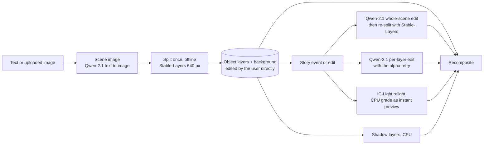

# Which models go where: pipeline plan after the first-look assessment

> **Role: proposal for the first prototype (2026-11-11).** Built from the user's assessments in the factsheets ([README](README.md)) and the measurements in them. Everything under "Proposed verdict" is a proposal; the user decides. Numbers are measured on the fox & cottage scene unless stated; the combined run that tests these combinations is not done yet (see section 7).

## 1. What the evidence says, in one table

| Need in the pipeline | What worked on the fox & cottage scene | Cost (compute, warm model) | What did not |
|---|---|---|---|
| **Scene edit / story event** (night, rain, new element) | **Qwen-Image-2.1**: whole-scene night and rain edits keep the composition ([qwen-image-2.1](qwen-image-2.1.md)) | about 22 s per edit | — |
| **Split a scene into object layers** | **Stable-Layers at the native 640 px**: sky, ground, cottage, tree, fox as separate clean layers, on the scene and on the night and rain composites ([stable-layers](stable-layers.md)) | 102 s (4 Euler steps); 178 s with Heun gives the same layers | the same model at 384 / 512 px gives bands; the base weights, and Lightning, do not split this scene ([qwen-image-layered](qwen-image-layered.md), [qwen-lightning](qwen-lightning.md)) |
| **Split with control by boxes**, filled background | **RevealLayer** (clean removal, filled background, layers follow the boxes), **CLD** (decent layers, invented replacement background) | 85-358 s and 116-459 s | both slow and FLUX.1-dev non-commercial; CLD's background is a different scene |
| **Fast masks** | **Grounding DINO + SAM2**: object cut-outs by name | 3 s | blurry LaMa fill; hidden parts missing ([sam2-lama](sam2-lama.md), [grounding-dino](grounding-dino.md)) |
| **Background without objects / hidden parts** | **Qwen-2.1** "remove X and fill" (one call) and "extract only the cottage without X"; RevealLayer's filled background | about 24 s per call | SDXL-inpaint: good for the first three fills, cannot add elements convincingly ([amodal-fill](amodal-fill.md)) |
| **Add / remove / modify one layer** | **Qwen-2.1** RGBA edit with the alpha retry (10 of 10 edits accepted); text to transparent object | 20-26 s per edit | LayerDiffuse-Flux and ART+ objects do not match the scene's style ([layerdiffuse-flux](layerdiffuse-flux.md), [art-plus](art-plus.md)) |
| **Relight a layer** | **IC-Light** (with the chroma fix), **Qwen-2.1** relight prompts ([relight-ic-light](relight-ic-light.md)) | 44 s on the laptop CPU / seconds on a GPU [est]; 20-26 s | IC-Light shifts hue (partly fixable) |
| **Shadows** | procedural shadow layer ([shadow-layers](shadow-layers.md)) | 0.5 s for five layers, CPU | — |
| **Move / resize** | direct manipulation of the layer in the frontend (instant); `relocate()` to re-harmonise ([relocate-harmonise](relocate-harmonise.md)) | 0 s / 3.4 s | `relocate()` runs on LayerDiffuse SDXL (see 4) |
| **Image to image** | **Qwen-2.1** only, so far | about 22 s | not compared with other image-to-image models yet |
| **Effects (fog, glow, snow) as layers** | procedural overlays | CPU, instant | LayerDiffuse SDXL effect layers gave objects or the scene itself ([layerdiffuse-sdxl](layerdiffuse-sdxl.md)) |

## 2. Proposed pipeline, as roles (one model per role)

The key timing consequence: **splitting a scene takes about 100 s, so it is done once per scene** (when the scene is generated or uploaded), not per request. The live loop works on the existing layers: move and resize are instant, a relight preview is a CPU grade, and the slow steps are one Qwen-2.1 call (about 24 s) for one layer or one background. A story event that changes the whole scene costs one edit (22 s) plus a re-split (about 100 s), so it runs in the background while the CPU preview is shown ([concepts/editing.md §3](../concepts/editing.md)).

## 3. Proposed combinations

| Combination | Models and their roles | Why | Open point |
|---|---|---|---|
| **A. Story editor (core)** | Qwen-2.1 edits the scene → Stable-Layers (640 px) splits the edit → Qwen-2.1 per-layer edit / IC-Light relight for single layers → shadow layers → recomposite | each model does what the first look found it best at; every step has a measured result | the whole chain has not been run end to end; the split step is about 100 s |
| **B. Fast object extraction** | Grounding DINO + SAM2 for the masks (3 s) → Qwen-2.1 for the background without the object and for hidden parts (about 24 s per call) instead of LaMa | keeps SAM2's speed and fixes its weak points (blurry fill, missing hidden parts) with the model that did those well | not tested as a combination; the pieces were measured separately |
| **C. Box-controlled / quality path** | RevealLayer (boxes, filled background) or CLD (boxes, decent layers) | the only methods where the user places the groups by boxes; RevealLayer's background removal is the strongest | slow (85-460 s) and FLUX.1-dev non-commercial; worth keeping only if the box control is wanted in the frontend |
| **D. Placement and harmonising** | user moves the layer directly; `relocate()` re-harmonises on request; shadow layer follows | movement is best done by the user; harmonising is the optional model step | `relocate()` needs LayerDiffuse SDXL (see 4) |

## 4. Interactions that constrain the verdicts

1. **Dropping LayerDiffuse SDXL has two consequences.** (a) `relocate()` (harmonise after a move) runs on it; without it the "re-harmonise" button has no engine until a replacement exists. (b) The current scene generator (the layer-by-layer chain, `Engine.generate_all`) is built on it; the replacement is "text → scene with Qwen-2.1, then split once" (the generate-then-decompose route in [concepts/pipeline.md](../concepts/pipeline.md)). Proposal: stop developing it as a generator, **keep it only as the engine of `relocate()` until a Qwen-2.1 based harmonise has been tested**, then decide.
2. **Stable-Layers needs the Qwen-Image-Layered weights** (it is a LoRA on them), so those stay on the server even though the base model alone splits this scene poorly. The base model is the comparison for Stable-Layers, not a separate pipeline step.
3. **Qwen-2.1 is the hub:** edit, image to image, add / remove / modify, background removal, amodal, relight and its output is what Stable-Layers splits. Its weaknesses (about 24 s per call, non-commercial licence, object position and scale not controlled in extraction) therefore matter most. A second model for the same roles (an alternative editor) is the main redundancy to consider.
4. **IC-Light and the shadow layer are independent** of the other models (SD1.5, and CPU), which makes them cheap to keep.
5. **Servers:** one profile per session for now (`layerproto/serve/profiles.py`). Combination A needs two profiles (`qwen21` and `qwen-layered`); the Qwen-2.1 profile alone loads about 21 GiB across the two T4s (8.0 + 12.7 GiB) and the Qwen-Image-Layered transformer is another 12 GB or more, so keeping both loaded probably does not fit (not measured together); a live demo would swap profiles or use a larger card. That is the "rethink" the user expects for later.

## 5. Proposed verdicts

| Model / approach | Proposed verdict | Reason (from the factsheets) |
|---|---|---|
| Qwen-Image-2.1 | **Core**; keep developing | scene edit, story composites, image to image, add / remove / modify, background inpainting, amodal, relight; slow per call |
| Stable-Layers (on Qwen-Image-Layered weights) | **Core** for the split | clean object layers at 640 px; splits Qwen-2.1's night and rain edits; colour shift in the recomposite; about 100 s |
| Shadow layers | **Core** (CPU helper) | instant, any layer |
| IC-Light + chroma fix | **Keep, tune further** | good relighting, especially with Qwen-2.1; hue drift |
| Grounding DINO + SAM2 | **Keep** (fast masks); combine with Qwen-2.1 fill (combination B) | 3 s; the fill and hidden parts are the weak part, not the masks |
| `relocate()` / harmonise | **Keep as an optional step**; move/resize itself is direct user interaction | 3.4 s; depends on LayerDiffuse SDXL today |
| RevealLayer | **Keep for the box-controlled path; explore** | best background removal and fill, layers follow boxes; slow, FLUX non-commercial |
| CLD | **Keep as the alternative to RevealLayer; explore** | decent layers, replacement background and style variation on the edits; slow; the background is a different scene |
| Qwen-Image-Layered (base) | **Park**: keep only as the base of Stable-Layers | inconsistent: good on the forest, no object layers on the fox scene at any setting tried |
| Qwen Lightning | **Candidate to drop** (the user decides) | no object layers on the fox scene at 384, 512 or 640 px; story composites not improved at 640 px |
| LayerD | **Park, look at it a little more** (the user's note) | limited on painted scenes; CPU only |
| SDXL-inpaint amodal fill | **Park**; Qwen-2.1 replaces it for amodal | good for 3 of 5 fills, cannot add elements convincingly |
| ART+ | **Drop** | all bad (the user); generates its own scene, does not split ours |
| LayerDiffuse SDXL | **Stop as a generator; keep only as the engine of `relocate()` for now** | all bad (the user); see 4.1 |
| LayerDiffuse-Flux | **Drop** | all bad (the user); objects do not match the scene's style |

## 6. Feature coverage if these verdicts hold

| Feature | Provided by | Gap |
|---|---|---|
| Split | Stable-Layers (640 px); SAM2 + Qwen-2.1 (fast, one object per call); RevealLayer / CLD (boxes) | 30 s per split is not reached by any model that gives object layers (SAM2 is 3 s but needs Qwen-2.1 for a good fill) |
| Harmonise | `relocate()` (LayerDiffuse SDXL) | a Qwen-2.1 based harmonise is untested |
| Story composite | Qwen-2.1 edit + Stable-Layers split; per-layer relight | the end-to-end run |
| Spatial edit | Qwen-2.1 text edits on a layer; boxes (RevealLayer, CLD); masks (SAM2) | an edit restricted to a drawn region is untested |
| Image to image | Qwen-2.1 | no other image-to-image model compared yet |
| Add / remove / modify | Qwen-2.1 | none measured against another model |
| Relight | IC-Light, Qwen-2.1 | further tuning |
| Effects | procedural overlays | a Qwen-2.1 transparent effect layer (fog, glow) is untried |
| Amodal | Qwen-2.1, RevealLayer | none |

## 7. Next steps toward the combined run

1. **The combined run (the user's plan):** combination A end to end on the fox & cottage scene and on two more scenes, with the model and role named for every output.
2. **Check that Stable-Layers' split holds on other scenes** (the forest, the pixel-art and the sketch scenes; Qwen-Image-Layered was inconsistent), and measure 640 px with 2-3 steps for a shorter split.
3. **Combination B:** SAM2 masks plus Qwen-2.1 fill, against Qwen-2.1 extraction alone.
4. **A Qwen-2.1 harmonise** ("re-light and blend this moved object into the scene") against `relocate()`, so LayerDiffuse SDXL can be dropped fully.
5. **Image to image:** compare Qwen-2.1 with other image-to-image models.
6. **Effects:** a Qwen-2.1 transparent fog / glow / snow layer.
7. **Decide Lightning** after the 640 px result (listed as a candidate to drop above).
8. **Server design for live use:** both profiles resident, weights pre-downloaded (the Qwen-Image-Layered weights already are, as Kaggle notebook outputs).

## 8. Not yet looked at (for after the first prototype)

From [../research/papers-survey.md](../research/papers-survey.md): **LayerFusion** (training-free attention blending, re-implementable, a route to harmonised joint generation), the **DreamLayer** dataset (a possible fine-tune for move / resize), **OmniPSD** (no weights), **LASAGNA** (shadows and reflections as layers, not released). Directions with no entry there yet and not verified [U]: further instruction-based image-editing models as alternatives to Qwen-2.1 (for story edits and image to image), newer segmentation models than SAM2, other relighting models than IC-Light v1, and layered models released after 2026-11-09. A short literature check on these is the next research task once the prototype loop is stable.

Licences: FLUX.1-dev (RevealLayer, CLD) and Qwen Research (Qwen-2.1) are non-commercial, Stable-Layers is under the Stability community licence; this is a personal non-commercial project, so all remain usable now ([TEMPLATE.md](TEMPLATE.md) lists the rest).
