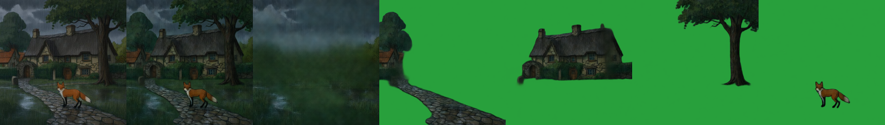
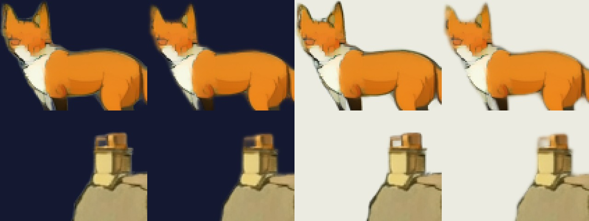
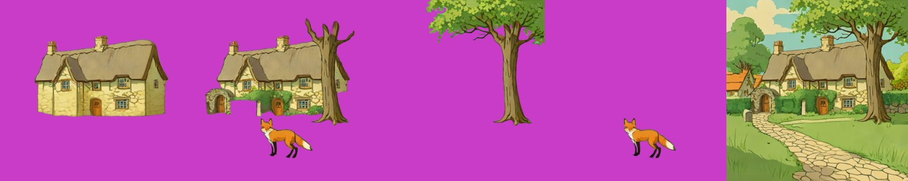
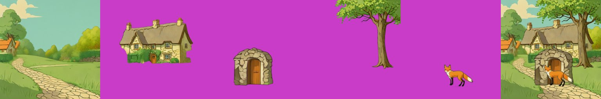
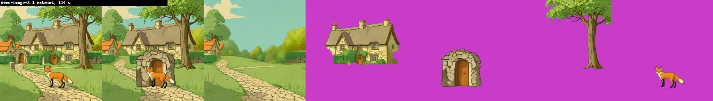
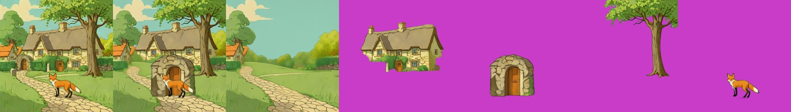
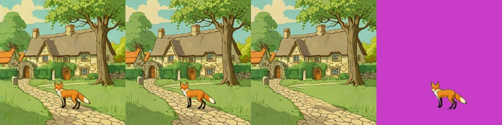
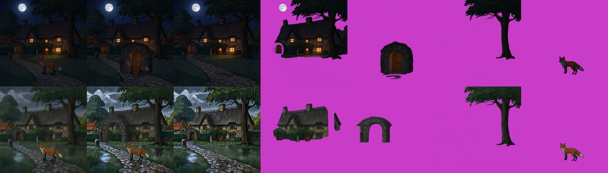
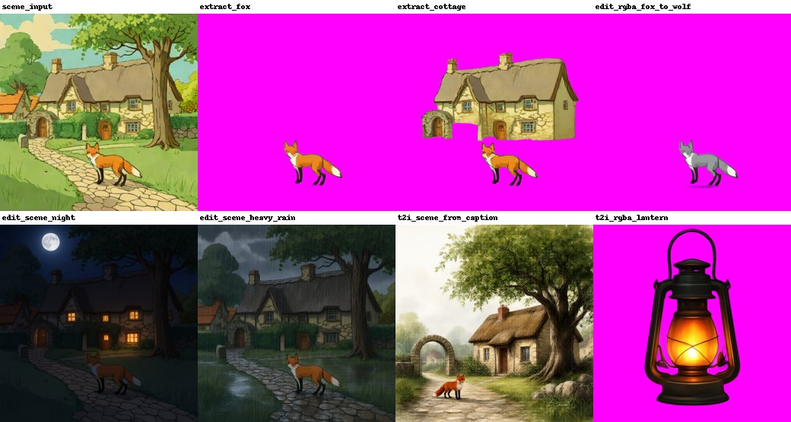
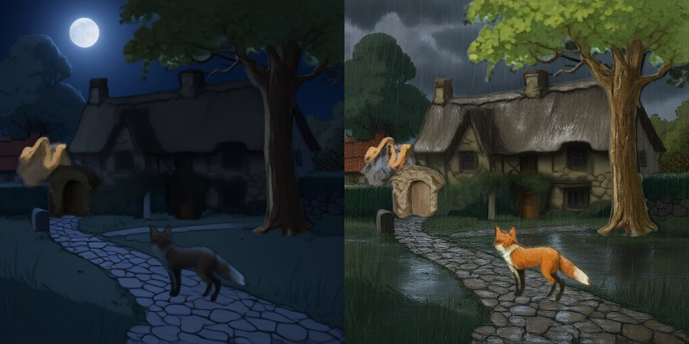

# Qwen-Image-2.1 (RGBA)
> **Role: current factsheet.** Template: What it does · Licence & weights · How we run it (happy path) · Benchmarks · Best features · Weak spots · Status · Next attempts · Sources. Verdicts are the user's.

> **User assessment (first look, 2026-11-11):** Very useful for scene editing and story-event composites. Also a useful decompose method (with successful background inpainting) and good layer splitting together with Stable-Layers. A bit slow (maybe better for adding single layers or modifying scenes). The only model here that supports image-to-image: worth comparing with other image-to-image models that cannot split layers.
>
> **User update (2026-11-11, after the attribution audit):** `sheet.jpg` is Qwen-2.1 plus SDXL-Turbo (SDXL-Turbo made the input scene), which is quite good and probably the best core path: generate with SDXL-Turbo (if faster than Qwen-2.1, locally or on Kaggle), then split and modify with Qwen-2.1. SDXL-Turbo is not a layer model but stays in the pipeline as the simple, fast first step for text to image and image to image.

## What it does

7B text-to-image and editing model with a native 4-channel (RGBA) VAE: generates transparent images, **edits a transparent layer**, **extracts a subject** from an image, local and multi-reference edits. No multi-layer split mode.

## Licence & weights

Qwen Research licence (non-commercial). `Qwen/Qwen-Image-2.1(-Turbo)`; GGUF from `unsloth/Qwen-Image-2.1-Turbo-GGUF` (Q4_K_S 3.91 GB); fp16-safe VAE `madebyollin/texture-fix-vae-for-qwen-image-2.1` (the stock VAE gives NaNs in fp16 on transparent pixels).

## How we run it (happy path)

1. Kaggle 2× T4; diffusers `main`, transformers ≥ 5.17.
2. Turbo GGUF Q4_K_S transformer on GPU 0 + dequantise its non-Linear GGUF parameters + `fp16_mixed`; Qwen3-VL text encoder fp16 split over both GPUs; texture-fix VAE.
3. 512 px, 8 steps (Turbo schedule), CFG 1. Transparent output: wrap the prompt as "This is an RGBA image with transparency. … The image has alpha channel and the background is transparent." Edits: pass the image(s) as `image=[...]`.
4. Generator: [`../../prototype/tools/make_qwen21_rgba_trial.py`](../../prototype/tools/make_qwen21_rgba_trial.py).

## Benchmarks

| Task (512 px, Turbo) | Time | Result |
|---|---|---|
| Text → transparent object | 17–23 s | 37% transparent / 50% opaque; dark smoky halo |
| Edit transparent layer ("blue flames") | 23 s | edit applied, alpha kept |
| Extract object from a scene | 22 s | clean layer at its original position |
| Text → opaque scene | 18 s | good |
| Scene-wide edit ("rainy night") | 22 s | composition kept, effect subtle |

Load 247 s; peak 9.6–10.7 GB. Results: [`../../prototype/kaggle/results_qwen21_v2/`](../../prototype/kaggle/results_qwen21_v2/).

## Fox & cottage (shared test scene)

| Task (512 px, Turbo, about 20 s each) | Result |
|---|---|
| extract fox ("Remove the background, and output a PNG image. Keep only the red fox …") | clean transparent fox at its original position; the RGBA-wrapper prompt returned an empty image |
| extract cottage | cottage + gate arch, but the fox was kept too |
| RGBA edit: fox → grey wolf | wolf in the same pose and style, alpha kept |
| scene edit: night | strong and convincing: moon, dark sky, lit windows, composition unchanged |
| scene edit: heavy rain | storm clouds, rain streaks, wet cobbles and puddles, composition unchanged |
| scene from the caption | coherent storybook scene (cottage, gate arch, tree, fox, path) |
| transparent lantern prop | clean, with a glow |

Results: [`../../prototype/kaggle/results_qwen21_fox/`](../../prototype/kaggle/results_qwen21_fox/). Strong, explicit edit prompts ("Keep every object, the composition and the style") fixed the subtle rain edit of the first run.

## Story-event composites re-split with Stable-Layers (run v10, 5 layers, 384 px, Heun, 67–70 s)

Strategy "recompose" end to end: Qwen-Image-2.1 edits the whole scene (night, heavy rain), then Stable-Layers splits the result.

| Composite | Layers found | Recomposite diff |
|---|---|---|
| night edit | moon + sky bits / cottage (lit windows) / tree / fox, path + hedge as a layer | 4.2 |
| heavy-rain edit | cottage / tree / fox, wet path + lawn layer, rain mostly in the background | 11.2 |
| text-to-image scene (Qwen-Image-2.1 from the caption) | 5 frames, 63–98 % transparent; strip in `results_qwen_v10/` not inspected in detail | 21.1 |

Night (input | recomposite | background | layers):

Heavy rain:

The base model (Euler, 4 steps, 39 s) splits the night edit worse (3 of the 4 object frames 99–100 % transparent, i.e. empty) but the rain edit with more layers filled (diff 10.8). Results: `prototype/kaggle/results_qwen_v10/`.

## Halo / fringe fix (CPU, `layerproto/matte_fix.py`)

The RGBA outputs have a soft edge (21 % of the fox layer's visible pixels are semi-transparent, 32 % for the wolf, 20 % for the lantern, 5 % for the cottage) whose colour belongs to the background the object was drawn on. `defringe()` replaces the edge colours with the nearest solid interior colours and shrinks the alpha by one pixel. Zoom, 3×, fox and cottage roof (before | after on a dark background, then before | after on a light one):

It removes the grey-green rim (visible on the dark background) but also softens the fox's dark outline, so it trades edge crispness for a clean rim; apply it when a layer will be moved onto a very different background, not by default. Not tested on the other generators' layers.

## Usage facts (from the research notes)

| Topic | Fact |
|---|---|
| Alpha design | the VAE takes 4-channel RGBA in and out (64-channel latent, 16× downsampling); generation and editing share one pipeline |
| Official prompts | only the transparency wrapper is official; ComfyUI's background-removal template uses "Remove the background, and output a PNG image." |
| References | up to 10 reference images (16 ComfyUI slots); `image_1` is the image being edited; placement only by prompt and circle/mask images, no coordinates |
| Harmonising a pasted object | plausible: pass the rough composite as `image_1` and ask for a blend [unverified] |
| Alpha quality | no measured benchmark; one provider guide reports near-binary alpha (glass ≈ 99 % opaque) |
| Speed-ups | Turbo (8 steps), Lightning LoRA, Lightning v2 RL, Fun-Acc LoRA (4 steps); KV cache int8/int4 in ComfyUI |
| VRAM reports | 4060 Ti 16 GB, int8, 1024 px, 25 steps: ≈ 20 s per image, peak ≈ 15 GB; 5090, NF4: 15.2 GB peak |
| fp16 | stock VAE NaNs on transparent pixels (texture-fix VAE fixes it); one all-NaN text-encoder report (suspected corrupt files) |
| Multi-layer | no official multi-layer mode, no announced Layered 2.x, no community decomposition LoRA |

Full notes: [qwen_image_21_rgba.md](../../research_notes/Layered%20loop%20open%20paths/qwen_image_21_rgba.md).

## Extracting single objects from the scene (T4 x2, 512 px, run 2026-11-10)

One scene image in, one object out as RGBA, about 23-27 s each after the 240 s load (361 s in total). Panels: cottage (prompt a), cottage (prompt b), tree, fox, scene with the fox removed.

- **Cottage, prompt a** ("only the cottage ... without the tree, fox, arch or hedge in front"): a whole, clean cottage, with the hidden parts completed. This is the best amodal result so far, better than the SDXL-inpaint fill.
- **Cottage, prompt b** ("complete the parts hidden behind the tree and the arch"): the tree, arch and fox came along. The wording "without X" works, "complete the hidden parts" does not.
- **Tree:** clean cut, the crown is clipped at the top edge of the canvas.
- **Fox:** clean cut, 97 % transparent.
- **Fox removed:** the path and grass are filled and the rest is unchanged (opaque output, edit mode).

Files: `prototype/kaggle/results_qwen21_extract/`.

### As a `/decompose` method (run through the real route, 2026-11-10)

[qwen21_decomposer.py](../../prototype/layerproto/backends/qwen21_decomposer.py) turns the prompts above into the app's decomposer contract (`method="qwen21-extract"`): one "remove all named objects" call for the background, then one extract call per name from the original image, each naming the objects in front of it as exclusions, retrying with the next seed if a layer comes back empty or flooded. `MethodRouter` in `decomposer.py` lets one server offer it next to `sam2-lama`. Logic tested with a stub pipeline (`prototype/tools/test_qwen21_decomposer.py`). 
**Through the FastAPI route** (in-process test client inside the T4 x2 session, `MethodRouter` with `qwen21-extract`, 512 px, boxes and four names): HTTP 200 in 114 s after a 236 s load. Strip: background, cottage, gate arch, tree, fox, recomposite.

- The **background** comes out clean, hole-free and coherent, with every named object removed (the SAM2 + LaMa background is smeared where the cottage and tree were).
- Cottage, tree and fox are whole and clean. The **arch** came back larger than in the scene (the extract prompt has no position, so the model redraws it big) and overlaps the fox in the recomposite; the boxes are not used by this method for position. Next: pass the box as a crop or a position hint, or paste the extracted object back into its box.
- An unknown method raised a server error in this run (the status showed ERROR although all outputs were produced); the route now answers HTTP 400 with the list of methods.
- Not yet served through the tunnel (needs a server notebook that loads this pipeline).

## Fox & cottage benchmark: paths A and B

Input: the shared scene; Qwen-Image-2.1 has no split mode, so the split is one extract call per object plus one call that removes the objects for the background (`qwen21-extract` method, [qwen21_decomposer.py](../../prototype/layerproto/backends/qwen21_decomposer.py)). Strips: input | recomposite | background | layers.

| | Settings | Compute (2× T4) | Result |
|---|---|---|---|
| **A. Best case measured** | 512 px, 8 steps, five calls (background + four objects) | 114 s through the `/decompose` route (236 s load) | clean hole-free background; whole cottage, tree, fox; the arch came back larger than in the scene |
| **B. Live-demo budget (about 30 s)** | 512 px, 8 steps, **one object per request** | 23–27 s per call | one clean layer per request; all four objects need four requests |

### Profile benchmark (warm model in one Kaggle session, 2026-11-11)

Run through the new `qwen21` server profile ([`layerproto/serve/qwen21.py`](../../prototype/layerproto/serve/qwen21.py)): loaded once (393 s), each case run twice, second run reported, 512 px, 8 steps. Results: `prototype/kaggle/results_profile_qwen21/`.

| | Request | Compute | Layers | Recomposite diff |
|---|---|---|---|---|
| **A. Best case** | background + four objects (cottage, arch, tree, fox) | 118.6 s | 5 | 17.17 |
| **B. Live-demo budget** | background + one object (the fox) | 47.6 s (two edit calls, about 24 s each) | 2 | 5.71 |

B shows the model's cost structure: every object is one 24 s call, and the background is one more. For a 30 s budget a request can ask for one thing (one object, or the background).

A:

B:

### Qwen-2.1 extraction on the night and rain edits (session `qwen21-story`, 2026-11-11)

Same `qwen21-extract` method as above, applied to the two Qwen-2.1 night / rain edits of the SDXL-Turbo scene (background + four objects, 512 px, 8 steps; night 138.7 s, rain 184.3 s). Strip rows: night, rain; tiles: input | recomposite | layer 0 (background) | cottage | arch | tree | fox. Results `prototype/kaggle/results_profile_qwen21-story/`.

Checked layer by layer ([`layer_report.py`](../../prototype/tools/layer_report.py) style measurements):
- **The background layer still contains the cottage and the tree.** Colour difference of the background layer to the input inside the cottage / tree / fox masks: night 3.9 / 2.5 / 14.5, rain 15.9 / 11.2 / 32.1 (about 4 means unchanged). Only the fox was (partly) taken out, whereas on the daylight scene the same request emptied the background.
- **The cottage layer is a block**, not the cottage: at night 45.5 % of the canvas (x 71-511, y 0-353) with the moon and the top of the tree in it; in the rain 22.5 % with holes.
- **The arch is invented and misplaced:** at night a large stone dome with a door (13.2 % of the canvas, x 193-388, y 245-467) that covers the fox in the recomposite; in the rain a stone arch (x 53-261) that spans over the cottage; the scene's arch is small and at the left (x 62-150).
- The tree (a clean cut-out, 17 %) and the fox (2.3-2.6 %, clean) are fine.

On the same two edits **Stable-Layers at 640 px** gave one clean layer per object, with a hole-free background that no longer contains them ([stable-layers.md](stable-layers.md)); it took 178 s with Heun on both edits (the Euler variant, about 100 s on the fox scene, was not run on them). So for splitting these story composites Stable-Layers has a measured advantage over Qwen-2.1 extraction (and the runtimes are of the same order); one seed and one prompt set, so no more than that. Qwen-2.1 remains the model that made the edits.

## Special features

| Feature | Status | Evidence |
|---|---|---|
| Split an image into layers | **supported** (one call per object) | strip above |
| Move / resize a layer | **partial**: a canvas move; the background without the object comes from the same model | [amodal-fill.md](amodal-fill.md) |
| Harmonise after a move | not tried | |
| Story composite | **supported**: whole-scene night and rain edits, then a re-split | [night](#story-event-composites-re-split-with-stable-layers-run-v10-5-layers-384-px-heun-6770-s), below |
| Spatial edit | **supported**: "fox → grey wolf" in the same pose and style, alpha kept | sheet below |
| Image to image | **supported**: scene edits | sheet below |
| Add / remove / modify a layer | **supported**: extract, remove ("fox removed, path filled"), RGBA edit, text → transparent object | sheet and strips below |
| Relight a layer | **supported** with an alpha retry: 10 of 10 edits accepted | `event_perlayer_retry.jpg` |
| Effects as layers | **partial**: lantern prop with a glow; procedural overlays for rain / snow | sheet below |
| Amodal completion | **supported**: whole cottage behind the tree | `qwen21_extract_strip.jpg` |

One sheet from the first fox & cottage run (extract fox, extract cottage, fox → wolf, night, heavy rain, scene from caption, lantern):

Per-layer relight with the retry (night left, rain right):

Whole-scene relight against recompose, night and rain: [concepts/editing.md §5](../concepts/editing.md) (`event_bg_relight_night.jpg`, `event_bg_relight_rain.jpg`).

## Best features

- One model covers three loop steps: new layer from text, re-prompt a layer keeping transparency, cut an object out of a scene.
- Fast (about 20 s) and follows prompts well; candidate base-image generator.

## Weak spots

Halo around generated transparent objects; scene-wide edits are subtle; alpha reported as near-binary by an API provider; non-commercial licence.

## Status

Works on 2× T4 (run 2).

## Next attempts

Stronger event edits (prompt wording, more steps); halo fix (prompt, matte clean-up); use as base-image generator for fox & cottage; re-prompt Qwen-Image-Layered layers.

## Sources

[`../../research_notes/Layered loop open paths/qwen_image_21_rgba.md`](../../research_notes/Layered%20loop%20open%20paths/qwen_image_21_rgba.md); [../log.md](../log.md) Phase 7.
