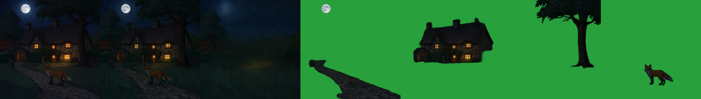

# Qwen-Image-2.1 (RGBA)
> **Role: current factsheet.** Template: What it does · Licence & weights · How we run it (happy path) · Benchmarks · Best features · Weak spots · Status · Next attempts · Sources. Verdicts are the user's.

## What it does

7B text-to-image and editing model with a native 4-channel (RGBA) VAE: generates transparent images, **edits a transparent layer**, **extracts a subject** from an image, local and multi-reference edits. No multi-layer split mode.

## Licence & weights

Qwen Research licence (non-commercial). `Qwen/Qwen-Image-2.1(-Turbo)`; GGUF from `unsloth/Qwen-Image-2.1-Turbo-GGUF` (Q4_K_S 3.91 GB); fp16-safe VAE `madebyollin/texture-fix-vae-for-qwen-image-2.1` (the stock VAE gives NaNs in fp16 on transparent pixels).

## How we run it (happy path)

1. Kaggle 2× T4; diffusers `main`, transformers ≥ 5.17.
2. Turbo GGUF Q4_K_S transformer on GPU 0 + dequantise its non-Linear GGUF parameters + `fp16_mixed`; Qwen3-VL text encoder fp16 split over both GPUs; texture-fix VAE.
3. 512 px, 8 steps (Turbo schedule), CFG 1. Transparent output: wrap the prompt as "This is an RGBA image with transparency. … The image has alpha channel and the background is transparent." Edits: pass the image(s) as `image=[...]`.
4. Generator: [`../../prototype/tools/make_qwen21_rgba_trial.py`](../../prototype/tools/make_qwen21_rgba_trial.py).

## Benchmarks

| Task (512 px, Turbo) | Time | Result |
|---|---|---|
| Text → transparent object | 17–23 s | 37% transparent / 50% opaque; dark smoky halo |
| Edit transparent layer ("blue flames") | 23 s | edit applied, alpha kept |
| Extract object from a scene | 22 s | clean layer at its original position |
| Text → opaque scene | 18 s | good |
| Scene-wide edit ("rainy night") | 22 s | composition kept, effect subtle |

Load 247 s; peak 9.6–10.7 GB. Results: [`../../prototype/kaggle/results_qwen21_v2/`](../../prototype/kaggle/results_qwen21_v2/).

## Fox & cottage (shared test scene)

| Task (512 px, Turbo, about 20 s each) | Result |
|---|---|
| extract fox ("Remove the background, and output a PNG image. Keep only the red fox …") | clean transparent fox at its original position; the RGBA-wrapper prompt returned an empty image |
| extract cottage | cottage + gate arch, but the fox was kept too |
| RGBA edit: fox → grey wolf | wolf in the same pose and style, alpha kept |
| scene edit: night | strong and convincing: moon, dark sky, lit windows, composition unchanged |
| scene edit: heavy rain | storm clouds, rain streaks, wet cobbles and puddles, composition unchanged |
| scene from the caption | coherent storybook scene (cottage, gate arch, tree, fox, path) |
| transparent lantern prop | clean, with a glow |

Results: [`../../prototype/kaggle/results_qwen21_fox/`](../../prototype/kaggle/results_qwen21_fox/). Strong, explicit edit prompts ("Keep every object, the composition and the style") fixed the subtle rain edit of the first run.

## Story-event composites re-split with Stable-Layers (run v10, 5 layers, 384 px, Heun, 67–70 s)

Strategy "recompose" end to end: Qwen-Image-2.1 edits the whole scene (night, heavy rain), then Stable-Layers splits the result.

| Composite | Layers found | Recomposite diff |
|---|---|---|
| night edit | moon + sky bits / cottage (lit windows) / tree / fox, path + hedge as a layer | 4.2 |
| heavy-rain edit | cottage / tree / fox, wet path + lawn layer, rain mostly in the background | 11.2 |
| text-to-image scene (Qwen-Image-2.1 from the caption) | 5 frames, 63–98 % transparent; strip in `results_qwen_v10/` not inspected in detail | 21.1 |

Night (input | recomposite | background | layers):

Heavy rain:

The base model (Euler, 4 steps, 39 s) splits the night edit worse (3 of the 4 object frames 99–100 % transparent, i.e. empty) but the rain edit with more layers filled (diff 10.8). Results: `prototype/kaggle/results_qwen_v10/`.

## Usage facts (from the research notes)

| Topic | Fact |
|---|---|
| Alpha design | the VAE takes 4-channel RGBA in and out (64-channel latent, 16× downsampling); generation and editing share one pipeline |
| Official prompts | only the transparency wrapper is official; ComfyUI's background-removal template uses "Remove the background, and output a PNG image." |
| References | up to 10 reference images (16 ComfyUI slots); `image_1` is the image being edited; placement only by prompt and circle/mask images, no coordinates |
| Harmonising a pasted object | plausible: pass the rough composite as `image_1` and ask for a blend [unverified] |
| Alpha quality | no measured benchmark; one provider guide reports near-binary alpha (glass ≈ 99 % opaque) |
| Speed-ups | Turbo (8 steps), Lightning LoRA, Lightning v2 RL, Fun-Acc LoRA (4 steps); KV cache int8/int4 in ComfyUI |
| VRAM reports | 4060 Ti 16 GB, int8, 1024 px, 25 steps: ≈ 20 s per image, peak ≈ 15 GB; 5090, NF4: 15.2 GB peak |
| fp16 | stock VAE NaNs on transparent pixels (texture-fix VAE fixes it); one all-NaN text-encoder report (suspected corrupt files) |
| Multi-layer | no official multi-layer mode, no announced Layered 2.x, no community decomposition LoRA |

Full notes: [qwen_image_21_rgba.md](../../research_notes/Layered%20loop%20open%20paths/qwen_image_21_rgba.md).

## Best features

- One model covers three loop steps: new layer from text, re-prompt a layer keeping transparency, cut an object out of a scene.
- Fast (about 20 s) and follows prompts well; candidate base-image generator.

## Weak spots

Halo around generated transparent objects; scene-wide edits are subtle; alpha reported as near-binary by an API provider; non-commercial licence.

## Status

Works on 2× T4 (run 2).

## Next attempts

Stronger event edits (prompt wording, more steps); halo fix (prompt, matte clean-up); use as base-image generator for fox & cottage; re-prompt Qwen-Image-Layered layers.

## Sources

[`../../research_notes/Layered loop open paths/qwen_image_21_rgba.md`](../../research_notes/Layered%20loop%20open%20paths/qwen_image_21_rgba.md); [../log.md](../log.md) Phase 7.
