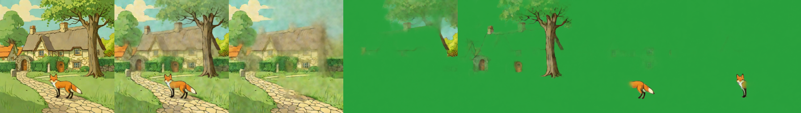
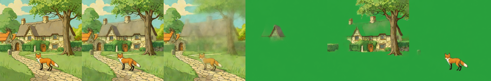
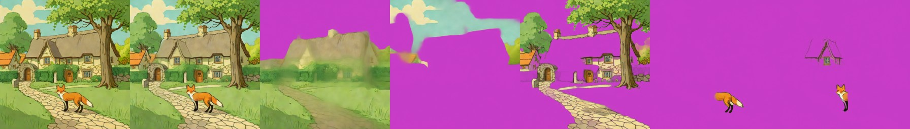
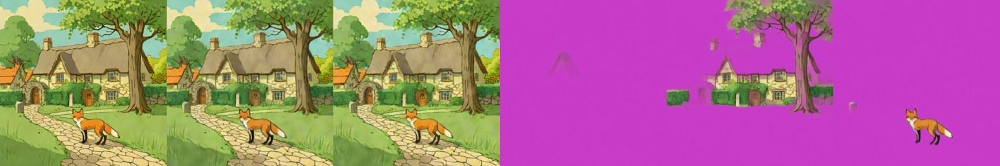
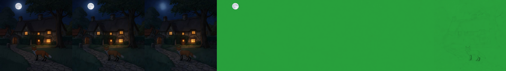
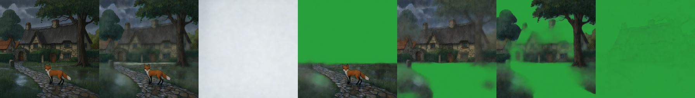

# Qwen-Image-Layered
> **Role: current factsheet.** Template: What it does · Licence & weights · How we run it (happy path) · Benchmarks · Best features · Weak spots · Status · Next attempts · Sources. Verdicts are the user's.

> **User assessment (first look, 2026-11-11):** Surprisingly bad layer extraction on the fox & cottage scene, although it showed promise before (`results_qwen_v7_layers/layers_forest_384px_4L_4st`, `results_qwen_sweep_v5/v5_forest_384px_4L_4st.png`); it effectively extracts noise. Find out what is going wrong; remove from consideration if unfixable.

## What it does

Splits one finished image into N full-canvas RGBA layers (N chosen per run, e.g. 3–8) that composite back to the input; hidden areas behind objects are filled. 20B MMDiT, image → layers (not text → layers).

## Licence & weights

Apache-2.0, [Qwen/Qwen-Image-Layered](https://huggingface.co/Qwen/Qwen-Image-Layered). We use a GGUF Q4_K_S transformer (12.4 GB) plus the original text encoder and VAE, cached as public Kaggle notebook outputs (`markandreduesing/qwen-layered-weights-transformer`, `-base`).

## How we run it (happy path)

1. Kaggle 2× T4, transformer split over both GPUs (blocks 0–29 / 30–59), `fp16_mixed` applied ([../concepts/fp16-on-t4.md](../concepts/fp16-on-t4.md)).
2. **384 px, 4 layers, 4 steps, `true_cfg=1.0`, `offload=False`** → 27–35 s per split.
3. Code: [`../../prototype/layerproto/qwen_layered.py`](../../prototype/layerproto/qwen_layered.py) (`decompose`, `recompose`, `cached_encode`, `HeunVelocity`); notebook generator [`../../prototype/tools/make_qwen_layered_batch.py`](../../prototype/tools/make_qwen_layered_batch.py); step-by-step guide [../guides/kaggle.md](../guides/kaggle.md).

## Benchmarks

| Setting | Time per split | Recomposite diff | Notes |
|---|---|---|---|
| 640 px, 4 layers, 50 steps, CFG 4 (defaults) | 35 min (42 s/step) | 4.1 | reference quality |
| 512 px, 3 layers, 12 steps, CFG 1 | 139 s | — | same split as CFG 4 |
| 384 px, 3 layers, 3 steps, CFG 1 | 20 s | — | softer edges |
| **384 px, 4 layers, 4 steps, CFG 1** | **27–35 s** | about 7 | recommended |
| 512 px, 4 layers, 4 steps, CFG 1 | 48 s | — | sharper |
| 384 px, 4 layers, 4 **Heun** steps | 58 s | 7.0 | 2 calls per step |
| 384 px, **2 layers**, 4 steps | 25.7 s | 5.9–6.5 | background + one foreground layer |

Peak memory 8.0 / 7.6 GB (fast settings). Measured on the forest, pixel-art and sketch scenes (sweeps v3–v7, [`../../prototype/kaggle/results_qwen_sweep_v5/`](../../prototype/kaggle/results_qwen_sweep_v5/), [`results_qwen_v7_layers/`](../../prototype/kaggle/results_qwen_v7_layers/)). Fox & cottage (shared test scene): 4 layers in 33 s → background / house roof / cottage + tree / fox (diff 9.4); 6 layers 41 s; 5 layers at 512 px 62 s (tree and fox separate). Results: [`../../prototype/kaggle/results_qwen_fox_v11/`](../../prototype/kaggle/results_qwen_fox_v11/).

## Fox & cottage benchmark

Input: the shared scene ([TEMPLATE.md](TEMPLATE.md)); the model takes the image and a layer count (no boxes). Strips: input | recomposite | layers (green = transparent).

| | Settings | Compute (2× T4) | Recomposite diff | What the layers show |
|---|---|---|---|---|
| **A. Best case measured on this scene** | 512 px, 5 layers, 4 steps, CFG 1 | 62 s | 13.4 | background, tree and fox separate, cottage faint |
| **B. Live-demo budget (about 30 s)** | 384 px, 4 layers, 4 steps, CFG 1 | 33 s | 9.4 | background / roof / cottage + tree / fox |

A, 512 px, 5 layers:

B, 384 px, 4 layers:

A has not yet been run with more steps (12–16, still under 8 minutes); the 640 px, 50-step reference setting takes 35 min and was measured on the forest scene only. Results: `prototype/kaggle/results_qwen_fox_v11/`.

### Profile benchmark (warm model in one Kaggle session, 2026-11-11)

Run through the new `qwen-layered` server profile ([`layerproto/serve/qwen_layered.py`](../../prototype/layerproto/serve/qwen_layered.py)); the model was loaded once (354 s), each case was run twice and the second run is reported. Compute is the decompose call only. Results: `prototype/kaggle/results_profile_qwen-layered/`.

| | Settings | Compute | Layers | Recomposite diff |
|---|---|---|---|---|
| **A. Best case (up to 8 min)** | 512 px, 5 layers, 16 Euler steps, CFG 1 | 254.8 s | 5 | 8.54 |
| **B. Live-demo budget (about 30 s)** | 384 px, 4 layers, 4 Euler steps, CFG 1 | 34.5 s | 4 | 8.68 |

A (16 steps): the background layer keeps a blurred cottage and path, the other layers hold sky and tree pieces, the tree and cottage detail, and the fox (split into two layers):

B (4 steps):

16 steps cost 7× the 4-step run and improved the recomposite difference only from 8.68 to 8.54, so on this scene the extra steps buy little.

## Special features

| Feature | Status | Evidence |
|---|---|---|
| Split an image into layers | **supported** | strips above |
| Move / resize a layer | **partial**: layers are full-canvas RGBA, so a canvas move works; no harmonising | [relocate-harmonise.md](relocate-harmonise.md) (the move loop used another model's split) |
| Harmonise after a move | not tried on these layers | |
| Story composite | **supported**: re-split of a night / rain edit | below |
| Spatial edit | n/a (no text or box control) | |
| Image to image | n/a | |
| Add / remove / modify a layer | **partial**: choose N; edit a layer with another model | [qwen-image-2.1.md](qwen-image-2.1.md) |
| Relight a layer | n/a | [relight-ic-light.md](relight-ic-light.md) |
| Effects as layers | n/a | |
| Amodal completion | **supported** (hidden areas behind objects are filled; faint ghosts of old positions remain) | strips above |

**Story composite: re-split after Qwen-Image-2.1 edited the scene** (run v10, 384 px, 5 layers, 4 steps, base Euler; night then heavy rain). The base model splits the night edit worse than Stable-Layers (3 of 4 object frames 99–100 % transparent) but the rain edit with more layers filled (diff 10.8): [qwen-image-2.1.md](qwen-image-2.1.md).

**Re-decomposing every turn** (drift arm C): [../research/drift-evaluation.md](../research/drift-evaluation.md), strip `redecompose_cycles.jpg`.

## Best features

- Most meaningful semantic layers of all routes tried so far (background, tree groups, campfire group, characters).
- Layers recomposite to the input almost exactly; background filled behind objects.
- Works across painterly, pixel-art and sketch styles.

## Weak spots

- Sometimes groups unrelated objects into one layer (skeleton + tree); thin or low-contrast subjects may stay in the background at 3 layers.
- At 384 px detail is limited; old object positions may leave faint ghosts in the background layer.

## Status

Working; main decomposer. Heun, 2-layer and fox & cottage variants measured (v9, v10); Lightning 2-step in [qwen-lightning.md](qwen-lightning.md).

## Next attempts

Heun at 8 steps; TPU route ([../research/hosting.md](../research/hosting.md#tpu)).

## Sources

Paper arXiv 2512.15603; history in [../log.md](../log.md) Phases 3–5; notes [`../../research_notes/Coherent layered generation pipeline/qwen_layered_and_layerdiffuse_papers.md`](../../research_notes/Coherent%20layered%20generation%20pipeline/qwen_layered_and_layerdiffuse_papers.md).
