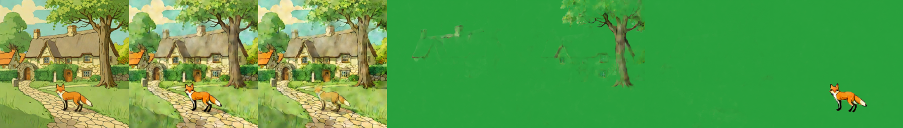
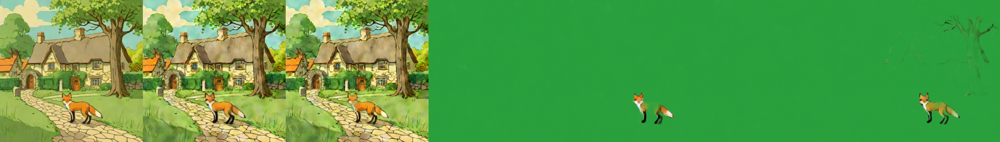
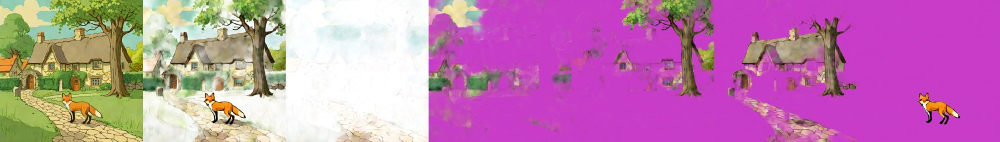
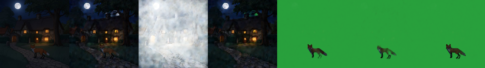

# Qwen-Image-Lightning LoRA (on Qwen-Image-Layered)
> **Role: current factsheet.** Template: What it does · Licence & weights · How we run it (happy path) · Benchmarks · Best features · Weak spots · Status · Next attempts · Sources. Verdicts are the user's.

> **User assessment (first look, 2026-11-11):** As bad at layer extraction as Qwen-Image-Layered. Maybe ok for story composites, worth seeing whether that can be improved; otherwise discard.

## What it does

lightx2v's distillation LoRA for plain Qwen-Image (4–8 steps). Untested on Layered before us.

## Licence & weights

`lightx2v/Qwen-Image-Lightning` (Apache-2.0 per card).

## How we run it (happy path)

Attach unmerged with `fp16_mixed.add_lora` (all 720 modules match Layered); Lightning scheduler config from the card; 384 px, 4 layers, 4 steps.

## Benchmarks

| Variant | Total | Recomposite diff |
|---|---|---|
| base model | 30 s | 7.1 |
| scheduler only | 35 s | 8.6 |
| LoRA 0.5 | 39 s | 10.3 |
| LoRA 1.0 | 37–39 s | 11–13.5 |

Results: [`../../prototype/kaggle/results_qwen_sweep_v6_lightning/`](../../prototype/kaggle/results_qwen_sweep_v6_lightning/).

## Run v10: 2 and 4 steps, scale sweep (fox & cottage, 384 px, 5 layers, 2× T4)

| Scale | Steps | Total | Recomposite diff | Layers look |
|---|---|---|---|---|
| 0.25 | 2 | 22.5 s | 32.3 | not split (frames mostly overlapping) |
| 0.5 | 2 | 22.5 s | 22.1 | partial |
| 0.75 | 2 | 22.5 s | 15.2 | partial |
| 1.0 | 2 | 22.4 s | 15.0 | tree + fox separated, cottage/houses almost empty |
| 0.5 | 4 | 43.6 s | 11.1 | cottage + tree + fox, cleanest of the sweep |
| 1.0 | 4 | 43.9 s | 13.8 | tree and fox, cottage nearly empty |
| *base, Euler, 4 steps (for reference)* | 4 | 39 s | 6–8 | all five objects |

2 steps halve the time (22 s vs 39–44 s) but the split quality is clearly worse; no speed-up at 4 steps. Fox & cottage at 1.0 / 2 steps (input | recomposite | background | layers):

Results: `prototype/kaggle/results_qwen_v10/`.

## Fox & cottage benchmark

Lightning is a speed LoRA on the base model; same input and strip layout as [qwen-image-layered.md](qwen-image-layered.md), 384 px, 5 layers, 2× T4.

| | Settings | Compute | Recomposite diff | What the layers show |
|---|---|---|---|---|
| **A. Best case measured** | scale 0.5, 4 steps | 43.6 s | 11.1 | cottage + tree + fox, cleanest of the sweep |
| **B. Live-demo budget (about 30 s)** | scale 1.0, **2 steps** | 22.4 s | 15.0 | tree + fox separated, cottage / houses almost empty |
| *base model for reference* | Euler, 4 steps | 39 s | 6–8 | all five objects |

B (2 steps):

4 steps:

Results: `prototype/kaggle/results_qwen_v10/`.

### Profile benchmark (warm model in one Kaggle session, 2026-11-11)

Same `qwen-layered` profile, Lightning LoRA at scale 1.0; second run reported. Results: `prototype/kaggle/results_profile_qwen-layered/`.

| | Settings | Compute | Layers | Recomposite diff |
|---|---|---|---|---|
| **A. Best case (up to 8 min)** | 512 px, 5 layers, 4 steps | 73.8 s | 5 | 14.37 |
| **B. Live-demo budget (about 30 s)** | 384 px, 5 layers, 2 steps | 22.5 s | 5 | 56.39 |

A (4 steps):

B (2 steps): the recomposite comes out washed out and the background layer is nearly white, so the very large difference is visible in the image, not only in the number:

## Special features

| Feature | Status | Evidence |
|---|---|---|
| Split an image into layers | **supported** (quality below the base model at 2 steps) | strips above |
| Story composite | **partial**: night edit re-split at 2 steps | below |
| Move / harmonise / edit / relight / effects | n/a (same as the base model) | [qwen-image-layered.md](qwen-image-layered.md) |
| Amodal completion | **partial** (as the base model) | |

## Best features

Separates thin, low-contrast subjects better (the pale skeleton came out cleanly).

## Weak spots

At 4 steps no speed-up (the base already works at 4), about 5 s LoRA overhead, colour/texture drift.

## Status

Tried in sweep v6 and run v10 (2-step and scale sweep).

## Next attempts

Only for hard thin/low-contrast scenes (the pale skeleton) where the base fails; for speed prefer the base model at 2 layers.

## Sources

[../log.md](../log.md), Sweep v6.
