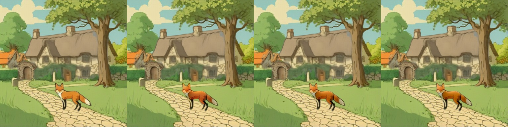
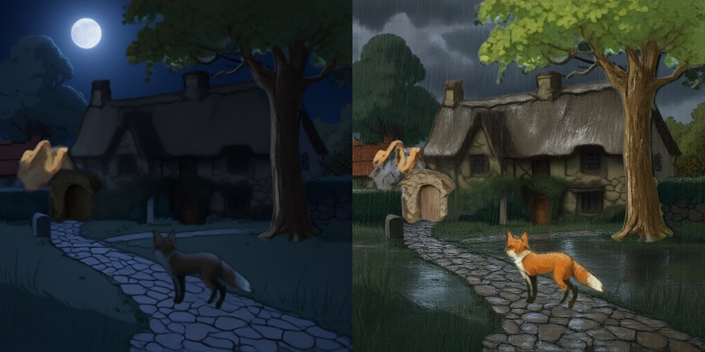
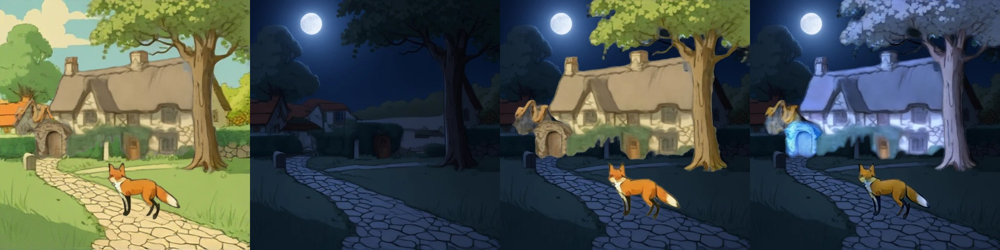
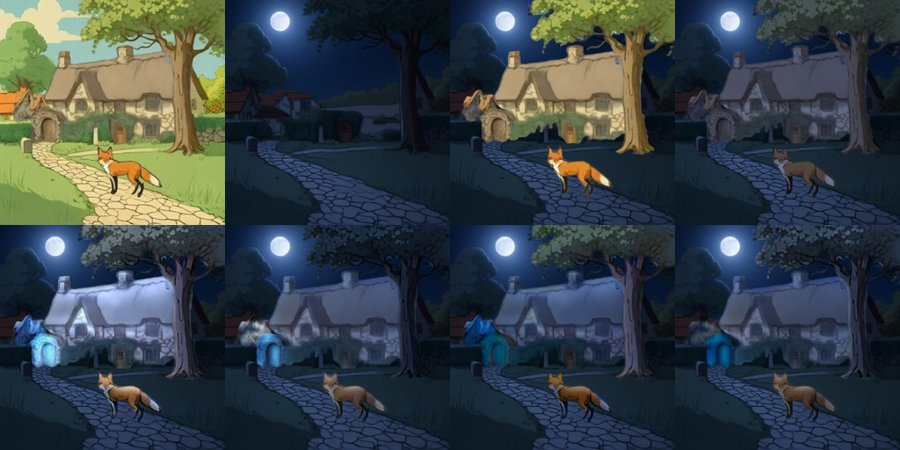
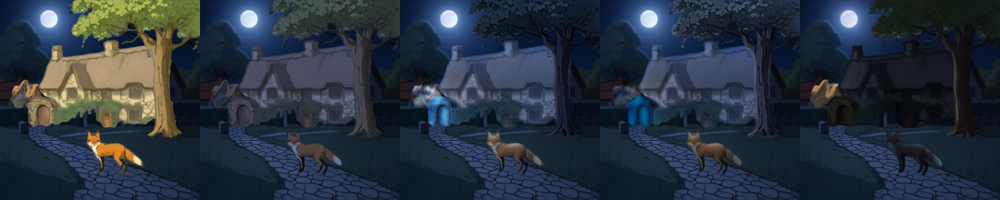
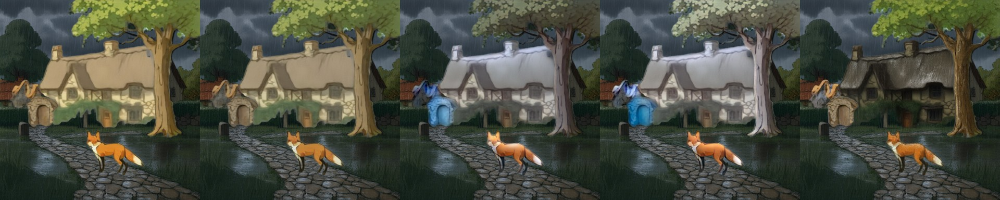

# IC-Light and relighting layers

> **Role: current factsheet** (components we use, not a layer model). Template: [TEMPLATE.md](TEMPLATE.md). Verdicts are the user's.

> **User assessment (first look, 2026-11-11):** Could be tuned and tested further, but generally quite good at relighting, especially together with Qwen-2.1.
>
> **User update (2026-11-11, after the attribution audit):** IC-Light could still be tuned to improve and is not completely superseded by Qwen-2.1; that is to be shown with more testing and evidence.

**Type:** RGBA layer + target background → the layer relit to match it; plus the cheaper alternatives (colour grade, Qwen-Image-2.1 relight prompt).

## What it does

Changes the lighting of one layer so it fits a new scene (night, rain, a lantern). Three routes are measured: **IC-Light v1 fbc** (SD1.5, relights against a given background), a **colour grade** (instant, CPU) and a **Qwen-Image-2.1 RGBA edit** with a relight prompt, which is retried when the alpha does not survive ([qwen-image-2.1.md](qwen-image-2.1.md)).

## Licence & weights

IC-Light v1 fbc: Apache-2.0 (Realistic Vision 5.1 UNet widened from 4 to 12 input channels). Qwen-Image-2.1: Qwen Research licence (non-commercial).

## How we run it

1. IC-Light: [`relight.py`](../../prototype/layerproto/relight.py) (fg with transparent pixels filled grey and bg latents concatenated each step; the layer's alpha is re-applied and fine detail transferred). `restore_chroma(relit, original, keep)` pulls the colour back.
2. Colour grade: `events.grade()` (CPU, instant); procedural overlays for rain, snow, fog, smoke, fire glow.
3. Qwen-2.1 per-layer relight with the alpha check-and-retry: `layer_edit.py` and `event_apply.py` (a plan from the event router is applied layer by layer).

## Fox & cottage benchmark

| Route | Compute | Result on the fox |
|---|---|---|
| **A. IC-Light fbc**, fox relit in place against the day scene (384 px, 8 steps) | 44 s on the laptop CPU; 56 s in the hue test; seconds on a T4 [est] | lowers lightness (Lab L 54.8 → 46.1) and raises redness (a* 15.2 → 20.3); `restore_chroma` keep 0.5–0.8 brings a* back to 17.8–16.4 |
| **A. Qwen-2.1 relight of all five layers** (night and rain, 512 px, 10 edits) | 20–26 s per edit, 547 s per 10 edits incl. retries | 10 of 10 accepted, 4 on the second try ([editing.md §5](../concepts/editing.md)) |
| **B. Colour grade + overlay** | milliseconds on the CPU | an instant preview; not a real relight |

### Who did the relighting in the night and rain strips (attribution check, 2026-11-11)

`bg_relight` strategy on RevealLayer's split: tiles = day composite | **background edited by Qwen-Image-2.1** | objects pasted unchanged | objects relit with **IC-Light fbc**. The convincing night (moon, dark sky and ground) in tile 2 is Qwen-2.1's edit of the filled background; the IC-Light objects in tile 4 are pale blue-white (cottage, tree, arch) with a darker, yellowish fox; the mean grey level of the objects only falls from 74 (tile 3) to 65 at night and does not change in the rain (85), so they are not dark. The IC-Light result is therefore the weak part of this strip, not the good part.

In `event_perlayer_retry.jpg` above both the background and the object layers are Qwen-2.1's; the layers themselves (and a malformed gate-arch layer, a tan stump) come from RevealLayer.

### Tuning IC-Light on the night objects (CPU test, 2026-11-11)

Objects = RevealLayer's layers (SDXL-Turbo scene); background = the Qwen-2.1 night edit of RevealLayer's filled background. Five object layers relit back to front, IC-Light fbc, 8 steps, 384 px, CPU float32 (about 200 s per variant for five layers). Script [`iclight_night_variants.py`](../../prototype/tools/iclight_night_variants.py), files `prototype/kaggle/results_iclight_tuning/`. Tiles, top row: day composite | Qwen-2.1 night background | objects unchanged (mean grey 73.6) | **colour grade only** (no IC-Light, 48.0); bottom row: **A** IC-Light as before (62.0) | **B** night grade first, then IC-Light (46.1) | **C** IC-Light, then lightness scaled to the graded version (47.6) | **D** grade, IC-Light, lightness match (45.4).

What the tiles show:
- **A (as before):** the cottage glows white-blue like snow, the arch is a bright cyan blob, the tree dark; mean grey 62, not dark.
- **Grade only:** dark, desaturated and flat: the cottage grey, the tree dark grey-green, the fox brown; the darkest natural-looking result of the five, with no cool moonlight cast.
- **B (grade first, then IC-Light):** the cottage is a muted grey-blue (a cool moonlit cast), the tree dark, the fox brown; mean grey 46. The best of the IC-Light variants.
- **C (lightness match only):** the mean falls to 47.6 but the cottage stays pale blue-grey and the tree turns greenish; the global scaling does not fix A.
- **D:** close to B (45.4).
- **In every IC-Light variant (A-D) the arch layer turns cyan** (it is the malformed RevealLayer layer from the earlier strips); the grade alone does not do that.

Reading: giving IC-Light an already night-graded object (B) removes the "not dark" failure, and the result carries a cool light cast that the plain grade lacks, at about 45 s per layer on the CPU; the lightness match alone does not help. IC-Light's remaining defects here are the cyan arch and the blue-white cast it adds to pale walls. The Qwen-2.1 per-layer relight (`event_perlayer_retry.jpg`) remains the other route for these layers. Not tested: the rain objects, other steps / prompts, `restore_chroma` on these variants.

### Side by side with the Qwen-2.1 per-layer relight, night and rain (CPU, 2026-11-11)

Same five RevealLayer object layers, same Qwen-2.1 edited background (384 px). Tiles: objects unchanged | colour grade only | IC-Light B (graded first) | IC-Light D (graded, IC-Light, lightness match) | **Qwen-2.1 per-layer relight** (the 10 edits of `results_perlayer_v3`, 512 px resized). Mean grey of the composite is in brackets; the background alone is 33.1 (night) and 52.1 (rain). Script [`relight_compare.py`](../../prototype/tools/relight_compare.py); IC-Light variants from `iclight_night_variants.py night|rain`.

Night (unchanged 73.6, grade 48.0, B 46.1, D 45.4, **Qwen-2.1 32.4**):

Rain (unchanged 82.7, grade 79.3, B 74.1, D 80.1, **Qwen-2.1 62.4**):

What the tiles show:
- **Night, grade:** dim and desaturated, a plausible dusk, no cool cast. **IC-Light B / D:** a cool grey-blue cottage and a dark blue-grey tree (a moonlit cast the grade lacks), a cyan arch blob. **Qwen-2.1:** the darkest and the most consistent with the dark background (mean grey 32.4 against the background's 33.1), but the cottage is close to a black silhouette, the fox almost black, and the arch layer is left in its tan daylight colours (the layer fell back to the unlit original).
- **Rain, grade:** almost no change (79.3 against 82.7). **IC-Light B / D:** the cottage and tree turn pale grey-white, a bright, washed-out look that does not match the grey rainy background, and again a cyan arch; IC-Light hardly darkens anything in the rain (mean grey 74-80). **Qwen-2.1:** a dark wet-looking thatch and walls with texture, a darker fox, the leaves still bright green; the most convincing of the five for rain; arch not relit.

Reading: on these layers **Qwen-2.1 per-layer relight is clearly the better route for night (darkness and consistency, but too dark on the cottage and fox) and for rain**; IC-Light with a night pre-grade gives a usable cool moonlit cast at night, but fails on the rain objects and turns the arch cyan in both. Where IC-Light was not beaten is where it was meant to work: matching the light of a daylight object inside a daylight scene (the fox in the move strip), which these tests do not include. Untested ideas for IC-Light that could change the picture: a rain pre-grade stronger than the current one, other prompts and step counts, `restore_chroma` on these variants, and a lighting mismatch inside one scene (sun to shade). The user's view that it is not superseded stays open until those are run.

## Further investigations

- The hue-drift fix and per-event `keep` parameter: [concepts/editing.md §2](../concepts/editing.md).
- Whole-scene relight versus recomposing versus per layer on night and rain: [concepts/editing.md §5](../concepts/editing.md) (`event_bg_relight_night.jpg`, `event_bg_relight_rain.jpg`).
- IC-Light on ART+ objects added colour casts (a pink tree trunk): [art-plus.md](art-plus.md).

## Special features

| Feature | Status | Evidence |
|---|---|---|
| Relight a layer | **IC-Light: partial** (a daylight fox is matched, but night and rain objects come out pale); **Qwen-2.1: supported** (10 of 10 edits accepted with the retry); grade: preview only | images above and below |
| Story composite | the edit is Qwen-2.1's; IC-Light on the objects of a night / rain scene gave pale blue-grey / white-grey objects (tested, poor) | `event_bg_relight_night.jpg` below, [provenance](provenance.md) |
| Harmonise after a move | partial | the last step of the move strip in [relocate-harmonise.md](relocate-harmonise.md) |
| Others | n/a | |

## Best features / Weak spots

- Best: IC-Light matches light to a given background at layer level; the Qwen-2.1 route follows text ("heavy rainstorm").
- Weak: IC-Light shifts hue (partly fixable); the Qwen-2.1 edit often floods or empties a layer without the retry; the colour grade is not physically a relight.

## Status / Next attempts / Sources

IC-Light tested on CPU; Qwen-2.1 route measured on a T4; neither is in a server profile yet. Next: a `/relight` route (Qwen-2.1 edit + retry) in the Qwen-2.1 profile. Sources: IC-Light repository, [concepts/editing.md](../concepts/editing.md).
