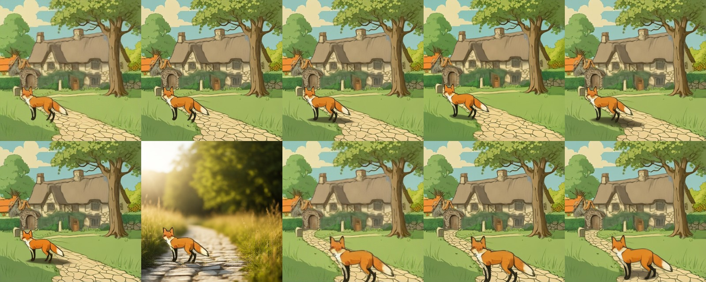
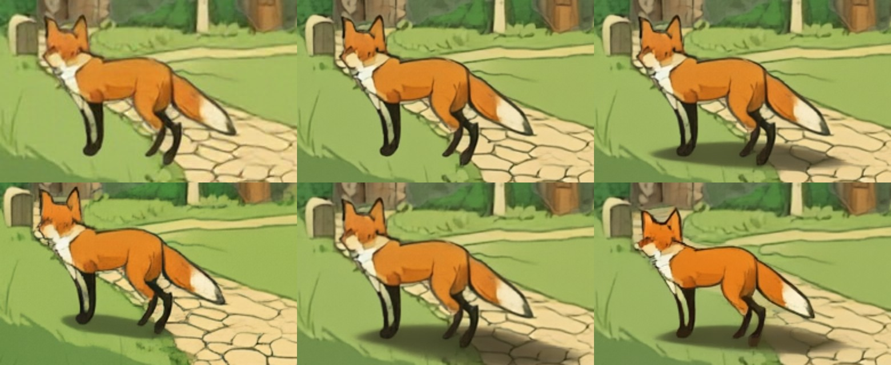

# relocate(): move / resize a layer with re-harmonisation

> **Role: current factsheet** (an approach we built, not a released model). Template: [TEMPLATE.md](TEMPLATE.md). Verdicts are the user's.

> **User assessment (first look, 2026-11-11):** Interesting and very fast, but moving and resizing is probably best done by direct user interaction with individual layers. Re-harmonising could still be useful.

**Type:** layer + new box + the scene below it → the layer re-drawn at its new place, matching the new surroundings.

## What it does

Training-free move and resize of one RGBA layer with re-harmonisation (after DreamLayer's harmonisation step): paste the object into its new box, re-noise the composite to a low strength, denoise with SDXL + LayerDiffuse `bg2ble` while the object's interior latents are pinned for most steps, then extract the object again by mask (alpha plus the ring that changed). The object keeps its identity, its rim and the light around it adapt, and contact shadows can grow.

## Licence & weights

Uses the LayerDiffuse SDXL chain ([layerdiffuse-sdxl.md](layerdiffuse-sdxl.md): SDXL base, LayerDiffuse weights; non-commercial terms of those models apply). No extra weights. Optional: [relight-ic-light.md](relight-ic-light.md) and [shadow-layers.md](shadow-layers.md).

## How we run it

1. Code: `LayerDiffuseChain.relocate()` in [`layerdiffuse_chain.py`](../../prototype/layerproto/backends/layerdiffuse_chain.py); remote route `POST /chain/relocate` and `RemoteChain.relocate`; app: `Engine.relocate_layer` and the button **Fit + re-harmonise (GPU)** (tested with a fake chain, `tools/test_relocate_route.py`).
2. Defaults: `strength` 0.3–0.45, `pin_frac` 0.4 (interior pinned for all but the last steps), `band` 4–9 px, Euler sampler, mask extraction, `paste_back` 0.8.
3. Canvas-only alternative (no model): **Fit to planned box** / the move sliders, instant.

## Fox & cottage benchmark

Input: RevealLayer's split of the scene (filled background + five layers). The fox is moved 28 % left, 4 % up and scaled 1.15×.

| | Compute (T4, 512 px) | Notes |
|---|---|---|
| **A. Best case** (strength 0.3 / 0.45, paste-back 0.8) | 3.4 s per edit (first call 133 s includes the SDXL download) | fox kept, edges blended into the path; 0.3 and 0.45 look nearly alike |
| **B. Live-demo budget (about 30 s)** | the same 3.4 s | already far under budget; the shadow layer adds 0.04 s |

The whole loop (move, harmonise, shadow, relight) took about 9 s on a T4 without IC-Light. Results: `prototype/kaggle/results_fox_move_v2/`.

## Further investigations

- Parameter sweep (strength, pin fraction, band, sampler, extraction): table in [concepts/editing.md §1](../concepts/editing.md).
- **ART+ objects harmonised onto another background:** it does not close a style gap (the glossy objects stay glossy and gain halos at strength 0.6): [art-plus.md](art-plus.md), strips `artplus_harmonise_s40.jpg` / `s60.jpg`.
- Identity drift over repeated moves (a long chain of relocations) is unsolved; pin length does not help.

### Can Qwen-Image-2.1 replace `relocate()` as the harmonise step? (test 2026-11-11)

Input: RevealLayer's split (SDXL-Turbo scene), fox moved 28 % left, 4 % up, 1.15× by a plain paste (naive), and a harder case at 1.6×. All edits are Qwen-Image-2.1, 512 px, 8 steps; results `prototype/kaggle/results_qwen21_harmonise/`, numbers from [`harmonise_eval.py`](../../prototype/tools/harmonise_eval.py). "Outside" = PSNR / mean grey difference to the naive paste away from the fox and its old place; the **control** asks the editor to change nothing, so it shows the editor's own drift.

| Job (what it asked) | Compute | Outside the fox | Inside the fox (mean diff) | What the image shows |
|---|---|---|---|---|
| control ("keep the picture exactly the same") | 29.2 s | 30.9 dB, diff 4.8 | 8.8 | the whole picture is redrawn slightly (crisper lines, arch and hedge textures differ), fox in the same pose |
| harmonise, seed 42 (blend the pasted fox in, soft shadow, keep the rest) | 21.9 s | 30.5 dB, 4.7 | 9.8 | **a clear soft cast shadow under the feet on the grass and the path**, same pose and markings; outside the same drift as the control |
| harmonise, seed 7 | 23.1 s | **17.3 dB, 22.6** | 48.5 | the whole picture is shifted / re-composed (the path and the fox sit differently): **seed-unstable** |
| shadow only ("add only a soft cast shadow") | 24.4 s | 27.6 dB, 5.1 | 8.8 | a larger, darker shadow that runs to the right over the stones, fox unchanged |
| two references (the fox layer + the scene without the fox) | 27.6 s | 30.0 dB, 5.6 | 41.6 | the fox is placed, with a shadow, but **re-posed** (straighter legs, lower head): identity changed |
| layer relight (RGBA fox, "stands on a sunlit path") | 22.9 s | n/a | n/a | **not a layer edit**: Qwen-2.1 drew a whole photographic sunlit-path scene around a copy of the fox; unusable as a layer |
| harder case, control | 23.2 s | 31.5 dB, 4.7 | 6.9 | as the control |
| harder case, harmonise (1.6×) | 23.6 s | 30.8 dB, 4.9 | 39.0 | the large fox is re-rendered (diff 39) with a faint shadow; outside drift as the control |

Contact sheet (tiles: naive, control, harmonise s42, harmonise s7, shadow only; two references, layer relight, naive 1.6×, control 1.6×, harmonise 1.6×):

Crops around the fox (top: naive paste, control, harmonise s42; bottom: harmonise s7, shadow only, two references):

**Reading:** Qwen-2.1 can make a convincing contact shadow in the scene's own flat style (harmonise s42, shadow only) and keeps the fox's pose, which `relocate()` plus the procedural shadow layer also do. Against that: it costs 22-29 s instead of 3.4 s + 0.5 s; it redraws the whole picture slightly even when told to change nothing (about 31 dB, so it cannot be used on a picture whose other pixels must stay exact; per-layer use would avoid this but the RGBA layer edit turned into a scene); one of two seeds shifted the whole picture; a reference-based placement re-posed the fox. So it is a candidate for a "make it look placed" button on a flattened composite, not a drop-in for `relocate()`'s layer-level result. The daylight scene gives little lighting to harmonise; a lighting mismatch case (the fox moved from sun to shade, or into the night scene) is not tested.

| Feature | Status | Evidence |
|---|---|---|
| Split an image into layers | n/a | takes an existing split |
| Move / resize a layer | **supported** | strip above, 3.4 s |
| Harmonise after a move | **supported** | strip above (naive paste vs relocate) |
| Story composite | n/a | see [qwen-image-2.1.md](qwen-image-2.1.md) |
| Spatial edit | partial | the box defines where the object goes; no text edit |
| Image to image | n/a | |
| Add / remove / modify a layer | partial | the moved layer is replaced by the harmonised one; the old place needs a filled background |
| Relight a layer | partial | combine with IC-Light: [relight-ic-light.md](relight-ic-light.md) |
| Effects as layers | not tried | |
| Amodal completion | n/a | |

## Best features / Weak spots

- Best: seconds per edit; identity largely kept; contact shadows and light adapt; works through the same server as the chain.
- Weak: thin parts at the edge can change; the old position needs a filled background (RevealLayer's, or [amodal-fill.md](amodal-fill.md)); cannot restyle objects from another model.

## Status / Next attempts / Sources

Works on the fox & cottage scene; in the app behind a button; the real server call is the 3.4 s measured above. Next: the harmonise step inside the profile server notebook, and a run through the tunnel. Sources: DreamLayer (harmonisation), [concepts/editing.md](../concepts/editing.md).
