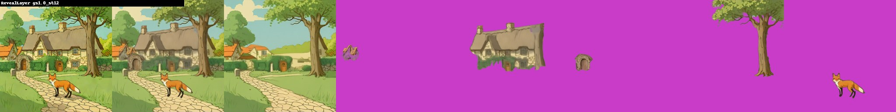
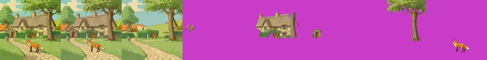

# RevealLayer (ICML 2026)
> **Role: current factsheet.** Template: What it does · Licence & weights · How we run it (happy path) · Benchmarks · Best features · Weak spots · Status · Next attempts · Sources. Verdicts are the user's.

> **User assessment (first look, 2026-11-11):** Good layer removal and background inpainting (`results_reveallayer_v11/reveal_out/gs1.0_st12/forest/bg_rgba.png`). Layer extraction ok but very slow; the layers follow the boxes, which could be a useful feature.

## What it does

Image + one box per object → RGBA layers, **including the hidden parts** (amodal completion), plus a background with the objects removed and filled in.

## Licence & weights

Code Apache-2.0 ([360CVGroup/RevealLayer](https://github.com/360CVGroup/RevealLayer)); LoRA, `layer_pe`, refiner and transparent decoder on HF `qihoo360/RevealLayer`; base FLUX.1-dev (non-commercial).

## How we run it (happy path)

1. Kaggle 2× T4; GGUF Q4_K_S FLUX.1-dev re-classed into RevealLayer's transformer; encoders/VAE from `ostris/Flex.1-alpha`; `transformers==4.57.1`; bundled diffusers 0.34.
2. Patches: ViT-B/32 path, attention-mask fill −1e4 (not −1e9 / finfo.min), guarded refiner residual, fp32 VAE decode, fp32 inputs to the transparent decoder; `fp16_mixed` on the transformer.
3. 512 px, 12 steps, `true_gs` 1.0, boxes in pixels.
4. Generator: [`../../prototype/tools/make_reveallayer_trial.py`](../../prototype/tools/make_reveallayer_trial.py).

## Benchmarks

| Setting | Time | Peak | Result |
|---|---|---|---|
| forest, 3 boxes, 512 px, 12 steps, true_gs 1 | **134 s** (+ about 4 min load) | 11.4 / 11.2 GB | background with hidden areas filled + 3 clean layers (pines, bare trees, campfire + chair) |

Results: [`../../prototype/kaggle/results_reveallayer_v11/`](../../prototype/kaggle/results_reveallayer_v11/).

## Code facts relevant to fp16 (from the research notes)

| Hazard in RevealLayer's code | Our fix |
|---|---|
| ROI attention mask filled with −1e9 (later `finfo.min`) → −inf in fp16 | fill with −1e4 |
| `layer_pe` kept fp32 and added to fp16 hidden states | cast to fp16 at load |
| refiner `delta` residual unguarded | fp32 add + clamp |
| VAE decode in fp16 (authors' comment: "odd purple output") | fp32 VAE, inputs cast to fp32 |
| hard-coded ViT-B/32 weight path | download + patch path |
| refiner loader ignores missing keys | check the load message |

The official pipeline runs only in bf16 at 1024 px, 30 steps. A ComfyUI port (Ltamann/ComfyUI-TBG-RevealLayer, Nov 2026) accepts fp16/bf16/fp32 FLUX but not GGUF. Full notes: [flux_layered_t4_and_weights.md](../../research_notes/Layered%20loop%20open%20paths/flux_layered_t4_and_weights.md).

## Fox & cottage (shared test scene, 5 boxes)

| Setting | Time | Result |
|---|---|---|
| true_gs 1.0, 12 steps | 140 s | background with cottage, tree and fox removed and plausibly filled; clean layers: cottage, gate arch, tree, fox; "village houses" layer nearly empty |
| true_gs 3.5, 16 steps | 334 s | same split, slightly cleaner edges |

Peak 8.7 / 11.2 GB. Results: [`../../prototype/kaggle/results_reveallayer_fox_v15/`](../../prototype/kaggle/results_reveallayer_fox_v15/).

## Fox & cottage benchmark (standard strips)

Input: the shared scene with its five boxes; output: a filled background plus five layers (houses, cottage, arch, tree, fox). Strips: input | recomposite | filled background | layers (magenta = transparent).

| | Settings | Compute (2× T4) | Peak | What the layers show |
|---|---|---|---|---|
| **A. Best case measured** | true_gs 3.5, 16 steps, 512 px | 334 s | 11.2 GB | same split as B, slightly cleaner edges |
| **B. Live-demo budget** | true_gs 1.0, 12 steps, 512 px | 140 s (over 30 s; fewer steps not yet measured) | 11.2 GB | background with cottage, tree and fox removed and filled; clean cottage, arch, tree, fox; houses layer nearly empty |

A:

B:

Gap: a run with 4–6 steps to find how far the compute drops toward 30 s.

### Profile benchmark (warm model in one Kaggle session, 2026-11-11)

Run through the new `reveallayer` server profile ([`layerproto/serve/reveallayer.py`](../../prototype/layerproto/serve/reveallayer.py)); loaded once (242 s), 512 px, five boxes, background + five layers. Results: `prototype/kaggle/results_profile_reveallayer/`.

| | Settings | Compute | Layers | Recomposite diff |
|---|---|---|---|---|
| **A. Best case** | true_gs 3.5, 16 steps | 357.6 s | 6 | 10.84 |
| **B. Cheapest setting tried** (not under 30 s) | true_gs 1.0, 6 steps | 84.7 s | 6 | 13.5 |

A:

B: the background is still a clean filled scene with the cottage, tree and fox removed; the cottage layer carries a grey cast and ragged right edge, the houses layer is a small fragment:

The 30 s budget is not reached; the negative-guidance pass is already skipped at true_gs 1.0, so the remaining cost is the step count.

## Special features

| Feature | Status | Evidence |
|---|---|---|
| Split an image into layers (with boxes) | **supported** | strips above |
| Move / resize a layer | **supported**: the filled background has no hole where the object was; the fox move loop uses this split | [relocate-harmonise.md](relocate-harmonise.md), `fox_move_strip.png` |
| Harmonise after a move | **supported** with `relocate()` | same strip |
| Story composite | not tried | |
| Spatial edit | **partial**: the boxes define the grouping | strips above |
| Image to image / relight / effects | n/a | |
| Add / remove / modify a layer | **partial** (a box per object) | |
| Amodal completion | **supported**: hidden parts of objects and the background behind them are filled | strips above; [amodal-fill.md](amodal-fill.md) |

## Best features

- Fills in what was behind each object: the background stays complete when an object is moved.
- Layers follow the given boxes exactly (controllable grouping, e.g. from the LLM breakdown).

## Weak spots

Slow (about 2 min per split); needs boxes; heavy setup; FLUX.1-dev licence.

## Status

Works on 2× T4 since run 11 (forest). Fox & cottage: runs 12–13 failed on fp16 inputs to the now-fp32 scene VAE; run 14 fixed that but ran out of memory in the fp32 decode (5 boxes → 7 frames); run 15 offloads the transformer before decoding and **works**.

## Next attempts

fox & cottage with LLM boxes; `true_gs` 3.5 / 16 steps; second scene; 768 px if memory allows.

## Sources

`../../research_notes/Layered methods deep dive/flux_models_t4_adaptation (untested cells)` (removed 2026-11-10; in git history before commit 35dc02a); [`../../research_notes/Layered loop open paths/flux_layered_t4_and_weights.md`](../../research_notes/Layered%20loop%20open%20paths/flux_layered_t4_and_weights.md); [../log.md](../log.md) Phases 6–7.
