# Generate → SAM2 → LaMa (segment + inpaint)
> **Role: current factsheet.** Template: What it does · Licence & weights · How we run it (happy path) · Benchmarks · Best features · Weak spots · Status · Next attempts · Sources. Verdicts are the user's.

> **User assessment (first look, 2026-11-11):** Very fast, but quite bad layer splitting and inpainting (the inpainting is modular: another model can do it).

## What it does

Build-your-own decomposition: segment objects with SAM2, cut each out as a layer, inpaint the holes in the background with LaMa (optionally amodal completion).

## Licence & weights

SAM2 Apache-2.0; LaMa (simple-lama-inpainting, Apache-2.0); all public.

## How we run it (happy path)

Kaggle T4; SAM2 hiera-small automatic masks, the 4 largest object masks (< 35% of the image) as layers, LaMa for the background (`simple-lama-inpainting` installed with `--no-deps`). Generator: [`../../prototype/tools/make_segment_inpaint_trial.py`](../../prototype/tools/make_segment_inpaint_trial.py).

## Benchmarks

3–7 s per image; recomposite diff 0.2–2.4 (layers are cut-outs). Results: [`../../prototype/kaggle/results_segment_inpaint/`](../../prototype/kaggle/results_segment_inpaint/).

## Helper tools (licences)

| Tool | Role | Licence | Size |
|---|---|---|---|
| SAM 2.1 | prompted segmentation | Apache-2.0 | 39–224M |
| SAM 3 | text-prompted segmentation | Meta licence, gated | ≈ 3.6 GB |
| Florence-2-large | text grounding → boxes for SAM | MIT | 0.77B |
| BiRefNet | matting (clean cut-outs) | MIT | 0.2B |
| BEN2 base | matting | MIT | 94.6M |
| RMBG-2.0 | matting | CC BY-NC, gated | — |
| LaMa | background fill | Apache-2.0 | small |
| pix2gestalt | amodal completion of occluded objects | — | — |

More in [../research/hosting.md §7](../research/hosting.md#7-matting-segmentation-and-helper-tools).

## Fox & cottage (v2: one mask per named object)

| Variant | Time | Result |
|---|---|---|
| A: hand boxes → SAM2 | 8 s | village house, cottage, gate arch, tree, fox: clean cut-outs; diff 1.27 |
| **B: layer names → Grounding DINO → SAM2** (fully automatic) | 7 s | same as A except "village houses" (boxed the cottage instead); diff 1.30 |
| C: automatic masks, 5 largest | 9 s | fragments (cloud, bush, lawn piece, path) |

Weak spot of A/B: the LaMa background fill is blurry where large objects (cottage, tree) were removed; hidden parts of objects stay missing. Results: [`../../prototype/kaggle/results_segment_inpaint_v2/`](../../prototype/kaggle/results_segment_inpaint_v2/).

## Background fill: LaMa vs SDXL-inpaint (v3, hand boxes, 512 px → 1024 inpaint, T4)

| Fill | Time (whole route) | Look |
|---|---|---|
| LaMa | 13 s | blurry, smeared texture over the removed cottage + tree + fox area |
| **SDXL-inpaint 1.0** (fp16-fix VAE, 30 steps, scene prompt, negative "fox, animal, person") | 28 s (30 s with Grounding DINO boxes) | sharp, in the scene's style, plausible new cottage behind; but **invents content** (different cottage, no village houses) so the recomposite differs from the input only where objects are moved |

LaMa fill (left strip) vs SDXL fill (right strip): input | recomposite | background | five object layers.

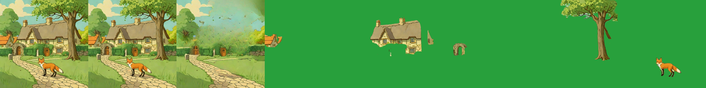

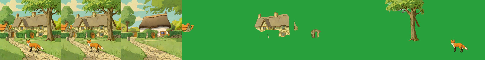

Object masks are the same in both; the cottage mask is incomplete where the tree and hedge overlap (no amodal completion), which shows when the tree is moved. Results: `prototype/kaggle/results_segment_inpaint_v3/`.

## As the app's decomposer (real `/decompose` route, T4)

`Sam2Decomposer` is a class that matches the app's decomposer contract, served through the FastAPI route and used by `Engine.decompose_image`. Result by noun (input | recomposite | background | five layers): 12 s by noun, 5 s with the hand boxes, 43 s load. The "village houses" layer is empty by noun (Grounding DINO boxes the whole cottage for that phrase), which hand boxes avoid.

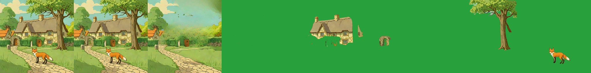

## Amodal completion with SDXL-inpaint (T4, 30 steps, run 2026-11-10)

The part of the cottage's box that the tree, arch and fox cover (precomputed on the CPU) is filled by SDXL-inpaint and pasted into the cottage layer, so the cottage becomes whole. 31 s per image, 73 s model load. Panels 1 and 2 of the strip: prompt a (whole cottage: the arch side gets a second door, the right end gets a tall wall) and prompt b ("left half ... no tree": the left side reads as a cottage wall with a clean arch opening, the right end is slightly better).

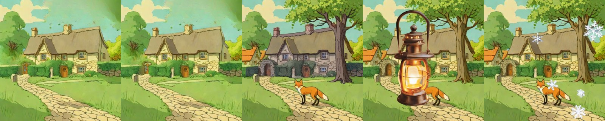

Both fills keep the style and make the cottage movable without a hole. Files: `prototype/kaggle/results_sdxl_batch/`.

## Run by hand in the app (laptop UI -> Kaggle T4 tunnel, 2026-11-10)

First user-driven run of the **Decompose an image (GPU)** tab through a Cloudflare tunnel to the `decompose-server` notebook. Strip order: background, then the layers, then the recomposite.

By noun (`cottage, big tree, red fox, stone gate arch`):

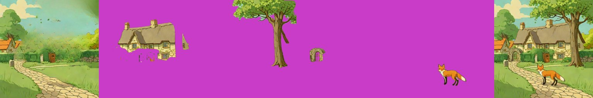

With hand boxes (`[[95,100,475,330],[62,245,150,322],[180,0,512,352],[205,325,375,452]]`, same names):

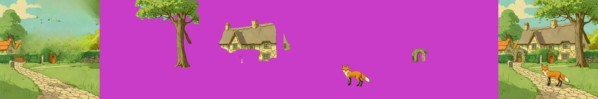

Both recomposite to the input. Both cottages are incomplete where the tree and hedge overlap it (lower part missing, a stray fragment on the right), and the tree has a small notch at the top right, so hand boxes did not fix the cottage here. The fox is clean in both. The first attempt with hand boxes used an image that had the box outlines painted on it, so those lines were cut out as part of the objects; the clean image is `prototype/test_scene/fox_cottage.png`. Amodal completion (SDXL-inpaint or Qwen-2.1 "extract only the cottage without ...") is the fix for the cottage.

### Amodal completion in the route (run 2026-11-10, live tunnel, T4 x2 session)

`DecomposeParams.amodal=True` (checkbox **Complete hidden parts**) makes `Sam2Decomposer` fill, for every object with others in front of it, the part of its box those objects cover, using SDXL-inpaint. Called from the laptop with the hand boxes on the clean scene ([amodal_route_test.py](../../prototype/tools/amodal_route_test.py)): plain 8.5 s, amodal 80 s (includes the one-off SDXL load; two objects had something in front). Top row plain, bottom row amodal; the recomposite is unchanged.

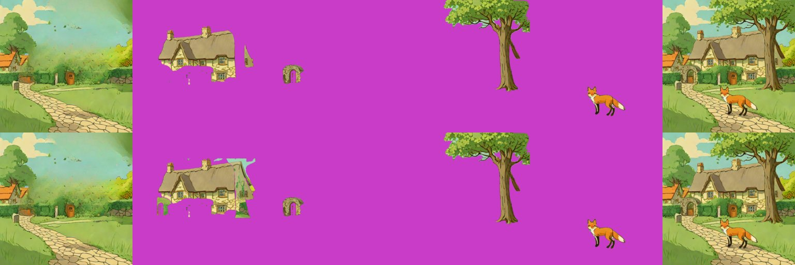

The cottage layer gains wall on its right end, but the fill is patchy: green and sky-coloured patches appear where the arch and the tree were, because the inpaint sees the leftover background around the hole and the prompt is only the object name. The Qwen-Image-2.1 "extract only the cottage without X" result ([qwen-image-2.1](qwen-image-2.1.md)) is much cleaner. Next: a better fill prompt (wall, roof, door), a tighter hidden mask, and routing the same box prompt to Qwen-2.1 on the server. **Second try (amodal v2, same session type, `prototype/kaggle/results_amodal_v2/`):** the fill on a neutral-grey base with the prompt "a complete cottage, the same material and colours continuing" and a negative prompt for grass, hedge, leaves and sky. Top row old base, bottom row neutral base.

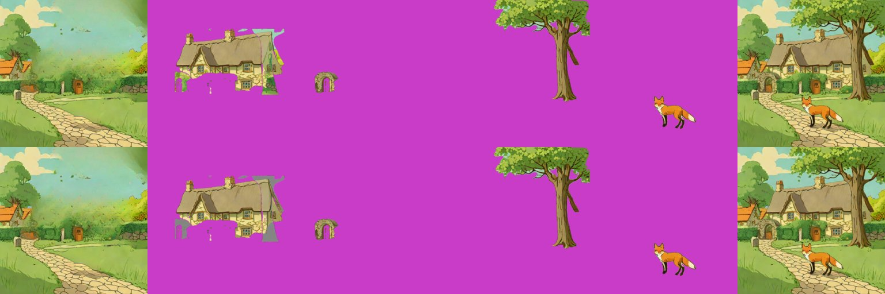

The green and sky patches are gone, but the model keeps the grey it was shown, so the hidden parts of the cottage come out as grey blocks, which is not better. The flag `Sam2Decomposer.amodal_neutral` stays available (default off). The Qwen-Image-2.1 extraction ([qwen-image-2.1](qwen-image-2.1.md)) is the approach that gave a clean whole cottage, so the next step for the SAM2 route is to take the fill from Qwen-2.1 (the `qwen21-extract` method) instead of SDXL-inpaint. Geometry unit test: `prototype/tools/test_amodal_fill.py`. Files: `prototype/kaggle/results_amodal_route/`.

## Fox & cottage benchmark (standard strips)

Input: the shared scene, five hand boxes or names. SAM2 cuts each object, LaMa fills the background. Strips: input | recomposite | background | layers.

| | Settings | Compute (T4) | What the layers show |
|---|---|---|---|
| **A. Best case measured** | hand boxes → SAM2 (hiera-small) + LaMa | 8 s | five clean object cut-outs; the LaMa background is blurry where the cottage and tree were; the cottage keeps its holes |
| **B. Live-demo budget (about 30 s)** | by name: Grounding DINO → SAM2 + LaMa ([grounding-dino.md](grounding-dino.md)) | 7 s | the same without hand boxes; "village houses" boxed the cottage instead |
| with amodal on (SDXL-inpaint) | `amodal=True` in the route | 80 s with the one-off load | patchy fill ([amodal-fill.md](amodal-fill.md)) |

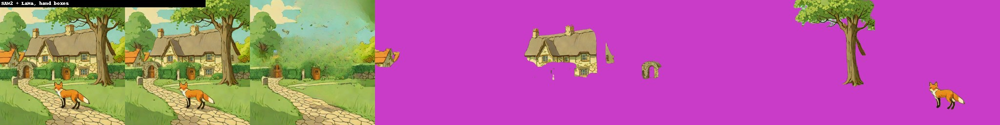

### Profile benchmark (warm model in one Kaggle session, 2026-11-11)

Run through the new `sam2` server profile ([`layerproto/serve/sam2.py`](../../prototype/layerproto/serve/sam2.py)); loaded once (39 s), second run reported. Results: `prototype/kaggle/results_profile_sam2/`.

| | Request | Compute | Layers | Recomposite diff |
|---|---|---|---|---|
| **A. Best case: hand boxes** | five boxes, SAM2 + LaMa | 3.3 s | 6 | 1.33 |
| **B. Live-demo budget: names only** | five names, Grounding DINO → SAM2 + LaMa | 2.8 s | 6 | 1.44 |
| with SDXL-inpaint amodal fill | four boxes, `amodal=True` (first request, includes loading SDXL) | 101 s | 5 | 1.24 |

Both A and B are far under 30 s. A (hand boxes):

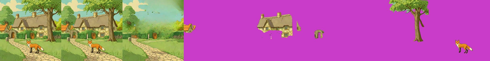

B (names):

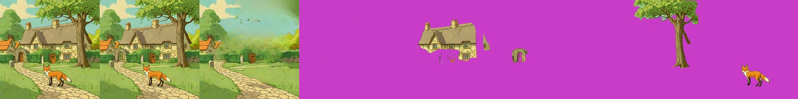

With the amodal fill:

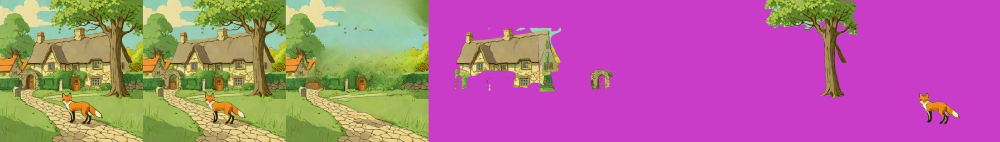

## Special features

| Feature | Status | Evidence |
|---|---|---|
| Split an image into layers | **supported** | strip above |
| Move / resize a layer | **partial**: a canvas move; the LaMa background has a smeared patch at the old place | [relocate-harmonise.md](relocate-harmonise.md) |
| Story composite | not tried | |
| Spatial edit | **supported**: boxes and names pick the objects | |
| Add / remove / modify a layer | **supported** (a layer per name) | |
| Relight / effects | n/a | |
| Amodal completion | **partial**: SDXL-inpaint fill option | [amodal-fill.md](amodal-fill.md) |

Run from the app through the Kaggle tunnel (names, then hand boxes):

## Best features

Very fast; exact pixels kept; every part public and light.

## Weak spots

Automatic "largest K" masks pick fragments (moon, stump, flame) instead of story objects; hidden parts stay missing.

## Status

Works by noun (v2): Grounding DINO + SAM2 gives meaningful object layers fully automatically in about 7 s.

## Next attempts

SDXL inpaint instead of LaMa for large holes (amodal fill done, see above); pix2gestalt as an alternative; combine with RevealLayer's filled background.

## Sources

[../log.md](../log.md) Phase 5; [`../../research_notes/Layered methods deep dive/other_psd_methods.md`](../../research_notes/Layered%20methods%20deep%20dive/other_psd_methods.md) §1.
