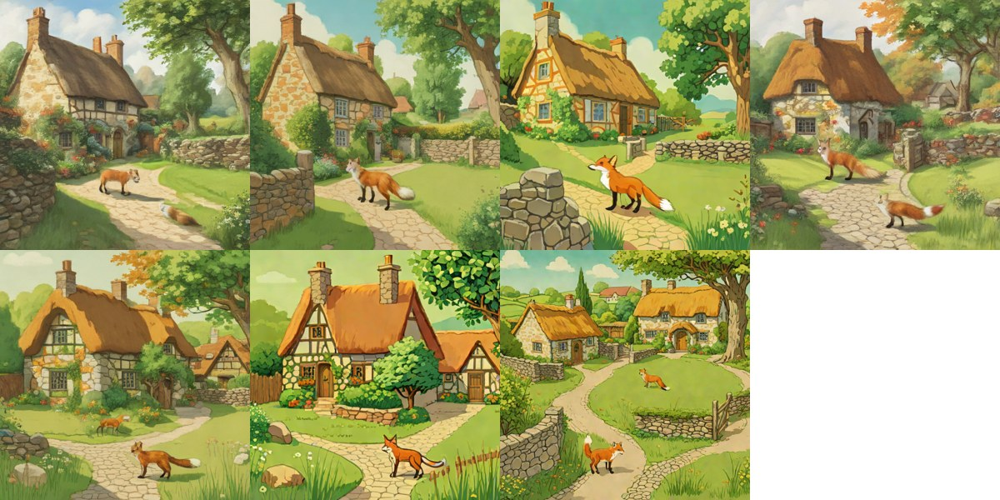
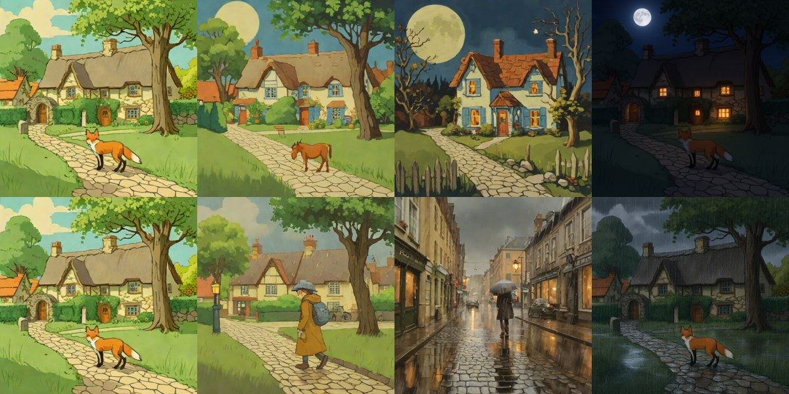

# SDXL-Turbo (fast first step: text to image, image to image)

> **Role: current factsheet** (not a layer model; kept in the pipeline as the simple, fast first step, the user 2026-11-11). Template: [TEMPLATE.md](TEMPLATE.md). Verdicts are the user's.

**Type:** text (or image + text) → one flat image. No layers, no transparency.

## What it does

Distilled SDXL that makes a 512 px image in 1-4 steps without guidance. It produced the shared test scene (`fox_cottage.png`: SDXL-Turbo, 4 steps, seed 13, on the laptop CPU, chosen by the user), so **every "split / extract / edit the fox & cottage scene" result in the factsheets starts from an SDXL-Turbo picture** ([provenance.md](provenance.md)).

## Licence & weights

`stabilityai/sdxl-turbo` (about 7 GB with fp16 variant), Stability AI's licence for the Turbo models; used here for personal non-commercial work (check the model card for the current terms). No gated components.

## How we run it

1. Laptop CPU (fp32, `diffusers` `AutoPipelineForText2Image`): [`make_test_scene.py`](../../prototype/tools/make_test_scene.py); about 58-70 s per 512 px image with 4 steps ([../log.md](../log.md) Phase 1-2).
2. Kaggle T4 (fp16): [`make_sdxl_turbo_bench.py`](../../prototype/tools/make_sdxl_turbo_bench.py); results `prototype/kaggle/results_sdxl_turbo/`. Not yet a server profile (a `/txt2img` and `/img2img` route is the next step).
3. Image to image needs `strength × steps ≥ 1`; sketch-to-image with a filled sketch (strength 0.8, 4 steps) was the best setting in the first project phase ([../log.md](../log.md)).

## Benchmark (T4, fp16, model load not counted, median of three after a warm-up)

| Case | Compute | Peak |
|---|---|---|
| text to image 512 px, 1 step | 1.08-1.11 s | 7.5 GiB |
| 2 steps | 1.21-1.25 s | 7.5 GiB |
| 4 steps | 1.47-1.52 s | 7.5 GiB |
| text to image 768 px, 4 steps | 3.49 s | 8.4 GiB |
| image to image 512 px, 4 steps, strength 0.5 / 0.75 (night and rain prompts) | 1.83-2.07 s | 8.4 GiB |

For comparison: Qwen-Image-2.1 text to image takes 17-23 s on the same card, so SDXL-Turbo is about 12-20× faster; on the laptop CPU it takes about a minute.

## What the images show

Text to image (the prompt that made the shared scene; rows: seed 13 with 1, 2, 4 steps and seed 5 with 1 step; then seed 5 with 2 and 4 steps and seed 13 at 768 px, 4 steps):

- Every image is a coherent storybook cottage scene with a fox, stone walls and a path, so one step already gives a usable draft. Details are cleaner at 4 steps.
- **The layout varies with every seed and step count** and does not follow the prompt closely: the fox "alone on the lawn" appears next to the path or the wall, and **four of the seven images contain a second fox** (both 1-step images, the seed 5 2-step image and the 768 px image); the 2-step seed 13 image and the two 4-step 512 px images show one.
- The shared scene cannot be reproduced on the T4: the same seed 13 with 4 steps in fp16 on the GPU gives a different picture (third tile) than the CPU fp32 run that made `fox_cottage.png`.

Image to image from the shared scene (top row: scene | night strength 0.5 | night 0.75 | **Qwen-2.1 night edit** for comparison; bottom row: scene | rain 0.5 | rain 0.75 | **Qwen-2.1 rain edit**):

- **SDXL-Turbo regenerates the picture instead of editing it.** At strength 0.5 the tree and path stay roughly where they were, but the cottage changes and **the fox becomes a brown horse-like animal** (night) or disappears in favour of a person in a yellow raincoat (rain); at 0.75 the scene is replaced entirely (a blue-shuttered house and bare trees at night, a city street with an umbrella in the rain).
- Qwen-Image-2.1 on the same pictures keeps the composition, the cottage and the fox and changes the light. For story edits of an existing scene, Qwen-2.1 is the model; SDXL-Turbo is for making new pictures (or stylising a sketch) quickly.

## Special features

| Feature | Status | Evidence |
|---|---|---|
| Image to image | **supported as regeneration** (fast, but content is not preserved at strength 0.5 or more) | above |
| Text to image | **supported** | above |
| Story composite / spatial edit | **tried, poor** (it replaces the scene) | above |
| Split / layers / amodal / relight / effects / move | n/a | |

## Best features / Weak spots

- Best: about 1.5 s per 512 px image on a T4 for a full draft; small memory (7.5 GiB); also runs on the laptop CPU; the pipeline's first step.
- Weak: no control of layout or object count (second foxes); image to image does not preserve the content; flat RGB only.

## Status / Next attempts / Sources

Measured on the T4; not yet served by the Kaggle server. Next: a `/txt2img` / `/img2img` server route, a prompt for the "single clearly separated object" layouts the splitters need, a test of a lower strength (0.3-0.4, needs more steps) for light stylisation, and a comparison with other fast first-step models. Sources: [../log.md](../log.md), model card `stabilityai/sdxl-turbo`.
