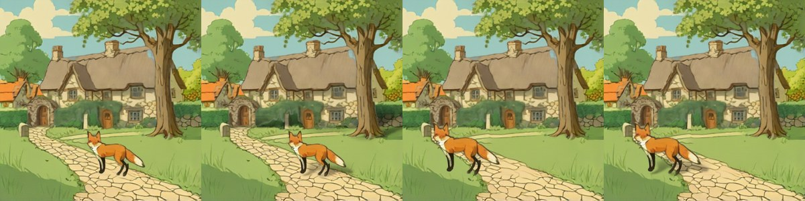

# Procedural shadow layers

> **Role: current factsheet** (CPU component we wrote, not a released model). Template: [TEMPLATE.md](TEMPLATE.md). Verdicts are the user's.

> **User assessment (first look, 2026-11-11):** Not really a model, but useful for what it does.

**Type:** RGBA object layer → a black RGBA shadow layer that sits between the background and the object and moves with it.

## What it does

Makes a cast shadow for an object in milliseconds: the object's alpha is squashed vertically, sheared along the light direction, made semi-transparent and blurred more with distance from the contact line, plus a small contact blob (recipe after EasyOmnimatte's supplement; DreamLayer also keeps shadows in the layer below). A layer holding several separate objects gets one contact line per object; the shadow length is capped so tall objects keep their shadow on the ground plane.

## Licence & weights

None: numpy / scipy / PIL only, written by us ([`shadow.py`](../../prototype/layerproto/shadow.py)).

## How we run it

1. `shadow_layer(obj_rgba, light_dx=0.6, squash=0.35, opacity=0.55, max_len=0.12)`; composite as `bg + shadow + object`.
2. CPU only, so it runs locally in the app and needs no server profile.
3. Demo on the fox & cottage layers: [`shadow_fox_demo.py`](../../prototype/tools/shadow_fox_demo.py).

## Fox & cottage benchmark

Panels: original composite | with shadows under all five layers | fox moved 28 % left, 4 % up, 1.15× without a shadow | the same with its shadow. RevealLayer split as input.

| | Compute | Result |
|---|---|---|
| **A. Best case** | 0.48 s for all five layers on the laptop CPU (0.04 s for one layer in the move loop) | soft shadow under the fox and the gate arch, light from the left |
| **B. Live-demo budget** | the same | far under 30 s |

## Further investigations

- Forest scene before / after and the move with shadow: `prototype/kaggle/results_local_shadow/`.
- The shadow layer is one step of the move loop: [relocate-harmonise.md](relocate-harmonise.md), strip `fox_move_strip.png`.
- In the story-event glue every object layer gets a shadow under it ([`event_apply.py`](../../prototype/layerproto/event_apply.py)).

## Special features

| Feature | Status | Evidence |
|---|---|---|
| Move / resize a layer | **supported** (the shadow follows the layer as its own layer) | panels 3 and 4 above |
| Harmonise after a move | **partial** (contact shadow only, no light matching) | panels 3 vs 4 |
| Add / remove / modify a layer | **supported** (a new layer under the object) | |
| Relight | n/a | see [relight-ic-light.md](relight-ic-light.md) |
| Others | n/a | |

## Best features / Weak spots

- Best: instant, no model, works on any RGBA layer from any model, the shadow stays editable as a layer.
- Weak: a flat black shape with one light direction; it works from the object's own alpha and contact line, with no knowledge of the real ground plane or the scene's actual light (we have not tested it on sloped ground).

## Status / Next attempts / Sources

Works; used in the move loop and the event glue. Next: expose light direction as a frontend control; learn a ground line from the background. Sources: EasyOmnimatte (CVPR 2026) supplement, DreamLayer.
