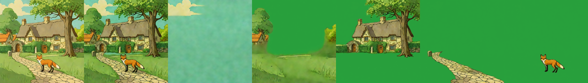
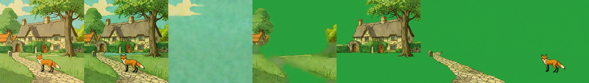
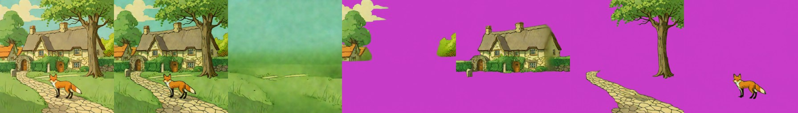
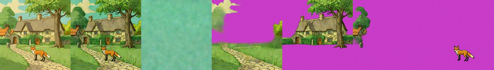
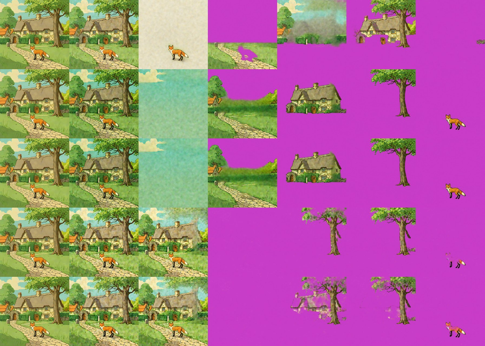
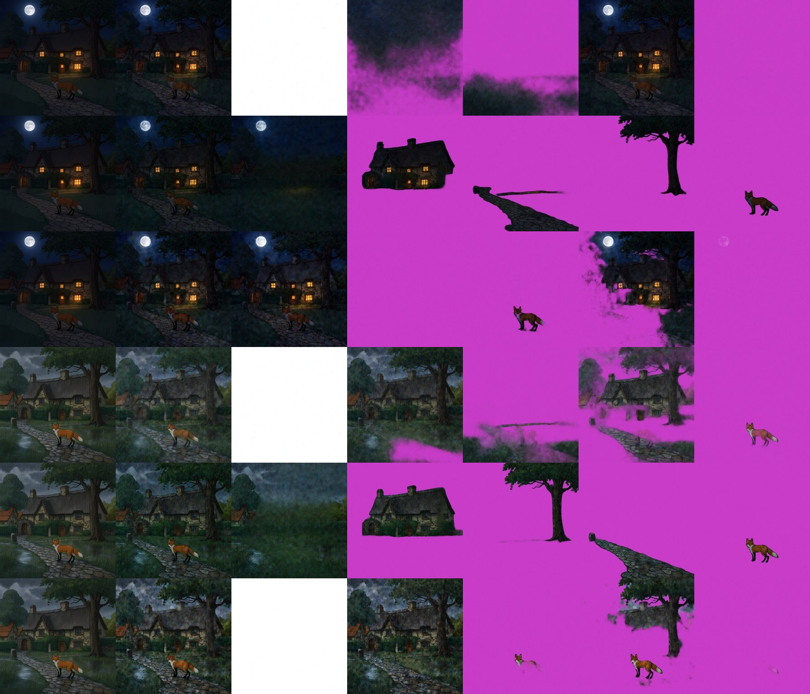
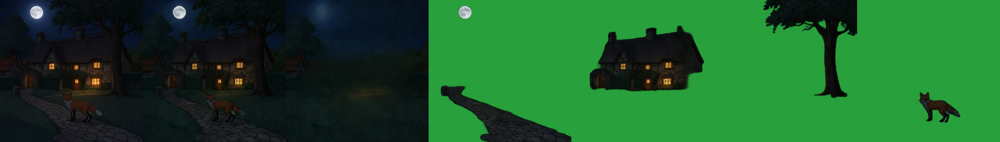
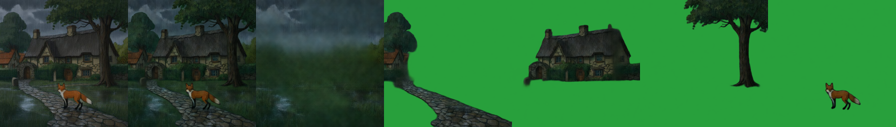

# Stable-Layers (Stability AI)
> **Role: current factsheet.** Template: What it does · Licence & weights · How we run it (happy path) · Benchmarks · Best features · Weak spots · Status · Next attempts · Sources. Verdicts are the user's.

> **User assessment (final intermediate, 2026-11-11):** Pretty solid layer extraction, particularly useful for story composites (with a Qwen-Image-2.1 edit).
>
> **User update (2026-11-11, after the attribution audit):** Keep Stable-Layers and CLD as options for splitting unless there is an absolute advantage to just using Qwen-2.1; runtime matters too.

## What it does

An RL-tuned LoRA (330 MB, PEFT, 420 modules) on top of Qwen-Image-Layered, trained with a VLM teacher for cleaner semantic splits.

## Licence & weights

Stability AI Community licence (free below $1M revenue, attribution). `StabilityLabs/Stable-Layers`.

## How we run it (happy path)

Same stack as Qwen-Image-Layered; LoRA attached unmerged with `fp16_mixed.add_lora` (all 420 modules match). 384 px, 4 layers, 4 Euler steps, CFG 1. Heun: `decompose(..., sampler="heun")`. Generator: [`../../prototype/tools/make_qwen_layered_batch.py`](../../prototype/tools/make_qwen_layered_batch.py) (SWEEP cell).

## Benchmarks

| Setting | Time | Recomposite diff |
|---|---|---|
| 4 Euler steps, 384 px | 34 s | 15–18 (base model ≈ 7) |
| 8 Euler steps, 384 px | 71 s | — |
| **4 Heun steps, 384 px** (forest / sketch / pixel art) | 58–61 s | 15.5–17.9 |
| 8 Heun steps, 384 px | 130 s | 14.8 |
| 2 layers, 4 Euler steps | 26.5 s | 14.2 |
| **fox & cottage, 5 layers, 4 Euler steps** | 39 s | 21.0 |
| fox & cottage, 5 layers, 4 Heun steps | 67 s | 20.6 |

On fox & cottage both give the cleanest split so far: **sky / meadow / cottage + tree / path / fox** ([`results_qwen_fox_v11/`](../../prototype/kaggle/results_qwen_fox_v11/)).

Heun results: [`../../prototype/kaggle/results_qwen_v9b/`](../../prototype/kaggle/results_qwen_v9b/). Euler results: [`../../prototype/kaggle/results_stable_layers_v8/`](../../prototype/kaggle/results_stable_layers_v8/). The README asks for Heun, 50 steps, 640 px.

## Fox & cottage benchmark

Same input and strip layout as [qwen-image-layered.md](qwen-image-layered.md). Stable-Layers is the base model plus the RL-tuned LoRA, so the cost per split is the same.

| | Settings | Compute (2× T4) | Recomposite diff | What the layers show |
|---|---|---|---|---|
| **A. Best case measured** | 384 px, 5 layers, 4 **Heun** steps, CFG 1 | 67 s | 20.6 | sky / meadow / cottage + tree / path / fox, the same clean split |
| **B. Live-demo budget (about 30 s)** | 384 px, 5 layers, 4 **Euler** steps, CFG 1 | 39 s | 21.0 | sky / meadow / cottage + tree / path / fox |

A (Heun):

B (Euler):

The colour shift (diff about 21 against 9–13 for the base model) is visible in the recomposite. Results: `prototype/kaggle/results_qwen_fox_v11/`.

### Profile benchmark (warm model in one Kaggle session, 2026-11-11)

Same `qwen-layered` profile as the base model (the LoRA is swapped in a few seconds); second run reported. Results: `prototype/kaggle/results_profile_qwen-layered/`.

| | Settings | Compute | Layers | Recomposite diff |
|---|---|---|---|---|
| **A. Best case (up to 8 min)** | 512 px, 5 layers, 8 Heun steps, CFG 1 | 248.4 s | 5 | 16.09 |
| **B. Live-demo budget (about 30 s)** | 384 px, 5 layers, 3 Euler steps, CFG 1 | 30.9 s | 5 | 23.2 |

A (8 Heun steps at 512 px), measured with [`layer_report.py`](../../prototype/tools/layer_report.py): the objects are really taken out of the background (colour difference 50 / 64 / 62 for cottage / tree / fox, a clean filled meadow); layer 1 is a sky band (16 %, top 54 %), layer 2 is a band with the cottage and gate arch (31 %, 83 % of the cottage box), layer 3 holds the tree and the path (29 %, fox-shaped hole in it), layer 4 is the fox alone (2.7 % of the canvas, 33 % of its box = the whole fox). **The best split of the three Qwen-Layered variants on this scene.** The cottage and the sky/tree pieces are still bands, not tight object cut-outs:

B (3 Euler steps at 384 px), measured: objects are also taken out of the background (55 / 65 / 88); layer 1 is a ground layer covering the whole canvas with the fox in it (53.6 %), layer 2 the top block with cottage and tree together (44.6 %), layer 3 a strip on the left (9 %), layer 4 the fox alone (2.8 %). The fox is separated, the cottage and tree are one block:

### Native 640 px session (warm model, 2026-11-11): the split that works

Same `qwen-layered` profile, 640 px, 5 layers, first run (each case once); a second session `qwen-layered-640`. Checked layer by layer with [`layer_report.py`](../../prototype/tools/layer_report.py). Results: `prototype/kaggle/results_profile_qwen-layered-640/`. Strip: input | recomposite | layers 0-4 (layer 0 = background).

| Case | Compute | Recomposite diff |
|---|---|---|
| fox & cottage, 4 Euler steps | 101.7 s | 18.48 |
| fox & cottage, 4 Heun steps | 177.7 s | 18.41 |
| night composite (Qwen-Image-2.1 edit), 4 Heun steps | 178.6 s | 4.61 |
| rain composite (Qwen-Image-2.1 edit), 4 Heun steps | 178.2 s | 11.35 |

**Fox & cottage, rows 2 (Euler) and 3 (Heun) of the strip:** one object per layer. Layer 0 is a sky wash with a cloud and the objects removed (colour difference to the input 54 / 70 / 83 for cottage / tree / fox); layer 1 is the hedge, meadow and path without the fox (the path is filled where the fox stood); layer 2 is the cottage with its gate arch as a clean cut-out (83 % of its box); layer 3 is the tree with its leaves as a clean cut-out; layer 4 is the fox alone (2.8 % of the canvas). **This is the first split of this scene where every object is its own layer and the background is hole-free.** Euler and Heun give the same layers (the numbers differ by hundredths); Heun costs 76 s more.

**Story composites at 640 px.** The night and rain pictures are **Qwen-Image-2.1 edits** of the SDXL-Turbo scene; what Stable-Layers adds is the split (strip below; rows: night base, **night Stable-Layers**, night Lightning, rain base, **rain Stable-Layers**, rain Lightning). Stable-Layers splits both Qwen-Image-2.1 edits properly:
- **Night:** layer 0 is the dark sky with the moon and the dark landscape (objects removed); layer 1 the cottage with its lit windows as a clean cut-out; layer 2 the path; layer 3 the tree; layer 4 the fox. The window light stays on the cottage layer.
- **Rain:** layer 0 is the grey rainy sky and wet greenery; layer 1 the cottage; layer 2 the tree; layer 3 the wet path; layer 4 the fox, all clean.

What this means for the earlier rows of this file: the 384 and 512 px runs above gave bands and partial splits; **the resolution is what matters for Stable-Layers on this scene**, and 640 px costs about 100 s (Euler) instead of 31 s. A 30 s budget at 640 px is not reached (2 or 3 steps at 640 px are not measured yet).

### Against Qwen-2.1 extraction on the same edits (2026-11-11)

On the night and rain edits Qwen-2.1 extraction (138.7 s / 184.3 s) left the cottage and the tree in the background layer, cut a block instead of the cottage and invented a misplaced arch ([qwen-image-2.1.md](qwen-image-2.1.md)); Stable-Layers at 640 px split both edits cleanly in 178 s (Heun). It is the measured advantage that keeps it as the splitter for story composites. For the daylight scene Qwen-2.1 extraction gave a clean background and whole objects but a mis-scaled arch.

## Special features

| Feature | Status | Evidence |
|---|---|---|
| Split an image into layers | **supported** | strips above |
| Move / resize a layer | **partial** (canvas move; no harmonising) | [relocate-harmonise.md](relocate-harmonise.md) |
| Story composite | the edit is Qwen-2.1's; Stable-Layers **splits** the night and rain edits (tested, clean at 640 px) | below, [provenance](provenance.md) |
| Spatial edit / image to image | n/a | |
| Add / remove / modify a layer | **partial** (N chosen per run) | |
| Relight / effects | n/a | |
| Amodal completion | **supported** (background filled behind objects; very clean with Heun) | strips above |

**Story composites** (Qwen-Image-2.1 edit, then Stable-Layers Heun, 5 layers, 384 px, 67–70 s). Night: moon + sky bits / cottage with lit windows / tree / fox, diff 4.2. Heavy rain: cottage / tree / fox plus a wet-path layer, diff 11.2:

## Best features

Cleaner semantic separation than the base model: on the sketch the background is truly empty paper and the fire gets its own layer.

## Weak spots

Colour and contrast shift, so the recomposite is about 2× further from the input.

## Status

Runs with Euler (v8) and with exact Heun (v9, via `HeunVelocity`). With Heun the forest background comes out very clean (trees and campfire fully removed, filled), trees split into clean layers; on the sketch the skeleton, fire and logs stay in one layer. Colour shift remains (diff 15–18).

## Next attempts

Heun 4–8 steps; colour correction (match the recomposite's colour statistics to the input); fox & cottage.

## Sources

[../log.md](../log.md) Phase 5; `../../research_notes/Layered methods deep dive/heavy_models_inference_plans` (removed 2026-11-10; in git history before commit 35dc02a) §4.
