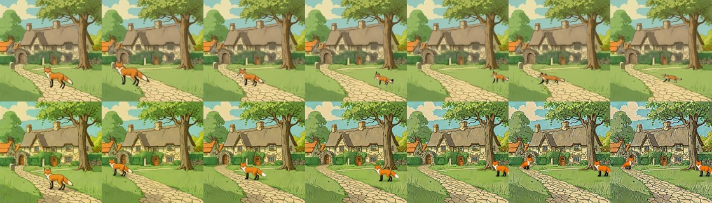
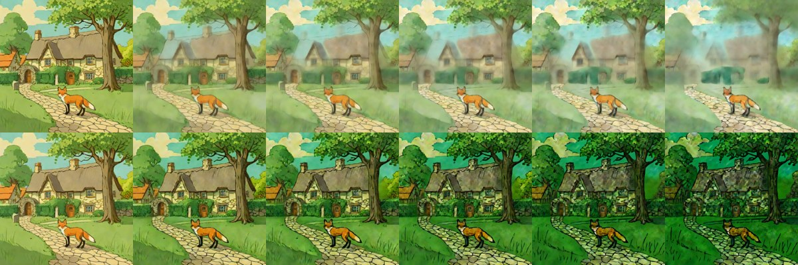

# Drift over long edit sequences (layered vs flat)

> **Role: research synthesis (current).** Summarises the sources; details and citations stay in the linked snapshots and research notes.

**Question (RQ1, gap G1):** do persistent RGBA layer stacks keep a scene stable over many story edits better than flat-image editing? No benchmark tests a layered editor, and nobody has measured the error of repeated decompose → recompose cycles. Full notes: [../../research_notes/Layered loop open paths/multi_turn_drift_evaluation.md](../../research_notes/Layered%20loop%20open%20paths/multi_turn_drift_evaluation.md).

## What is known for flat editors
- **EdiVal-Agent (ICLR 2026, 3 turns):** consistency drops about 3–4 points per turn for every editor (FLUX.1-Kontext-dev 95.3 → 90.2; Qwen-Image-Edit 84.2 → 78.0); flow editors get brighter each turn; VLM judges miss gradual quality loss.
- **MTEdit-Bench (8 turns):** at turn 8 some open editors fall to near zero consistency.
- **TailSteer (10 turns, edit inside a box, measure outside):** outside-box PSNR 11–19 dB after 10 turns.
- **ImageDirector (UIST '26):** compositing instead of regenerating kept background SSIM at 0.998 vs 0.922 over 3 edits, but lighting and cohesion were not better.

## Our protocol
- **Arms:** (A) layered: edit only the target layer, recomposite; (B) flat: an editor chaining its own outputs; (C) layered but re-decomposed every turn (new: isolates decompose/recompose error).
- **Metrics per turn vs turn 0:** PSNR / SSIM (optionally LPIPS, DINO) outside the union of all edited regions; per-layer alpha IoU and alpha-weighted L1; mean luminance shift; edit success; area under the curve and the first turn below 25 dB.
- **Scale:** about 20 scenes × 10 turns (5 scenes × 20); EdiVal-Agent's harness can host our editors (`generate_single_edit`).

## Code
Harness: [`../../prototype/layerproto/drift_eval.py`](../../prototype/layerproto/drift_eval.py); self-test with stand-in editors: [`../../prototype/tools/drift_harness_selftest.py`](../../prototype/tools/drift_harness_selftest.py) (tests the logic, not real editors). Soft alpha edges mean even the layered arm is not exactly unchanged.

## First result with real editors (fox & cottage, 6 successive fox moves, 2026-11-10)

Task: move the red fox six times (left, right, far right, back left, back home), the same ground-truth edits in both arms. Arm A (layered): `relocate()` on RevealLayer's layers, every other layer untouched. Arm B (flat): Qwen-Image-2.1 edits the whole composite each turn from the previous output ("move the red fox to …, keep everything else the same"). Metrics: PSNR / SSIM against turn 0 **outside** the union of old and new fox areas (`drift_eval.py`).

| Turn | A layered: PSNR out / SSIM out | B flat: PSNR out / SSIM out | B luminance shift |
|---|---|---|---|
| 1 | 59.2 dB / 0.992 | 19.6 dB / 0.569 | −2.5 |
| 2 | 60.9 / 0.995 | 18.6 / 0.517 | −5.1 |
| 3 | 60.8 / 0.995 | 17.1 / 0.425 | −6.6 |
| 4 | 60.8 / 0.995 | 15.9 / 0.351 | −7.3 |
| 5 | 60.5 / 0.996 | 15.0 / 0.295 | −9.5 |
| 6 | 61.9 / 0.997 | 14.3 / 0.252 | −11.6 |

Top row = arm A, bottom row = arm B (turn 0 … 6):

- **Flat editor:** falls below 25 dB at turn 1, darkens by 11.6 grey levels over 6 turns, loses fine texture, and from turn 5 draws a second fox (the edit "move" turns into "add"). Cost about 23 s per turn.
- **Layered arm:** the background is exact by construction (about 60 dB; the remainder is soft alpha edges), which is the expected strength of layers and not a surprise. The moved object itself is not free: against turn 0 its colour L1 grows 0.22 → 0.30 over six moves (crop-normalised), and its size does not return exactly (back at its home position it covers 84 % of the original area, and the first move came out 1.7× the area instead of the intended 1.3×).
- **Arm C (re-decompose every turn), added later the same day:** the same six moves, but before each move after the first the composite is split again with Grounding DINO + SAM2 by noun + LaMa (6–9 s per turn). PSNR outside the edit against turn 0: 59.2 dB at turn 1 (no decomposition yet), **35.3 dB at turn 2**, 31.6, 30.2, 29.1 and **28.2 dB at turn 6**; SSIM 0.93. The untouched layers' alpha IoU against turn 0 falls to 0.38–0.68 (the masks are re-estimated each time and only the visible parts are kept). It stays above the 25 dB line but sits between A (about 60 dB) and B (14–20 dB):

| Turn | A persistent layers | C re-decompose each turn | B flat editor |
|---|---|---|---|
| 1 | 59.2 dB | 59.2 dB | 19.6 dB |
| 2 | 60.9 | 35.3 | 18.6 |
| 3 | 60.8 | 31.6 | 17.1 |
| 4 | 60.8 | 30.2 | 15.9 |
| 5 | 60.5 | 29.1 | 15.0 |
| 6 | 61.9 | 28.2 | 14.3 |

Composites of arm C, turn 0 … 6:

- **Still open:** more scenes and edit types (re-prompt, relight), LPIPS / DINO, arm C with Qwen-Image-Layered as the decomposer (the cycle test above suggests it would be worse than SAM2). One scene, one seed: a demonstration of the harness with real editors, not a benchmark.

Files: `prototype/tools/fox_drift_demo.py` (arm A), `make_qwen21_drift_trial.py` (arm B), `fox_drift_armc.py` (arm C), `drift_analyse.py`, results in `prototype/kaggle/results_drift*/`.

## Arm C building block: error of re-decomposing again and again (no edit)

Fox & cottage at 384 px, Qwen-Image-Layered (5 layers, 4 steps): decompose → recomposite → feed the recomposite back in, five cycles, PSNR of the whole image against the original (2× T4, `results_qwen_v12/`).

| Cycle | Base model (Euler) | Stable-Layers (Heun) |
|---|---|---|
| 1 | 21.4 dB | 20.1 dB |
| 2 | 19.6 | 15.2 |
| 3 | 18.0 | 12.2 |
| 4 | 17.1 | 10.4 |
| 5 | 15.5 | 9.2 |

Top row base model, bottom row Stable-Layers (cycle 0 … 5):

The base model slowly washes out and blurs the scene; Stable-Layers saturates the colours towards green and loses texture. Cycle 1 already costs about 20 dB (partly the 384 px working resolution), so re-decomposing every turn (arm C) would sit far below the persistent-layer arm A (about 60 dB outside the edit) before any editing error is added. Caveat: one scene, no edits, two splitter settings.

## Next
More scenes and edit types ([../todo.md](../todo.md)).
